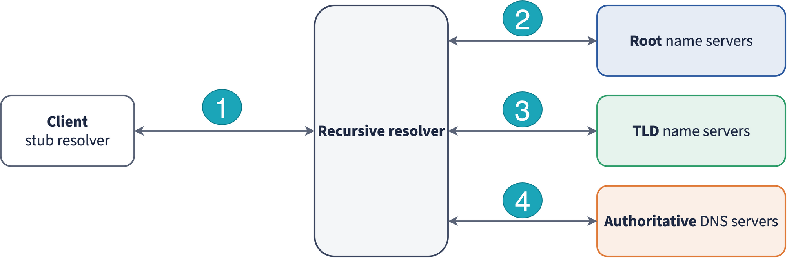
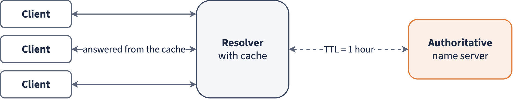
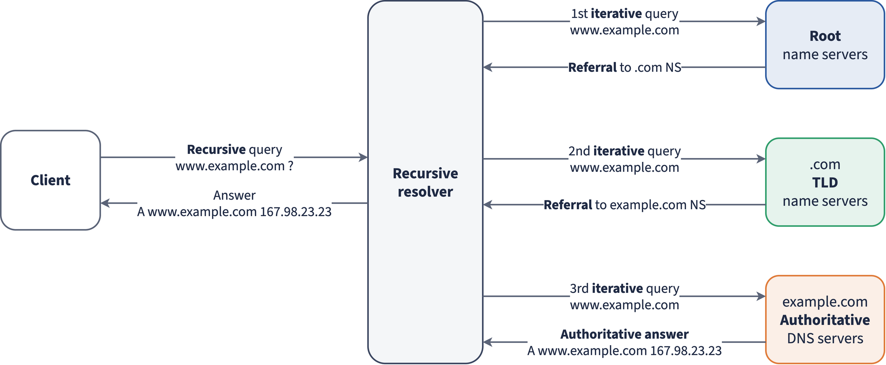
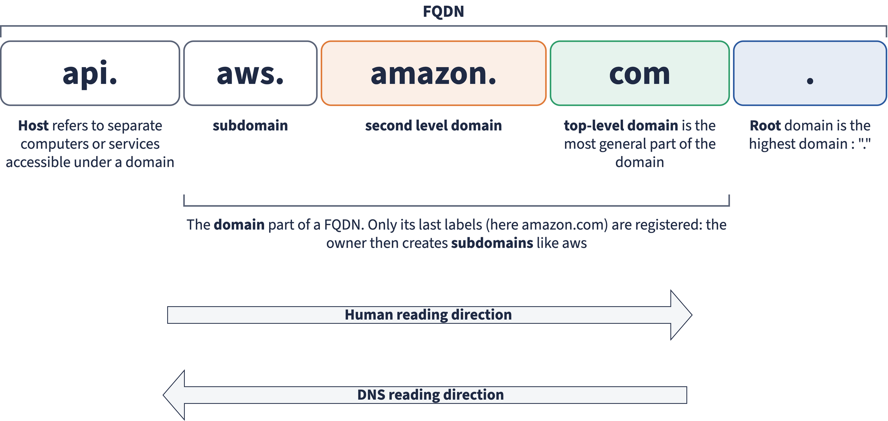
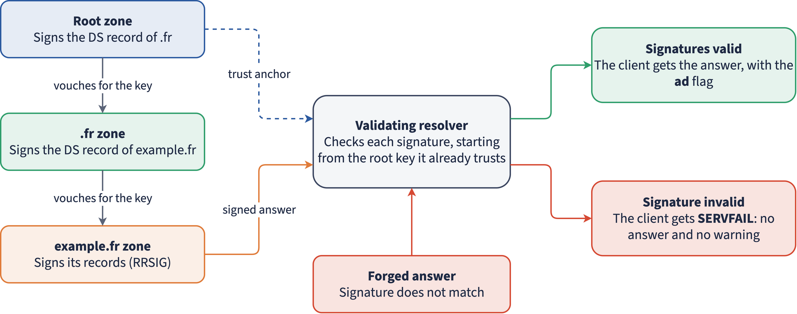
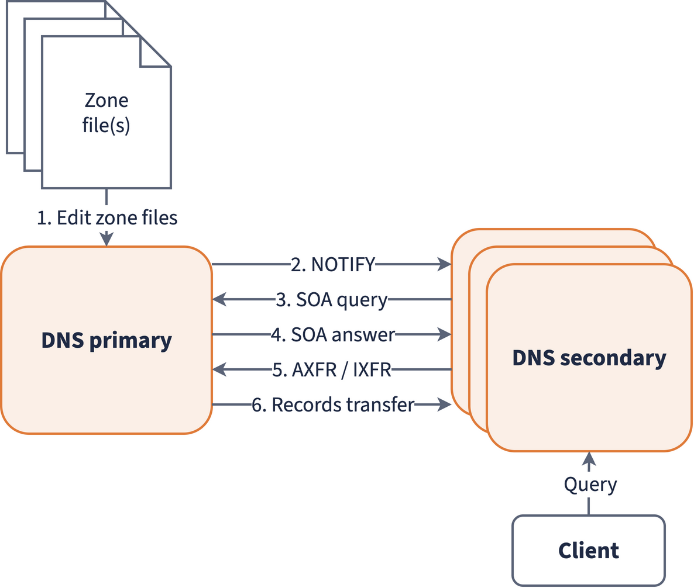
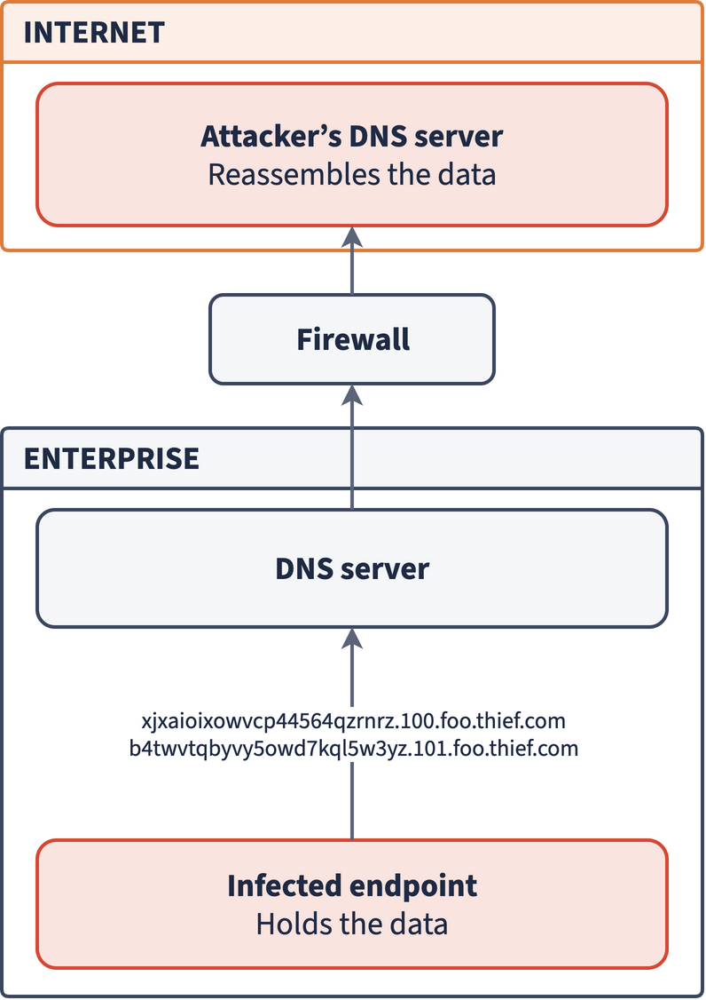

## How to use this deck

::: {.absolute left=61 top=130 width=1160 .f29}
- Read it **on your own** before the **Advanced** missions of Dig Quest. They unlock once every main mission is solved.
- It starts where *DNS Fundamentals* stops: you already know records, resolution, TTL, flags, NODATA and the idea of DNSSEC.
- Every slide ends with a **Try it** command. Run it: the answers change over time, and reading live output is the skill being trained.
- Each Advanced mission names the part of this deck it needs.
:::

::: {.tryit style="left:61px;top:560px;width:1160px"}
`dig -v` (you need dig 9.16 or later for every command in this deck)
:::

## Agenda {.agenda-slide}

1

Who answers you? Anycast, CHAOS, NSID, your resolver

2

Reading answers closely: SOA, error codes, wildcards, caches

3

Size and transport: 512 bytes, EDNS, TCP, long TXT

4

Special records and names: null MX, mail auth, SRV, NAPTR, IPv6, IDN

5

DNSSEC in practice: the chain of trust, the flags, SERVFAIL

6

Opening a zone: zone transfers and NSEC walking

7

DNS as a puzzle: encodings, chained clues, files in pieces

LAB

Dig Quest Advanced missions

## Who answers you? {.divider}

Part 1

Anycast, CHAOS, NSID and the resolver behind your resolver

## One address, many servers: anycast

::: {.absolute left=44 top=118 width=1192 .f27}
`f.root-servers.net` has **one** IP address, announced by **hundreds of sites**. Internet routing (BGP) sends your packet to the closest one. This is **anycast**, and most root servers, TLD servers and public resolvers use it.
:::

FAST

The closest copy answers

ROBUST

A DDoS is spread across all the sites

BUT

You can't tell which machine answered

::: {.predict style="left:44px;top:390px;width:1192px"}
From Toulouse, you ask F-root to name itself. Which city answers?
:::

<pre class="a terminal" style="left:44px;top:450px;width:1192px;font-size:21px;line-height:1.45">❯ dig @f.root-servers.net CH TXT hostname.bind +short
"<b>CDG</b>.cf.f.root-servers.org"          # CDG: the Paris airport code</pre>

::: {.tryit style="left:44px;top:600px;width:1192px"}
Same query to `k.root-servers.net`, then to `l.root-servers.net`. Same city?
:::

::: notes
Operators often name anycast instances after the nearest airport (IATA code). K-root answered "ns1.fr-lio.k.ripe.net" (Lyon) in November 2026. A student on another network may get another city: that is the point.
:::

## The CHAOS class: servers describing themselves

::: {.absolute left=44 top=118 width=560 .f25}
Every record has a **class**. You only ever saw `IN` (Internet). Two others survive:

- `CH`: **Chaosnet**, an MIT network from the 1970s
- `HS`: **Hesiod**, an MIT directory service

Nobody uses Chaosnet anymore, so servers reuse the `CH` class for **questions about themselves**:

- `version.bind`, `hostname.bind`, `authors.bind` (BIND)
- `id.server`, `version.server` (the standard names, RFC 4892)
:::

<pre class="a terminal" style="left:640px;top:118px;width:596px;font-size:15px;line-height:1.45">❯ dig @1.1.1.1 CH TXT id.server +short
"cdg14"
❯ dig @9.9.9.9 CH TXT id.server +short
"res711.cdg"
❯ dig @k.root-servers.net CH TXT hostname.bind +short
"ns1.fr-lio.k.ripe.net"
❯ dig @a.gtld-servers.net CH TXT version.bind +short
"<b>ATLAS</b>"</pre>

::: {.absolute left=640 top=440 width=596 .f22 .gray}
Verisign answers "ATLAS" (its own software) and no version number. Knowing the exact version helps an attacker pick an exploit, so many operators hide it or return a joke.
:::

::: {.tryit style="left:44px;top:600px;width:1192px"}
`dig @8.8.8.8 CH TXT id.server`: what does Google answer, and with which status?
:::

## NSID: the identity inside the answer

::: {.absolute left=44 top=118 width=1192 .f25}
A `CH TXT` query is a **separate** packet: with anycast it may reach another instance than your real query did. **NSID** (RFC 5001) asks the server to add its identity to **the same answer**, as an EDNS option.
:::

<pre class="a terminal" style="left:44px;top:230px;width:1192px;font-size:20px;line-height:1.45">❯ dig @l.root-servers.net . SOA +norecurse <b>+nsid</b>
;; flags: qr aa; QUERY: 1, ANSWER: 1, AUTHORITY: 13, ADDITIONAL: 27
;; OPT PSEUDOSECTION:
; EDNS: version: 0, flags:; udp: 4096
; <b>NSID: 62 67 2d 67 6f 7a 2d 61 61 ("bg-goz-aa")</b></pre>

::: {.predict style="left:44px;top:430px;width:1192px"}
L-root also names itself in a normal record (RFC 7108). Whose instance is it?
:::

<pre class="a terminal" style="left:44px;top:486px;width:1192px;font-size:20px;line-height:1.45">❯ dig IDENTITY.L.ROOT-SERVERS.ORG TXT +short
"de-ham-aa."     # not yours: the one your resolver reached (Hamburg)</pre>

::: {.tryit style="left:44px;top:610px;width:1192px"}
Add `+nsid` to a query to `1.1.1.1` or `9.9.9.9`. Which instance answered?
:::

## The `dig ch` trap

::: {.absolute left=44 top=118 width=1192 .f25}
dig reads each word on its own: a **class** name (`in`, `ch`, `hs`) becomes the class, a **type** name becomes the type. With no name left, dig asks for the root (`.`).
:::

<pre class="a terminal" style="left:44px;top:200px;width:580px;font-size:20px;line-height:1.45">❯ dig ch NS +short
(nothing)
❯ dig in NS +short
a.root-servers.net.
b.root-servers.net.
…
m.root-servers.net.</pre>

::: {.absolute left=656 top=200 width=580 .f25}
- `dig ch NS` sends **`. CH NS`**: root servers in the Chaosnet class. Switzerland never shows up.
- `dig in NS` sends **`. IN NS`**: the root servers, not India's.
- **Fix:** write the name in full, with its final dot: `dig ch. NS`, `dig in. NS`.
:::

::: {.tryit style="left:44px;top:560px;width:1192px"}
`dig ch. NS +short`: which organisation runs the `.ch` servers? (Hint: `nic.ch`.)
:::

## Who is my resolver, really?

::: {.absolute left=44 top=118 width=1192 .f25}
Your machine asks a resolver, which may forward to another, and the authoritative server only sees the **last hop**. **"whoami"** names are served by authoritative servers that put **the source of the question** in the answer.
:::

<table class="a" style="left:44px;top:220px;width:1192px;font-size:21px">
<tr><th>Ask</th><th>You learn</th></tr>
<tr><td><code>dig TXT o-o.myaddr.l.google.com @8.8.8.8 +short</code></td><td>IP your resolver uses to reach Google's servers, plus the ECS it sent</td></tr>
<tr><td><code>dig TXT whoami.ds.akahelp.net +short</code></td><td>Same idea at Akamai: <code>"ns"</code> resolver IP, <code>"ecs"</code> subnet</td></tr>
<tr><td><code>dig myip.opendns.com @resolver4.opendns.com +short</code></td><td>Your own public IP (you asked OpenDNS directly)</td></tr>
</table>

<pre class="a terminal" style="left:44px;top:430px;width:1192px;font-size:20px;line-height:1.45">❯ dig TXT o-o.myaddr.l.google.com @8.8.8.8 +short
"<b>edns0-client-subnet 86.201.70.0/24</b>"     # your network, sent on your behalf
"172.253.92.148"                          # a Google resolver, not you</pre>

::: {.tryit style="left:44px;top:600px;width:1192px"}
Same question through `1.1.1.1`, then `9.9.9.11`. Which ones pass your subnet (ECS) along?
:::

::: notes
ECS was seen with +subnet in the main lab. Here students see it from the other side: what an authoritative server learns about them. Results vary with each resolver's policy and change over time; do not give the answer, let them compare.
:::

## Reading answers closely {.divider}

Part 2

SOA fields, extended errors, wildcards and caches

## The SOA, field by field

<pre class="a terminal" style="left:44px;top:112px;width:1192px;font-size:18px;line-height:1.4">❯ dig iut-blagnac.fr SOA +short
brassens.iut-blagnac.fr. pinf.iutb.univ-tlse2.fr. 2026082311 3600 600 1209600 3600</pre>

<table class="a" style="left:44px;top:232px;width:1192px;font-size:19px">
<tr><th>Field</th><th>Value</th><th>Meaning</th></tr>
<tr><td>MNAME</td><td><code>brassens.iut-blagnac.fr.</code></td><td>Primary server of the zone</td></tr>
<tr><td>RNAME</td><td><code>pinf.iutb.univ-tlse2.fr.</code></td><td>Admin mailbox: the first <code>.</code> becomes <code>@</code> → pinf@iutb.univ-tlse2.fr</td></tr>
<tr><td>SERIAL</td><td><code>2026082311</code></td><td>Version of the zone. Common habit <code>YYYYMMDDnn</code>: 23 Aug 2026, change 11. Only a habit: <code>.fr</code> uses a counter</td></tr>
<tr><td>REFRESH / RETRY</td><td><code>3600</code> / <code>600</code></td><td>How often secondaries check the serial, and retry after a failure</td></tr>
<tr><td>EXPIRE</td><td><code>1209600</code></td><td>Secondaries stop answering after 14 days without the primary</td></tr>
<tr><td>MINIMUM</td><td><code>3600</code></td><td>Negative caching limit: how long "does not exist" is kept</td></tr>
</table>

::: {.tryit style="left:44px;top:610px;width:1192px"}
`dig fr SOA +short` and `dig afnic.fr SOA +short`: which serial is a date? Who to e-mail?
:::

::: notes
A dot inside the mailbox part is escaped: john\.doe.example.com is john.doe@example.com.
:::

## Why did it fail? Extended DNS Errors

::: {.absolute left=44 top=118 width=600 .f25}
`SERVFAIL` only says "something went wrong". **Extended DNS Errors** (EDE, RFC 8914) add a code and a text in the OPT section.
:::

<table class="a" style="left:672px;top:118px;width:564px;font-size:20px">
<tr><th>Code</th><th>Meaning</th></tr>
<tr><td>6, 7, 9</td><td>DNSSEC bogus, signature expired, DNSKEY missing</td></tr>
<tr><td>15, 17</td><td>Blocked, Filtered (a DNS firewall)</td></tr>
<tr><td>18</td><td>Prohibited (you may not use this resolver)</td></tr>
<tr><td>22</td><td>No reachable authority</td></tr>
<tr><td>0</td><td>Other: read the text</td></tr>
</table>

<pre class="a terminal" style="left:44px;top:390px;width:1192px;font-size:20px;line-height:1.45">❯ dig dnssec-failed.org @8.8.8.8
;; -&gt;&gt;HEADER&lt;&lt;- opcode: QUERY, status: <b>SERVFAIL</b>, id: 42839
; <b>EDE: 9 (DNSKEY Missing)</b>: (No DNSKEY matches DS RRs of dnssec-failed.org)</pre>

::: {.tryit style="left:44px;top:560px;width:1192px"}
The same name through `1.1.1.1` and `9.9.9.9`: same status? same EDE code?
:::

## Wildcards

::: {.absolute left=44 top=118 width=600 .f25}
A record named `*.github.io` answers for **any name that does not exist** under `github.io`. The rules (RFC 4592):

- `*` only as the **leftmost** label
- an existing name **blocks** it: no record of that type gives NODATA, not the wildcard
- it does not reach below an existing name
:::

<pre class="a terminal" style="left:672px;top:118px;width:564px;font-size:19px;line-height:1.45">❯ dig zz-not-here-42.github.io +short
185.199.108.153
185.199.109.153
…
❯ dig zz-not-here-42.wikipedia.org +short
(nothing: NXDOMAIN)</pre>

::: {.predict style="left:44px;top:440px;width:1192px"}
The answer shows the name you asked, never the `*`. Can you prove a wildcard was used?
:::

::: {.absolute left=44 top=500 width=1192 .f24 .fragment}
Only with DNSSEC: the RRSIG has a **labels** field. A signature with fewer labels than the name was made for `*.github.io`.
:::

::: {.tryit style="left:44px;top:610px;width:1192px"}
`dig anything-you-want.blogspot.com +short`, then `dig "*.blogspot.com" +short`
:::

## Peeking into a cache: `+norecurse`

::: {.absolute left=44 top=118 width=1192 .f25}
Without the `rd` flag, you ask a resolver: **"answer only from your cache"**. If it plays along, you learn whether someone already asked for that name, and when (the TTL left).
:::

<pre class="a terminal" style="left:44px;top:220px;width:1192px;font-size:19px;line-height:1.45">❯ dig @8.8.8.8 www.google.com +norecurse +noall +answer
www.google.com.   <b>154</b>   IN   A   142.251.152.119      # cached, 154 s left
❯ dig @1.1.1.1 www.iut-blagnac.fr +norecurse
;; status: <b>SERVFAIL</b>
; EDE: 0 (Other): (no local cache to fulfill non recursion (RD=0) request)
❯ dig @9.9.9.9 www.google.com +norecurse +noall +answer
(nothing)</pre>

::: {.absolute left=44 top=495 width=1192 .f22}
- **Cache snooping:** on a company resolver, this reveals which sites its users visit. Many resolvers refuse `rd=0` from outside.
- **Anycast again:** each instance has its own cache. Run it twice and the TTL may jump.
:::

::: {.tryit style="left:44px;top:625px;width:1192px"}
Run the 8.8.8.8 query three times, a few seconds apart. Does the TTL count down smoothly?
:::

## Size and transport {.divider}

Part 3

512 bytes, EDNS, the tc flag and long TXT records

## 512 bytes, EDNS and the `tc` flag

::: {.absolute left=44 top=118 width=600 .f22}
1. **1987** (RFC 1035): a UDP answer is at most **512 bytes**.
2. **EDNS** (RFC 6891): the client announces a bigger buffer (`udp: 1232` in dig).
3. **DNS Flag Day 2020**: 1232 bytes, to avoid IP fragmentation.
4. Too big anyway? The server cuts the answer and sets **`tc`** (truncated). The client asks again **over TCP**, which every server must support (RFC 7766).
:::

<pre class="a terminal" style="left:672px;top:118px;width:564px;font-size:18px;line-height:1.45">❯ dig @8.8.8.8 google.com TXT +noall +stats
;; MSG SIZE  rcvd: <b>1187</b>
❯ dig @8.8.8.8 google.com TXT +noedns
;; <b>Truncated, retrying in TCP mode.</b>
;; SERVER: 8.8.8.8#53(8.8.8.8) (<b>TCP</b>)</pre>

::: {.predict style="left:44px;top:450px;width:1192px"}
Add `+ignore`: dig keeps the cut answer instead of retrying. What do you expect?
:::

<pre class="a terminal fragment" style="left:44px;top:505px;width:1192px;font-size:19px;line-height:1.45">❯ dig @8.8.8.8 google.com TXT +noedns +ignore
;; flags: qr <b>tc</b> rd ra; QUERY: 1, ANSWER: <b>0</b>, AUTHORITY: 0, ADDITIONAL: 0</pre>

::: {.tryit style="left:44px;top:630px;width:1192px"}
`dig . DNSKEY +bufsize=512 +ignore`: is the root's key set too big for 512 bytes?
:::

## Long TXT records

::: {.absolute left=44 top=118 width=1192 .f25}
A TXT record is a list of **strings of at most 255 bytes each**. Longer data (a 2048-bit DKIM key, a big SPF policy) is split. Programs that read it **join the strings with nothing in between**; dig shows each string in its own quotes.
:::

<pre class="a terminal" style="left:44px;top:240px;width:1192px;font-size:19px;line-height:1.45">❯ dig TXT whoami.ds.akahelp.net +short
"ns" "141.101.96.152"            # ONE record, TWO strings
"ecs" "86.201.70.0/24/24"
❯ dig TXT dns.google +short
"v=spf1 -all"                    # two records, one string each
"https://xkcd.com/1361/"</pre>

::: {.absolute left=44 top=485 width=1192 .f24}
- Several strings in **one record**: one value, cut in pieces → join them.
- Several **records**: separate values, in no fixed order.
:::

::: {.tryit style="left:44px;top:610px;width:1192px"}
`dig TXT google.com +short`: find the longest value. Is it one string or several?
:::

## Special records and names {.divider}

Part 4

Null MX, mail authentication, apex, SRV, NAPTR, IPv6 reverse, IDN

## Null MX: "no mail here"

::: {.absolute left=44 top=118 width=600 .f25}
A domain **without** MX still receives mail: senders fall back to its A/AAAA address (RFC 5321) and keep retrying for days.

A **null MX** (RFC 7505) says it clearly: this domain accepts **no mail**. Senders fail at once and the user gets a clear bounce.

It goes with an SPF `v=spf1 -all`: "this domain never **sends** mail either".
:::

<pre class="a terminal" style="left:672px;top:118px;width:564px;font-size:20px;line-height:1.5">❯ dig example.com MX +short
<b>0 .</b>
❯ dig iana.org MX +short
10 pechora1.icann.org.
10 pechora6.icann.org.
…</pre>

::: {.absolute left=672 top=360 width=564 .f24 .gray}
`0 .`: priority 0, target `.` (the root, which is not a host).
:::

::: {.tryit style="left:44px;top:560px;width:1192px"}
`dig example.org MX +short` and `dig example.org TXT +short`: does example.org send mail?
:::

## Mail authentication: SPF, DKIM, DMARC

SPF

TXT on the domain: <code>v=spf1 include:… -all</code>. <b>Which servers</b> may send mail for this domain.

DKIM

TXT at <code>&lt;selector&gt;._domainkey.&lt;domain&gt;</code>: the <b>public key</b> that checks the mail's signature. The selector is in the mail header (<code>DKIM-Signature: … s=selector</code>).

DMARC

TXT at <code>_dmarc.&lt;domain&gt;</code>: <b>what to do</b> when SPF and DKIM fail (<code>p=none</code>, <code>quarantine</code>, <code>reject</code>) and where to send reports (<code>rua=</code>).

<pre class="a terminal" style="left:44px;top:470px;width:1192px;font-size:18px;line-height:1.45">❯ dig _dmarc.airbus.com TXT +short
<b>reject.dmarc.airbus.com.</b>                         # a CNAME: one shared policy
"v=DMARC1;<b>p=reject</b>;rua=mailto:…;ruf=mailto:…;fo=1;"</pre>

::: {.tryit style="left:44px;top:625px;width:1192px"}
`dig _dmarc.gouv.fr TXT +short`: what does `sp=none` change for the subdomains?
:::

## No CNAME at the zone apex

::: {.absolute left=44 top=118 width=600 .f25}
A CNAME says "this name is **only** an alias", so no other record may sit next to it.

The apex (`example.com` itself) **always** has SOA and NS records → **it can't be a CNAME**.

So how do `example.com` sites point to a CDN?
:::

ALIAS ANAME flattening

The DNS provider looks up the target itself and serves plain A/AAAA records. Not a standard: each provider has its own name.

HTTPS SVCB

Standard record (RFC 9460): it can point to another name, gives ports, HTTP/3, IP hints.

<pre class="a terminal" style="left:44px;top:440px;width:1192px;font-size:18px;line-height:1.45">❯ dig cloudflare.com HTTPS +short
1 . alpn="h3,h2" ipv4hint=104.16.132.229,104.16.133.229 ipv6hint=2606:4700::6810:84e5,…</pre>

::: {.tryit style="left:44px;top:560px;width:1192px"}
`dig www.airbus.com CNAME +short`, then `dig airbus.com CNAME +short`. Why the difference?
:::

## SRV and NAPTR: services, ports, rewriting

::: {.absolute left=44 top=118 width=1192 .f24}
**SRV** (RFC 2782) finds a service: `_service._protocol.domain` → **priority, weight, port, host**.
:::

<pre class="a terminal" style="left:44px;top:170px;width:1192px;font-size:19px;line-height:1.45">❯ dig _imaps._tcp.gmail.com SRV +short
<b>5 0 993</b> imap.gmail.com.        # priority 5, weight 0, port 993
❯ dig _xmpp-server._tcp.jabber.org SRV +short
30 30 <b>5269</b> scarlet.jabber.org.</pre>

::: {.absolute left=44 top=365 width=1192 .f24}
**NAPTR** (RFC 3403) rewrites a name with a **regular expression**. ENUM uses it to turn a phone number into a SIP address: digits reversed under `e164.arpa`.
:::

<pre class="a terminal" style="left:44px;top:445px;width:1192px;font-size:18px;line-height:1.45">❯ dig 4.4.2.2.3.3.5.6.8.1.4.4.e164.arpa NAPTR +short     # +44 1865 332244
100 10 "u" "E2U+sip" "<b>!^\\+441865332(.*)$!sip:\\1@nominet.org.uk!</b>" .</pre>

::: {.tryit style="left:44px;top:590px;width:1192px"}
Apply the regex to `+441865332244`: which SIP address do you get? (`\1` is what `(.*)` matched.)
:::

## Reverse lookup in IPv6

::: {.absolute left=44 top=118 width=1192 .f25}
IPv4 reverses the 4 bytes under `in-addr.arpa`. IPv6 reverses **every hex digit** (a "nibble") under `ip6.arpa` (RFC 3596): 32 labels.
:::

<table class="a" style="left:44px;top:200px;width:1192px;font-size:20px">
<tr><th>Step</th><th>2001:4860:4860::8888</th></tr>
<tr><td>1. Write all 32 digits (expand <code>::</code>)</td><td><code>2001 4860 4860 0000 0000 0000 0000 8888</code></td></tr>
<tr><td>2. Reverse them, one per label</td><td><code>8.8.8.8.0.0.0.0.0.0.0.0.0.0.0.0.0.6.8.4.0.6.8.4.1.0.0.2</code></td></tr>
<tr><td>3. Append the zone</td><td><code>….1.0.0.2.ip6.arpa.</code></td></tr>
</table>

<pre class="a terminal" style="left:44px;top:440px;width:1192px;font-size:20px;line-height:1.45">❯ dig -x 2001:4860:4860::8888 +short
dns.google.</pre>

::: {.tryit style="left:44px;top:590px;width:1192px"}
Build the name by hand, then check: `dig PTR <your name> +short` must give the same answer.
:::

## Names beyond ASCII: IDN

::: {.absolute left=44 top=118 width=600 .f25}
DNS labels stay plain ASCII (letters, digits, hyphen). A Unicode name is converted to **Punycode** (RFC 3492) with the prefix **`xn--`** (IDNA, RFC 5890–5893). Browsers show the Unicode form, DNS only sees the `xn--` form.
:::

<table class="a" style="left:672px;top:118px;width:564px;font-size:21px">
<tr><th>You type</th><th>DNS sees</th></tr>
<tr><td>résumé.fr</td><td><code>xn--rsum-bpad.fr</code></td></tr>
<tr><td>café.fr</td><td><code>xn--caf-dma.fr</code></td></tr>
<tr><td>bücher.de</td><td><code>xn--bcher-kva.de</code></td></tr>
<tr><td>straße.de</td><td><code>xn--strae-oqa.de</code> (IDNA 2008) or <code>strasse.de</code> (2003)</td></tr>
</table>

::: {.absolute left=44 top=420 width=1192 .f24}
The `ß` case shows two standards giving **two different domains** for the same text. Lookalike letters (Cyrillic `а` vs Latin `a`) give the homograph attacks seen in *DNS Fundamentals*.
:::

::: {.tryit style="left:44px;top:560px;width:1192px"}
`dig xn--caf-dma.fr +short`, then `dig café.fr +short` (recent dig converts it for you).
:::

## DNSSEC in practice {.divider}

Part 5

The records, the chain of trust, the flags

## The four records of DNSSEC

DNSKEY

The zone's public keys. Flags <code>257</code> = <b>KSK</b> (key-signing key, signs the keys), <code>256</code> = <b>ZSK</b> (zone-signing key, signs the records).

RRSIG

The signature of one record set: algorithm, labels, validity dates, <b>key tag</b> of the key that signed it.

DS

Stored in the <b>parent</b> zone: a hash of the child's KSK. It links the child to the parent's signature.

NSEC NSEC3

A signed proof that a name or a type <b>does not exist</b> (part 6).

::: {.tryit style="left:44px;top:600px;width:1192px"}
`dig fr DNSKEY +dnssec +multi`: find the KSK, the ZSK and the RRSIG that signs them.
:::

## Following the chain: DS → DNSKEY

<pre class="a terminal" style="left:44px;top:112px;width:1192px;font-size:19px;line-height:1.4">❯ dig fr DS +short                                  # asked to the root's data
<b>65381</b> 13 2 8163ABF45792942CF4EE38CCA31F6A6832FCDC6D402338FC687827690C4132F6
❯ dig fr DNSKEY +multi +noall +answer               # asked to .fr's data
fr.  163 IN DNSKEY 256 3 13 ( Z4ReGON4… ) ; ZSK; alg = ECDSAP256SHA256 ; key id = 1580
fr.  163 IN DNSKEY <b>257</b> 3 13 ( C8Q2nWGQ… ) ; KSK; alg = ECDSAP256SHA256 ; key id = <b>65381</b></pre>

::: {.absolute left=44 top=330 width=1192 .f24}
- DS fields: **key tag** `65381`, **algorithm** `13` (ECDSA P-256), **digest type** `2` (SHA-256), then the hash.
- The key tag points to the **KSK** of `.fr`. The root signs the DS, `.fr`'s KSK signs its ZSK, the ZSK signs the records.
- Your resolver repeats this up to the **root key**, which it knows in advance (the *trust anchor*).
:::

::: {.tryit style="left:44px;top:560px;width:1192px"}
Do the same one level down: `dig afnic.fr DS +short` (asked to `.fr`), then `dig afnic.fr DNSKEY`.
:::

## The flags: `do`, `ad`, `cd`

do

<b>Client:</b> send me the signatures (<code>+dnssec</code>)

ad

<b>Resolver:</b> I checked it, it is valid

cd

<b>Client:</b> don't check, give me the data (<code>+cd</code>)

<pre class="a terminal" style="left:44px;top:250px;width:1192px;font-size:19px;line-height:1.45">❯ dig dnssec-failed.org @8.8.8.8
;; status: <b>SERVFAIL</b>      ;; flags: qr rd ra
; EDE: 9 (DNSKEY Missing): (No DNSKEY matches DS RRs of dnssec-failed.org)
❯ dig dnssec-failed.org @8.8.8.8 <b>+cd</b> +short
96.99.227.255</pre>

::: {.absolute left=44 top=440 width=1192 .f24}
- A **bogus** signature gives `SERVFAIL`, the same status as a dead server. `+cd` tells them apart: if the data comes back, DNSSEC was the problem.
- `ad` is set **by the resolver**: you trust it, and the path to it.
:::

::: {.tryit style="left:44px;top:600px;width:1192px"}
`dig iana.org @1.1.1.1` vs `dig iut-blagnac.fr @1.1.1.1`: which one has the `ad` flag? Why?
:::

## Opening a zone {.divider}

Part 6

Zone transfers and walking the NSEC chain

## Zone transfers: AXFR

::: {.absolute left=44 top=118 width=600 .f24}
Secondary servers copy the zone from the primary:

- **AXFR**: the whole zone, over TCP, between two SOA records
- **IXFR**: only the changes since a serial (RFC 1995)
- **NOTIFY**: "the serial changed, come and get it"

If **anyone** may run an AXFR, the whole zone leaks: every host name, internal naming, test servers. Allow it only to the secondaries (address list), and sign transfers with **TSIG** (a shared key, RFC 8945).
:::

<pre class="a terminal" style="left:672px;top:118px;width:564px;font-size:15px;line-height:1.4">❯ dig @nsztm1.digi.ninja zonetransfer.me AXFR
zonetransfer.me. 7200 IN SOA nsztm1.digi.ninja. …
zonetransfer.me. 301  IN TXT "google-site-…"
zonetransfer.me. 7200 IN MX  0 ASPMX.L.GOOGLE.COM.
zonetransfer.me. 7200 IN A   5.196.105.14
zonetransfer.me. 7200 IN NS  nsztm1.digi.ninja.
…</pre>

::: {.absolute left=672 top=380 width=564 .f22 .gray}
`zonetransfer.me` is left open **on purpose** for training. Try AXFR only on zones you are allowed to test.
:::

::: {.tryit style="left:44px;top:600px;width:1192px"}
Run the AXFR above. How many records? Which ones would interest an attacker?
:::

## Proving that a name does not exist: NSEC

::: {.absolute left=44 top=118 width=1192 .f24}
A server can't sign "nothing". So it signs the **gap**: an NSEC record says "after this name, the next existing name is X, and nothing is in between". Ask for each next name, and you **walk the whole zone**, without AXFR.
:::

<pre class="a terminal" style="left:44px;top:262px;width:1192px;font-size:18px;line-height:1.45">❯ dig isc.org NSEC +short
<b>_acme-challenge.isc.org.</b> A NS SOA MX TXT AAAA NAPTR RRSIG NSEC DNSKEY CDS CDNSKEY HTTPS CAA …
❯ dig _acme-challenge.isc.org NSEC +short
<b>_atproto.isc.org.</b> CNAME RRSIG NSEC
❯ dig _atproto.isc.org NSEC +short
<b>_dmarc.isc.org.</b> TXT RRSIG NSEC
❯ dig _dmarc.isc.org NSEC +short
<b>05DFB016-…._domainkey.isc.org.</b> TXT RRSIG NSEC      # a DKIM selector, found without guessing</pre>

::: {.tryit style="left:44px;top:600px;width:1192px"}
Walk three more steps. Then: why would a company **not** want this?
:::

## NSEC3 and compact denial

::: {.absolute left=44 top=118 width=600 .f24}
**NSEC3** (RFC 5155) chains **hashes** of names instead of names. Walking gives hashes only… but common names can be guessed offline with a dictionary.

**Compact denial** (Cloudflare, Route 53; RFC 9824) signs a tiny gap built on the fly, from the name to `\000.name`. Nothing is revealed, and the answer becomes `NOERROR` with a type `NXNAME` (`TYPE128`) instead of `NXDOMAIN`.
:::

<pre class="a terminal" style="left:672px;top:118px;width:564px;font-size:15px;line-height:1.45">❯ dig zz-nope.iana.org +dnssec +noall +authority
2su40cd1….iana.org. 3600 IN NSEC3 <b>1 0 0 -</b>
  4DI2M49H… AAAA RRSIG
#  hash 1 = SHA-1, 0 iterations, no salt

❯ dig zz-nope.cloudflare.com +dnssec
;; status: <b>NOERROR</b>
zz-nope.cloudflare.com. 300 IN NSEC
  <b>\000.zz-nope.cloudflare.com.</b>
  RRSIG NSEC <b>TYPE128</b></pre>

::: {.tryit style="left:44px;top:600px;width:1192px"}
`dig zz-nope.afnic.fr +dnssec +noall +authority`: NSEC or NSEC3? With a salt?
:::

## DNS as a puzzle {.divider}

Part 7

Encodings, chained clues and files in pieces

## Data hidden in TXT records

::: {.absolute left=44 top=118 width=1192 .f24}
TXT holds any bytes, so CTF challenges (and malware, see *infiltration* in *DNS Fundamentals*) hide data in it. Recognise the encoding, then decode it:
:::

<table class="a" style="left:44px;top:200px;width:1192px;font-size:20px">
<tr><th>Looks like</th><th>Encoding</th><th>Decode with</th></tr>
<tr><td><code>"ZGlnIGRlZXBlcg=="</code></td><td>Base64: A–Z a–z 0–9 + /, ends with <code>=</code></td><td><code>echo ZGlnIGRlZXBlcg== | base64 -d</code></td></tr>
<tr><td><code>"646967"</code></td><td>Hex: 0–9 a–f, even length</td><td><code>echo 646967 | xxd -r -p</code></td></tr>
<tr><td><code>"\240\159\148\141"</code></td><td>dig's escape for bytes it can't print: <b>decimal</b> <code>\DDD</code></td><td><code>printf '\360\237\224\215'</code> (printf wants octal)</td></tr>
<tr><td><code>"\144\151\147"</code> inside the data</td><td>Octal written by the author: <b>check the digits</b> (no 8 or 9)</td><td><code>printf '\144\151\147'</code></td></tr>
</table>

::: {.tryit style="left:44px;top:540px;width:1192px"}
`dig TXT wd.ip.wtf +short`: Wordle over DNS. Its second record shows a shell function that decodes dig's escapes.
:::

::: notes
\240\159\148\141 is 🔍 (bytes F0 9F 94 8D). The same bytes in octal are \360\237\224\215. Mixing up dig's decimal escapes with octal is the classic trap.
:::

## Chained clues and files in pieces

CHAIN

Each record names the next one to ask: a TXT points to an MX, the MX host has an SRV, the SRV gives a port…

MAZE

Several CNAMEs at each step, only one leads somewhere. A loop in a script beats clicking.

CHUNKS

A file split into <code>chunk-0</code> … <code>chunk-N</code> TXT records, plus a record with the count and a SHA-256 to check the result. Real malware stages payloads this way.

<pre class="a terminal" style="left:44px;top:470px;width:1192px;font-size:18px;line-height:1.45">❯ for i in $(seq 0 9); do dig +short TXT chunk-$i.&lt;zone&gt;; done | tr -d '" \n' | base64 -d &gt; out.bin
❯ shasum -a 256 out.bin                        # compare with the meta record</pre>

::: {.tryit style="left:44px;top:600px;width:1192px"}
The Advanced missions on the game zone use these three patterns.
:::

## Dig Quest: Advanced missions {.lab-slide}

{.absolute .lab-icon left=96 top=140 width=150 height=150}

::: {.lab-banner}
Dig Quest Advanced missions
:::

::: {.absolute left=96 top=330 width=1100 .f27}
- They unlock once **every main mission** is solved.
- A **separate leaderboard**: the main ranking stays as it was.
- The dig console gains `class CH`, `+nsid`, `+cd`, and AXFR and `-p` toward the game server.
- Hints cost points as before. Each mission names the part of this deck it needs.
- The explanations unlock when you solve them all, or when the session closes.
:::

Cheat sheet

## What to remember

::: {.absolute left=75 top=115 width=1150 .f27 .gray .sp2}
1. Anycast hides **which** server answered: `CH TXT`, `+nsid` and whoami names reveal it.
2. A resolver is a chain: the authoritative server sees the last hop, and maybe your subnet (ECS).
3. Read the SOA and the EDE text before guessing why a lookup failed.
4. Wildcards answer for names that don't exist; `+norecurse` reads a resolver's cache.
5. Big answers set `tc` and move to TCP; long TXT values come in 255-byte pieces.
6. Null MX, SPF, DKIM and DMARC are all plain DNS records: you can audit a domain's mail with dig.
7. DNSSEC is a chain DS → DNSKEY → RRSIG up to the root. `SERVFAIL` + `+cd` = a DNSSEC problem.
8. AXFR and NSEC walking both list a zone: restrict the first, prefer NSEC3 or compact denial for the second.
:::

## Resources

::: {.absolute left=44 top=125 width=1192 .f24 .links}
- RFC 4892 (`id.server`), RFC 5001 (NSID), RFC 7108 (L-root identity), RFC 8914 (Extended DNS Errors)
- RFC 4592 (wildcards), RFC 6891 (EDNS), RFC 7766 (DNS over TCP), RFC 7505 (null MX)
- RFC 7208 (SPF), RFC 6376 (DKIM), RFC 7489 (DMARC), RFC 2782 (SRV), RFC 3403 (NAPTR), RFC 9460 (SVCB/HTTPS)
- RFC 3596 (IPv6 in DNS), RFC 3492 (Punycode), RFC 4033–4035 (DNSSEC), RFC 5155 (NSEC3), RFC 9824 (compact denial)
- [Mess With DNS (Julia Evans)](https://messwithdns.net/) · [zonetransfer.me](https://digi.ninja/projects/zonetransferme.php) · [Why you can't dig Switzerland](https://shkspr.mobi/blog/?p=43028)
- [Which anycast server are you talking to? (jpmens)](https://jpmens.net/2011/02/26/which-anycasted-dns-server-are-you-really-talking-to/) · [RFC search](https://www.rfc-editor.org/search/rfc_search.php)
:::
