## Objectives {style="--t:62px"}

::: {.absolute left=61 top=181 width=1192 .f41 .gray}
- Describe the principles of the DNS
- Describe how the DNS data are handled and organized
- Identify the various types of name servers and how a DNS resolution is done
- Describe the key DNS operations
- Describe the role of DNS in killchain
- Identify the malicious usages of DNS
:::

## Teacher Presentation: Julien MANTEAU {.teacher style="--t:48px"}

::: {.absolute left=83 top=159 width=1100 .f21}
- Network & Telecom Engineer (ENSEEIHT)
:::

Systems & Network Security Engineer

LAN Global Technical Leader

Connectivity Solution Architect

France Network Service Delivery Manager

Cloud Solution Architect

Public & Private Cloud Principal Architect

2019

::: {.absolute left=83 top=517 width=1180 .f21}
- Lecturer at Bézier then Blagnac IUT in “Réseaux Télécoms” from 2010 to 2020
- Leader on Airbus CyberDiploma cursus setup and teacher/lecturer since 2021
- Hobbies:
:::

{.absolute left=240 top=622 width=45}
{.absolute left=316 top=607 width=65}
{.absolute left=434 top=616 width=45}
{.absolute left=520 top=614 width=51}
{.absolute left=612 top=609 width=51}
{.absolute left=704 top=616 width=50}

## {.agenda-slide}

AGENDA

1

DNS Overview

What is the Domain Name System ?

2

DNS & CyberSecurity

How DNS can be subverted ?

3

Labs

## DNS Overview {.divider}

{.absolute left=0 top=0 width=640 height=719}

## DNS is hard ? {.divider}

::: {.a .f38 .gray style="left:56px;top:85px;width:590px;line-height:1.4"}
The only three hard problems in computer science are **cache invalidation** and **naming things**.

And **DNS is a caching system for names of things.**

(And off-by-one errors)
:::

{.absolute left=785 top=309 width=313 height=313}

## Question

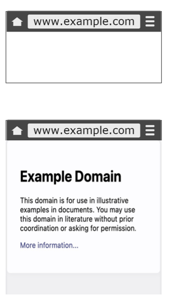{.absolute left=115 top=120 width=340 height=590}

::: {.a .f37 .gray style="left:483px;top:211px;width:760px"}
What is happening behind the scenes ?
:::

::: {.a .f37 .gray style="left:483px;top:407px;width:760px"}
What do you know about the protocol allowing the name to be translated into technical information ?
:::

## What is DNS ?

::: {.a .f35 style="left:44px;top:114px;width:1192px;line-height:1.3"}
**DNS is a distributed, hierarchical system for translating objects.**

The main usage is Name to IP translation but it can also be IP to Name, Name to Ressources (Mail Servers, Domain Verification, etc)

DNS can mean the system (Domain Name System) or the infrastructure supporting it (Domain Name Servers)

DNS is a critical piece of the Internet infrastructure and any network infrastructure.
:::

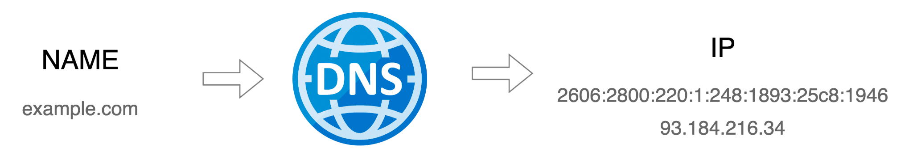{.absolute left=145 top=518 width=962 height=169}

## DNS Features

Globally Distributed

Multiple DNS servers managed by different operators

Loosely coherent

Even if distributed, servers are still part of one global DNS system

Scalable

The system can be scaled up and multiple servers can be added

Reliable

Failure tolerance due to hierarchical distributed architecture and local caches

Dynamic

Anyone can add domains and records without causing outage

## DNS Protocol

::: {.absolute left=74 top=100 width=1192 .f30}
- DNS is a client-server protocol
  - Client (resolvers) requests resolution for a **function** (IP, mail server …) of a **name**
  - DNS server responds with information about the record
- Requests and responses are normally sent via **UDP/53**
- Also uses **TCP/53** for large requests
  - Ex: Zone transfers, large answers with DNSSEC, etc
:::

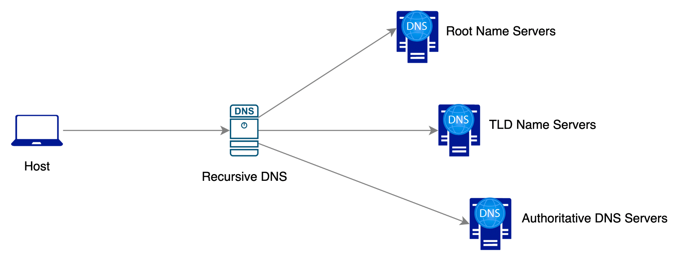{.absolute left=171 top=359 width=948 height=360}

## DNS Namespace Hierarchy

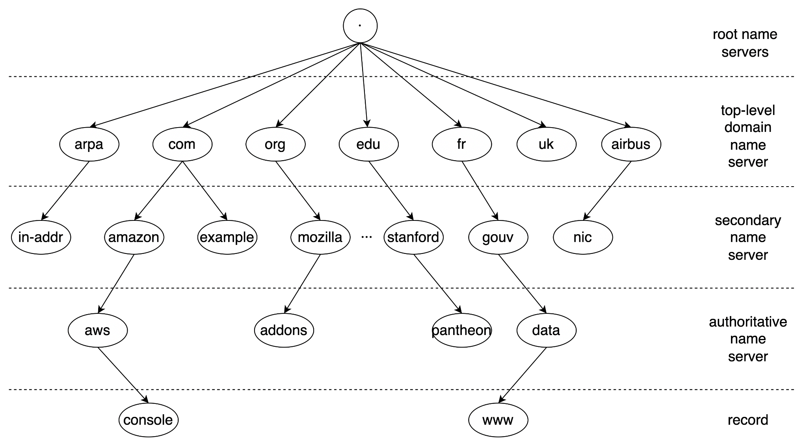{.absolute left=169 top=99 width=1084 height=599}

[13 Anycasted Root Servers](https://www.internic.net/domain/named.root) ([URL](https://www.internic.net/domain/named.root))

[1446 TLDs](https://data.iana.org/TLD/tlds-alpha-by-domain.txt) (Oct 2024) ([URL](https://data.iana.org/TLD/tlds-alpha-by-domain.txt))

[~360 Millions domains](https://blog.verisign.com/domain-names/q2-2024-domain-name-industry-brief-quarterly-report/) ([URL](https://blog.verisign.com/domain-names/q2-2024-domain-name-industry-brief-quarterly-report/))

## Who is responsible for DNS ?

::: {.absolute left=46 top=180 width=1192 .f27 .m64 .lh14}
- **ICANN (Internet Corporation for Assigned Names and Numbers)**: Oversees the global DNS structure, including the policies governing domain name registration.
- **IANA (Internet Assigned Numbers Authority)**: Part of ICANN, IANA coordinates key technical aspects of DNS, including the root zone file. It assigns IP address blocks, manages root servers, and designates top-level domains (TLDs).
- **Registry Operators**: Responsible for specific TLDs (like Verisign for .com), they maintain the records of domains under each TLD.
- **Registrars**: Accredited companies (e.g., GoDaddy) that allow individuals and organizations to register domain names.
- **ISPs and Network Admins**: Provide local DNS servers, translating domain names to IP addresses for end-users.
:::

## IANA type of TLDs

<h3>country-code top-level domains (ccTLD)</h3>
Two-character domains established for countries or territories. Example: .us for United States. .ca, .uk, .ae, and .fr are all ccTLDs.

<h3>internationalized country code top-level domains (IDN ccTLD)</h3>
ccTLDs in non-Latin character sets (e.g., Arabic or Chinese).

<h3>generic top-level domains (gTLD)</h3>
Top-level domains with three or more characters which include the generic .com, .net, .gov, .org, and more.

<h3>unsponsored top-level domains</h3>
Domains that operate directly under policies established by ICANN processes for the global Internet community, for example "edu".

<h3>sponsored top-level domains (sTLD)</h3>
These domains are proposed and sponsored by private organizations that decide whether an applicant is eligible to use the TLD, based on community theme concepts. Include .airbus, .museum, .travel, etc

<h3>[Special-Use top-level domain](https://www.iana.org/assignments/special-use-domain-names/special-use-domain-names.xhtml)</h3>
This group consists of Address and Routing Parameter Area (ARPA), Private TLD (corp, local, etc) or specific TLD such as TOR .onion

## DNS Terminology: “name” decomposition {.t24}

::: {.absolute left=144 top=127 width=1069 .f24 .gray}
A **Fully Qualified Domain Name** is an absolute name containing the host and the domain. **A proper FQDN ends with a dot**, indicating the root of the DNS hierarchy.
:::

{.absolute left=143 top=203 width=863 height=355}

::: {.a .f25 .gray style="left:349px;top:437px;width:285px"}
**second level domain:**
:::

::: {.absolute left=1025 top=357 width=268 .f24 .gray}
**Root** domain is the highest domain : “.”
:::
::: {.absolute left=864 top=514 width=381 .f24 .gray}
**top-level domain** is the most general part of the domain
:::
::: {.absolute left=27 top=498 width=497 .f24 .gray}
**Host** refer to separate computers or services accessible under a domain
:::
::: {.absolute left=330 top=617 width=630 .f24 .gray}
The **domain** part of a FQDN. This is usually the part that needs to be loaned/registered to be used
:::

::: notes
Root domain is the highest domain : “.”

A top-level domain, or TLD, is the most general part of the domain. The top-level domain is the furthest portion to the right (as separated by a dot)

A “subdomain” refers to any domain that is part of a larger domain. In this case, “amazon.com” can be said to be a subdomain of “com”. This is typically just called the domain or the “amazon” portion is called a SLD, which means second level domain. DNS works in a hierarchy. Each domain can control “subdomains” that are located under it. This is usually what we mean by subdomains. The difference between a host name and a subdomain is that a host defines a computer or resource, while a subdomain extends the parent domain. It is a method of subdividing the domain itself.

Within a domain, the domain owner can define individual hosts, which refer to separate computers or services accessible under a domain

A Fully Qualified Domain Name is an absolute name that specifies its location in relation to the absolute root of the domain name system. This means that it specifies each parent domain including the TLD. A proper FQDN ends with a dot, indicating the root of the DNS hierarchy.
:::

## Types of DNS Record

::: {.absolute left=50 top=143 width=1229 .f27}
They are 47 active DNS types and 43 obsoleted ones. ([List here](https://en.wikipedia.org/wiki/List_of_DNS_record_types)). The most common are:
:::

A AAAA

Links the hostname to the IP address. (A: IPv4, AAAA: IPv6)

CNAME

Point a Domain Name to another Domain Name

TXT

Text records are used to store descriptive text (site verification, SPF/DMARC mail record, etc)

MX

Mail Exchanger record point the domain name of the email server responsible for the domain name.

SOA

identify the Start of Authority with essential parameters of the zone (NS, contact info, default TTLs)

NS

NameServer records identify the responsible DNS Server for answering this zone.

PTR

Pointer record links an IP address to a domain name (opposite to A)

SRV

SeRVice record points to a host and its corresponding port for a specific service with a priority. It is used for discovering a services.

::: {.absolute left=166 top=681 width=984 .f21 .center}
CAA, LOC, HINFO, RRSIG, NSEC, DNSKEY, GLUE are also seen but are more “advanced ones”
:::

## Quizz Time {.t30}

::: {.absolute left=43 top=344 width=612 .f37 .center}
www.pollev.com/jmanteau973
:::
{.absolute left=643 top=91 width=585 height=585}

## DNS Client: nslookup/dig {.t30}

::: {.absolute left=34 top=162 width=1245 .f32}
**nslookup** is officially deprecated in favour of **dig**.

nslookup is however almost universally available (e.g. only resolver on Windows).

So my recommendation is:

- Master and have dig on your system for dns investigation and testing.
- Know enough nslookup for basic troubleshooting on others devices
:::

{.absolute left=122 top=479 width=181 height=141}

::: {.a .f32 style="left:346px;top:528px;width:783px;font-weight:bold"}
Practical Exercise: Request DNS with Dig
:::

## Full DNS Query and types of DNS Server {.t30}

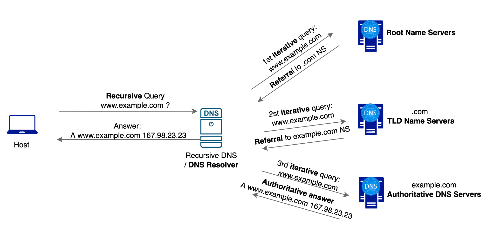{.absolute left=22 top=100 width=1248 height=587}

::: notes
A Recursive DNS resolver responds to a recursive request from a client and takes the time to track down the DNS record (like a librarian fetching a book for a client querying it with its identifier)

Root nameserver is the first step in translating (resolving) human readable host names into IP addresses. It can be thought of like an index in a library that points to a room with different racks of books.

TLD nameserver can be thought of as finding a specific rack of books in a library. This nameserver is the next step in the search for a specific IP address.

Authoritative nameserver - This final nameserver can be thought of as a dictionary on a rack of books, in which a specific name can be translated into its definition. The authoritative nameserver is the last stop in the nameserver query. If the authoritative name server has access to the requested record, it will return the IP address for the requested hostname back to the DNS Recursor (the librarian) that made the initial request.
:::

## [Full DNS Query](https://sequencediagram.org/index.html#initialData=FAFwliA2CmAECqBnaAnWARAcgZVgJWkQHtIBXcIgO2GADMqQBDAd0KIFtoBWYyMAE1i0AjAAYAnBmgA3MAGNodBizaceJAUIBMAZh35oc0ikRhpcLNiWUmrYmt6bau-XiJEQGHNdurujwWc9WAAVABl0WAA6OQ5YTEZOWGxUcxMfFXt-DUCXWGgAD0SABxgYuIBBcgALIhQIRnBzL1wUlDTEGmB0GXloAFoAPgIjEzMLHAAuZhmowpKy2PZYAH5gRjkmxotehRpGACMiAtgiNINR02bLSewmFE8iWlgUQ2MridwARVJUAE8hHV8kV2KVoOV2DQRu9xi0hm4PC1JsJEJ4AI6-FB-SawGbMOYgsEQ9abMzbfDuTyWElbEBwaFja7eBkfFoAHn6CKpUwItFQKEYkFgICI0SW8SsNH40A2tPplJaULejM+Q3CkQh8UScDaHUmWlRsAx-xxeIJC3BSxpZLpoQiYriCSSutQnWALNhlg56odyydOtSrsmvP5guFovmoMWjqs0tlNrgPs1-uSgfSHqZ2CGkaJ4qqIFq9SYTU+qfaQZ0KEExqxptmOejkPj0nJDctlRqdQaJZaZY67uVrK9-Tbmvzhe7npwfaDFUoiFYKBxFVx9cJjdgwgAbAB2KLiAAcUV0x50wDjpJbttHec7RcaU9aac6F7lFxhmfWRxOZ1Q75VSIAKKUIITwvIOj6wD8-zdLs0AchmnyTHOC6oMuq74jecTbnuh6nqeUoype5I9LIChAA) {.t30}

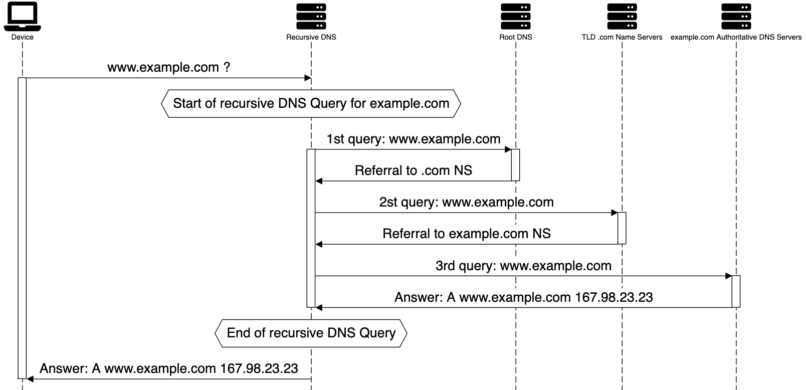{.absolute left=23 top=109 width=1233 height=596}

## Lab: Full DNS Query sequence diagram for www.impots.gouv.fr {.t19 style="--t:62px"}

{.absolute left=96 top=163 width=181 height=141}

::: {.a .f32 style="left:320px;top:222px;width:783px;font-weight:bold"}
Practical Exercise: Full DNS Query
:::

::: {.absolute left=89 top=392 width=1104 .f29}
Based on the previous sequence diagram (click on link), please recreate the full chain of the resolution of www.impots.gouv.fr
:::

<pre class="a terminal" style="left:89px;top:544px;width:1150px;font-size:21px;line-height:1.35;color:#777">❯ dig www.impots.gouv.fr +noall +answer
www.impots.gouv.fr.	129	IN	CNAME	www.impots.gouv.fr.edgesuite.net.
www.impots.gouv.fr.edgesuite.net. 21429	IN CNAME a1352.dscb.akamai.net.
a1352.dscb.akamai.net.	20	IN	A	95.100.133.81
a1352.dscb.akamai.net.	20	IN	A	95.100.133.74</pre>

## TTL: Definition {.t30}

::: {.absolute left=44 top=171 width=1192 .f27}
TTL (Time To Live) is a value configured on the DNS Server which informs the client / resolver **how long it should store the DNS record details before sending the query to get the updated information**. The DNS Server returns the TTL Value along the record.

Per the DNS RFC, DNS TTL values can be configured from 0 seconds to 248555 days.

However [DNS client implementations](https://www.ctrl.blog/entry/dns-client-ttl.html) can have different values.

This is why I personally advise TTL values between 1min and 1 day.
:::

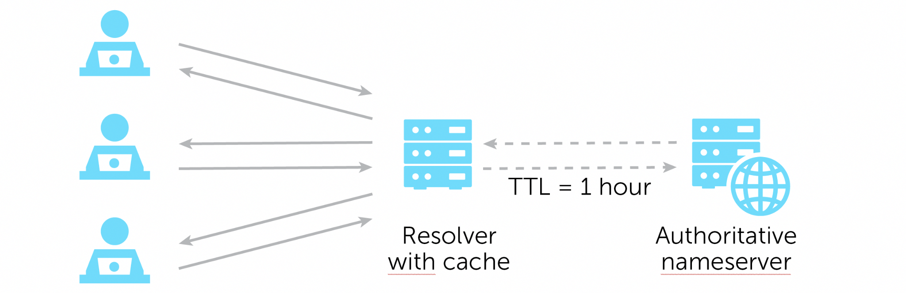{.absolute left=328 top=505 width=559 height=181}

::: notes
A or AAAA Record: Your A records should be set to a faster pace TTL as IP address lookups can change frequently if usage of CDN. A standard baseline would be around the 1-hour mark but may need to be adjusted depending on how often changes need to be made on an emergency basis (30 seconds in case of rapid change).

CNAME Record: Your main website URL, for example (www.example.com), should usually never change. It is recommended that you set your TTL for something longer than the average session time (for example 10 min).

TXT Record: Widely used for DKIM records, email security and verifying domain ownership. TXT records are rarely changed so anywhere within the 1 – 12-hour timeframe should suffice.

MX Record: Your mail exchange TTL can be set between the 12-24 hour range, but you may want to consider placing it lower in case of emergencies; somewhere in the 1-4 hour range would be useful as well.
:::

## DNS Cache {.t30}

::: {.absolute left=44 top=139 width=1192 .f27}
DNS Cache (sometimes called a DNS resolver cache) is a temporary database, maintained by an OS, that contains records of all recent DNS lookups.

Before attempting to resolve a name, the OS will check if the entry is present in the cache. The entries are cleared according to their TTL. Before requesting he will also check the “static cache”: the hosts file.

A browser will also have a DNS cache that they will use before using the OS cache (and the default resolver if not in OS cache OR their own resolver)
:::

<table class="cache">
<tr><th></th><th>Windows</th><th>Linux (if present)</th><th>Mac (12.x)</th><th>Chrome</th><th>Firefox</th></tr>
<tr><td>Check Cache</td><td>ipconfig /displaydns</td><td>resolvectl query $HOSTNAME</td><td>Hashed as considered as private data</td><td>chrome://net-internals/#dns</td><td>about:networking#dns</td></tr>
<tr><td>Clear Cache</td><td>ipconfig /flushdns</td><td>resolvectl flush-caches</td><td>sudo dscacheutil -flushcache; sudo killall -HUP mDNSResponder</td><td></td><td></td></tr>
</table>

::: notes
A or AAAA Record: Your A records should be set to a faster pace TTL as IP address lookups can change frequently if usage of CDN. A standard baseline would be around the 1-hour mark but may need to be adjusted depending on how often changes need to be made on an emergency basis (30 seconds in case of rapid change).

CNAME Record: Your main website URL, for example (www.example.com), should usually never change. It is recommended that you set your TTL for something longer than the average session time (for example 10 min).

TXT Record: Widely used for DKIM records, email security and verifying domain ownership. TXT records are rarely changed so anywhere within the 1 – 12-hour timeframe should suffice.

MX Record: Your mail exchange TTL can be set between the 12-24 hour range, but you may want to consider placing it lower in case of emergencies; somewhere in the 1-4 hour range would be useful as well.
:::

## TTL: Lookup {.t30}

<pre class="a terminal" style="left:44px;top:146px;width:850px;font-size:25px;line-height:1.45">❯ dig wikipedia.org +noall +answer
wikipedia.org.   	 <b>403</b>    IN    A    185.15.58.224
❯ dig ns wikipedia.org +noall +answer
wikipedia.org.   	 2907    IN    NS    ns0.wikimedia.org.
wikipedia.org.   	 2907    IN    NS    ns2.wikimedia.org.
wikipedia.org.   	 2907    IN    NS    ns1.wikimedia.org.
❯ dig wikipedia.org +norecurse @ns0.wikimedia.org +noall +answer
wikipedia.org.   	 <b>600</b>    IN    A    185.15.58.224</pre>

::: {.a .r .f25 style="left:907px;top:169px;width:380px;font-weight:bold"}
ISP DNS Resolver Local TTL
:::
::: {.a .r .f25 style="left:1015px;top:288px;width:260px;font-weight:bold"}
Locate and direct Query to authoritative NS
:::
::: {.a .r .f25 style="left:922px;top:438px;width:360px;font-weight:bold"}
Authoritative TTL answer
:::

::: {.absolute left=67 top=524 width=1153 .f27}
If your default DNS server is not the authoritative server for the zone you are digging (so 99,99% of the time) dig will show the time remaining (until the next refresh) instead of the raw TTL value in this position.
:::

## DNS Concepts: Reverse Mapping / DNS Lookup, PTR Record {.t24}

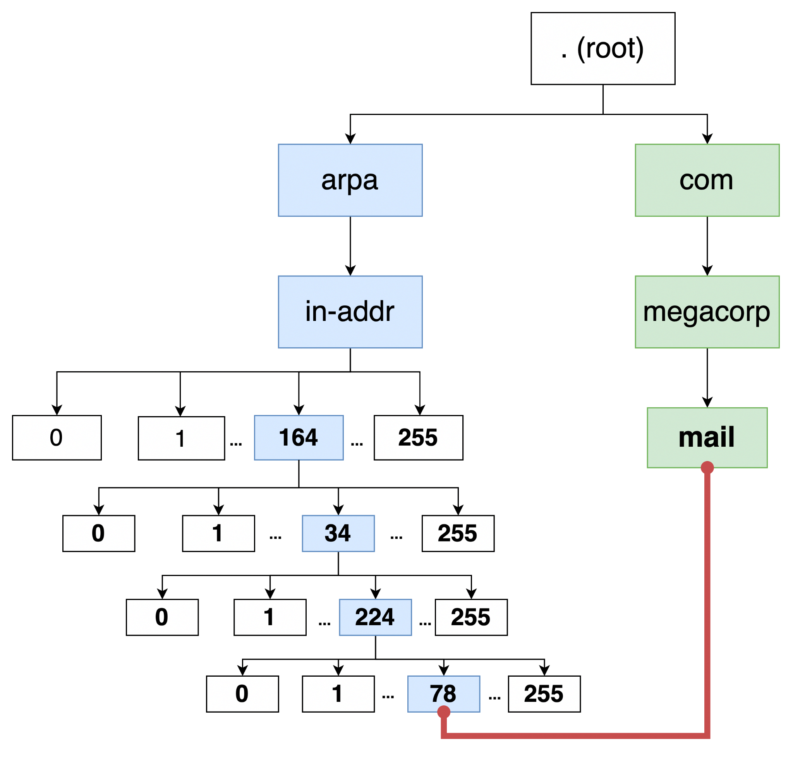{.absolute left=16 top=112 width=569 height=547}

<pre class="a terminal" style="left:595px;top:335px;width:700px;font-size:21px">78.224.34.164.in-addr.arpa PTR mail.megacorp.com</pre>

::: {.absolute left=609 top=435 width=686 .f24}
This is equal to :

"Pointer from IP 164.34.224.78 to mail.megacorp.com"
:::

## DNS Concepts: Views {.t30}

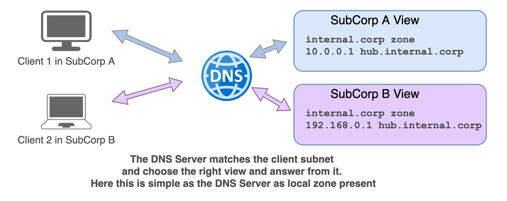{.absolute left=16 top=179 width=1211 height=481}

## DNS Concepts: Split Horizon {.t30}

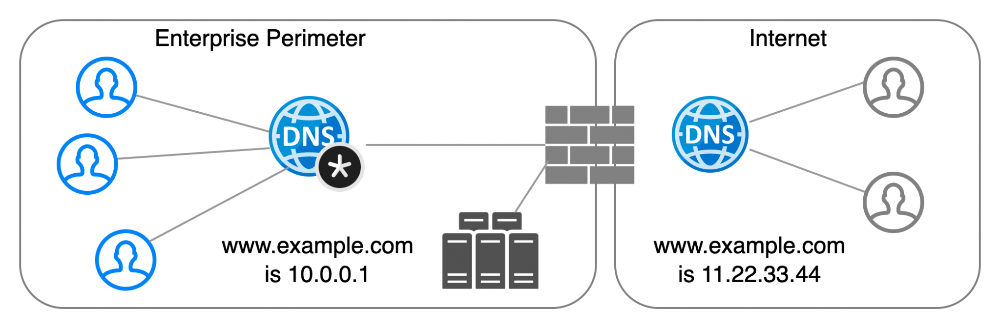{.absolute left=95 top=138 width=1041 height=341}

::: {.absolute left=105 top=491 width=1098 .f24}
Split Horizon is the DNS concept that the same resource is having different DNS entry depending from where the resolution is done. It can be implemented in different ways:

- DNS Views
- Different DNS servers (hence different zones)
- DNS Global Load Balancing
- RPZ
:::

## DNS Concepts: Round Robin {.t30}

{.absolute left=169 top=124 width=831 height=284}

::: {.absolute left=81 top=414 width=1210 .f29}
- **What it is**: A DNS load balancing method managed by the authoritative nameserver, without needing dedicated load-balancing hardware.
- **Use Cases**: Ideal for websites or services hosted on multiple redundant servers or when a single DNS name directs to multiple proxy servers.
- **How it works**: The nameserver provides a different IP address in each DNS response, rotating through available server IPs for balanced traffic distribution.
:::

## DNS Concepts: RPZ definition {.t30}

::: {.absolute left=67 top=131 width=1140 .f37 .tight}
- DNS Response Policy Zone (RPZ) is a DNS zone which allow to customize policy in DNS servers, so that the server returns modified answers to clients’ queries.
- **RPZ** provides a way to **alter a DNS response** in real time. RPZ is a “lying” mechanism.
- It can be used to modify potentially unsafe DNS Data to block communication or provide local data to redirect to a “walled garden”.
- As we can alter query response or block any domain using RPZ it is also known as **DNS firewall (or DNS Sinkhole)**.
:::

## DNS Concepts: RPZ schema {.t30}

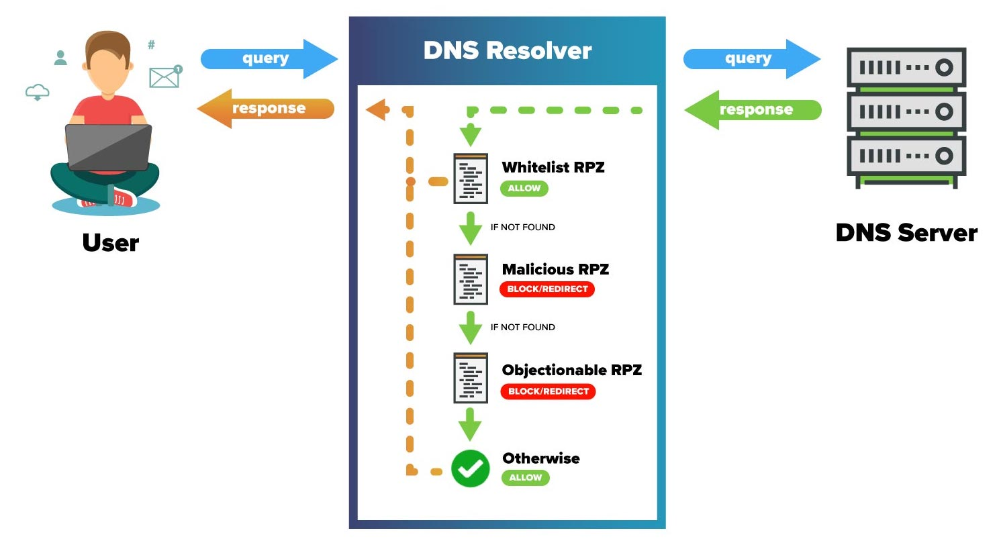{.absolute left=87 top=127 width=1042 height=568}

## DNS Concepts: Primary, Secondary & Zone Update {.t28}

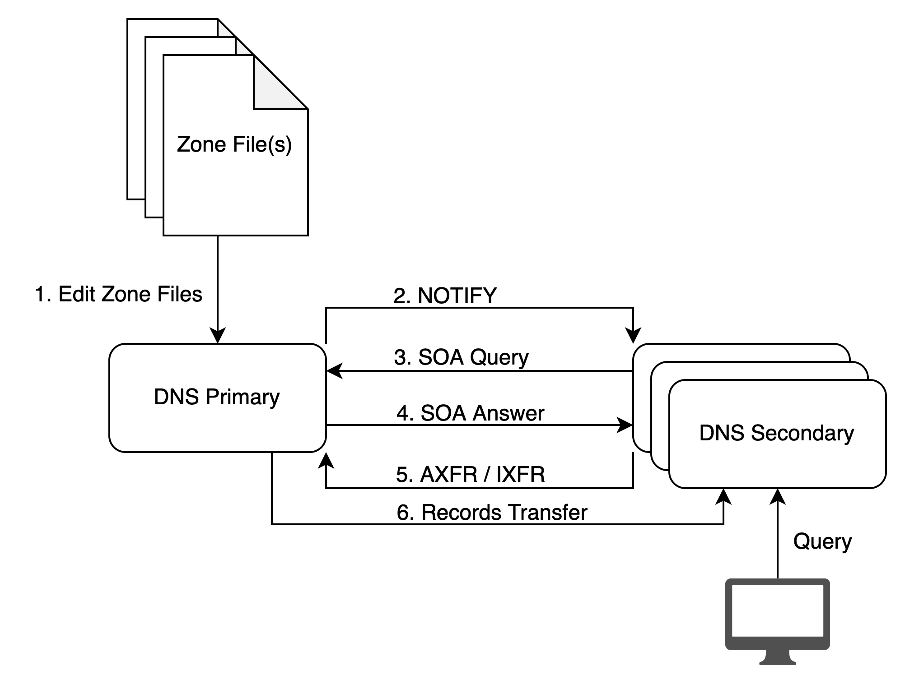{.absolute left=12 top=169 width=681 height=515}

::: {.absolute left=371 top=185 width=866 .f29}
DNS Zone Primary / Secondary (used to be called Master / Slave) is a concept which allow DNS servers to scale while keeping one unique management point for zone edition.

The master contains the DNS data source of truth.
:::

::: {.absolute left=735 top=457 width=491 .f22}
Secondary reads Master SOA Resource Record, check the serial number and request zone transfer if higher
:::

::: {.absolute left=736 top=610 width=542 .f22}
It is impossible to determine from a query result that it came from a zone primary or secondary.
:::

## Quizz Time {.t30}

::: {.absolute left=43 top=344 width=612 .f37 .center}
www.pollev.com/jmanteau973
:::
{.absolute left=643 top=91 width=585 height=585}

## DNS & CyberSecurity {.divider}

{.absolute left=0 top=0 width=677 height=720}

## How DNS is used by malware (DNS usage in the KillChain) ? {.t24 style="--t:30px"}

{.absolute left=51 top=293 width=1173 height=175}
{.absolute left=51 top=312 width=1173 height=138}

1

2

3

4

5

6

7

<b>Reconnaissance</b>Harvesting email addresses, conference information, etc.

<b>Weaponization</b>Coupling exploit with backdoor into deliverable payload

<b>Delivery</b>Delivering weaponized bundle to the victim via email, web, USB, etc.

<b>Exploitation</b>Exploiting a vulnerability to execute code on victim’s system

<b>Installation</b>Installing malware on the asset

<b>Actions on Objectives</b>With “Hands on Keyboard” access, intruders accomplish their original goal

<b>Command & Control (C2)</b>Command channel for remote manipulation of victim

{.absolute left=225 top=396 width=69 height=63}
{.absolute left=367 top=312 width=54 height=50}
{.absolute left=482 top=386 width=74 height=72}
{.absolute left=604 top=315 width=64 height=59}
{.absolute left=720 top=399 width=65 height=51}
{.absolute left=849 top=305 width=59 height=71}
{.absolute left=973 top=395 width=52 height=65}

DNS Reconnaissance

DNS Resolution DNS Infiltration

DNS Tunneling DNS Exfiltration DNS DDoS

DNS Resolution DNS Callback DNS Tunneling

DNS Protocol Anomalies DNS Exploits DNS Hijacking

## {.pillars-slide}

DNS & CyberSecurity

1

Preventing communication over DNS

2

Stopping APTs/malware from using DNS

3

Defending DNS Infrastructure

## {.pillars-slide}

DNS & CyberSecurity

1

Preventing communication over DNS

2

Stopping APTs/malware from using DNS

3

Defending DNS Infrastructure

## DNS as a Transport Mechanism {.t24 style="--t:30px"}

::: {.a .f32 style="left:46px;top:96px;width:1172px;font-weight:bold"}
Exfiltration
:::

::: {.absolute left=60 top=146 width=785 .f24 .sp2 .sub25}
- Attacker registers a domain & sets up an authoritative DNS server on the Internet to act as the tunnel endpoint
- Data to be sent from inside network is:
  - Encrypted using public key
  - Encoded into a-z, 0-9 and – using algorithm such as Base32, which allows up to 110 bytes to be encoded into an FQDN
  - Divided into chunks of up to 63 characters (label limit)
  - Sent as individual queries in format of \<chunk\>.domain
- Queries can be sent direct (if allowed by firewall), via a network’s existing DNS servers or via proxies (e.g. request http://\<chunk\>.domain)
- If sent via DNS the source address can be spoofed to make tracing harder
- Attacker’s authoritative server receives encoded chunks, reassembles data, decodes & decrypts using private key
:::

{.absolute left=918 top=139 width=104 height=104}
{.absolute left=1031 top=116 width=48 height=68}
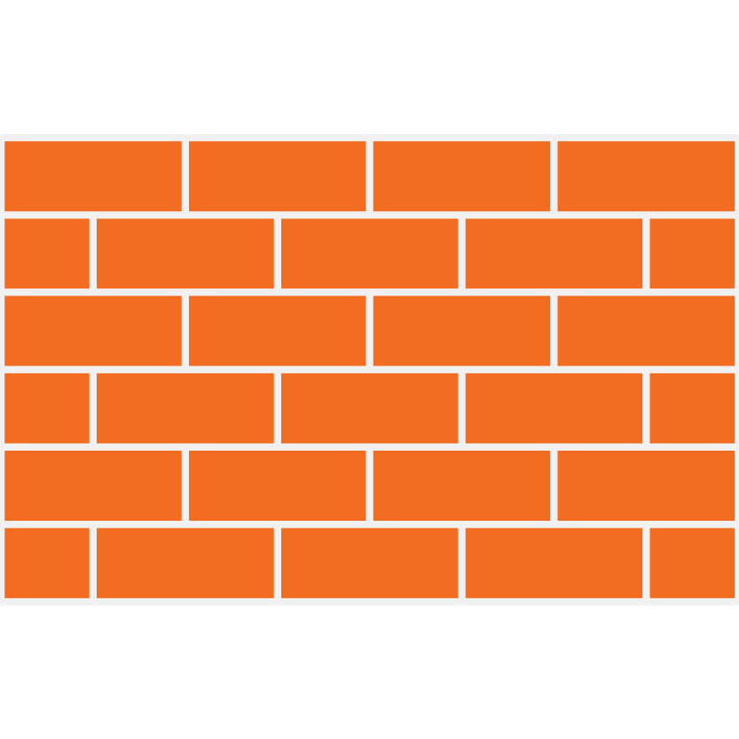{.absolute left=918 top=263 width=119 height=119}
{.absolute left=928 top=397 width=108 height=108}
{.absolute left=890 top=518 width=158 height=158}
{.absolute left=1055 top=571 width=186 height=92}

Attacker’s DNS Server

INTERNET

ENTERPRISE

Data

DNS server

Infected endpoint

KS93KDKSK344SD3434DS.100.foo.thief.com kjhHJhUy7UjfryGF6rHDSFA.101.foo.thief.com

KS93KDKSK344SD3434DS.100.foo.thief.com kjhHJhUy7UjfryGF6rHDSFA.101.foo.thief.com

## DNS as a Transport Mechanism {.t24 style="--t:30px"}

::: {.a .f32 style="left:46px;top:96px;width:1172px;font-weight:bold"}
Infiltration
:::

::: {.absolute left=89 top=150 width=1190 .f24 .sp2 .sp3}
- Can be used to download a payload in a covert way for example.
- TCP features can be imitated by encoding the chunks with additional data, such as Checksum & Packet Number
- Data can be sent back in a variety of records, e.g.
  - A - allowing 4 bytes  (enough for codes, e.g. 1.1.1.200 = resend packet 200)
  - AAAA - allowing 16 bytes
  - MX record : 2 bytes + domain name (255 bytes)
  - CNAME - allowing up to 110 bytes in Base32
  - TXT - allowing N x 220 bytes in Base64 (up to RDATA limit of 64kB)
  - NULL - allowing up to 256 bytes
- Using TXT and NULL make transmission faster, at expense of easier detection
:::

## DGA – Domain Generation Algorithm {.t24 style="--t:30px"}

::: {.a .f22 style="left:63px;top:145px;width:689px;line-height:1.75"}
An algorithm producing Command & Control (C2) rendezvous points dynamically

For example: every day malware connects to time-based server FQDN: *\<month\>-\<day\>-\<year\>.com* ie. on December 24, 2017 malware connects to 2017-12-24.com
:::

<table class="dga" style="position:absolute;left:74px;top:461px">
<tr><th>Example Family</th><th>Example Domain</th></tr>
<tr><td>DirCrypt</td><td>vlbqryjd.com</td></tr>
<tr><td>Bamital</td><td>b83ed4877eec1997fcc39b7ae590007a.info</td></tr>
<tr><td>CCleaner</td><td>ab6d54340c1a.com</td></tr>
</table>

Bot

Bot

{.absolute left=1139 top=202 width=53 height=94}

DNS server

{.absolute left=1128 top=491 width=75 height=87}

C2 Server IP 135.175.17.35

DNS query: ajdhkbf.info

DNS Reply: NXdomain

DNS query: dnskasd.info

DNS Reply: NXdomain

DNS query: akdjnfag.info

DNS Reply: 135.175.17.35

Contact 135.175.17.35

Malicious Payload

## Lookalike Domain Detection {.t24 style="--t:30px"}

::: {.absolute left=87 top=128 width=1172 .f26}
- Detects from Newly Observed Domains (NOD), domain names that try to mimic popular domains (Alexa top-100) or strategic domains for phishing (e.g. banks) and spamming.
- Detects domains that overlaps and/or have homograph n-grams, e.g. letter ‘O’ and number ‘0’ are considered homographs. Use distance analysis to detect the likelihood of lookalike attacks
- Detects
  - Letter replacement, example g00gle.com, gooogle.com, bankofthevvest.com, rn1cr0soft.com
  - apple.com  >>>  app**I**e.com (Arial) &nbsp;&nbsp;&nbsp;&nbsp; apple.com  >>>  app**I**e.com (Cutive)
  - TLD change, example, walmart.cc
  - other generic highly resembled domains, example: bankofAmericas.com
- SOA record is analyzed and used for catching false positives.
:::

## Legitimate DNS Tunneling {.t24 style="--t:30px"}

::: {.absolute left=70 top=166 width=1172 .f22 .sp40}
- g63uar2ejiq5tlrkg3zezf2fkemc6pi88tz.er.spotify.com
- a-0.19-b3000081.a010083.15e0.1d99.36d4.210.0.ic7arfsqqzf694fs8zf8nz2t9b.avts.mcafee.com
- 4rzjp8zy7i7vawluximoxrko1p2tn58gj0fjjj2g.p.03.s.sophosxl.net
- p2.a22a43lt5rwfg.ihg5ki5i6q3cfn3n.191742.i1.ds.ipv6-exp.l.google.com
- a1294.w20.akamai.net
- dnn506yrbagrg.cloudfront.net
- A98dc034c7781a941ebabac02262202668bbe918ea9fb5289cd2.r58.cf2.rackcdn.com
:::

## C2 over DNS over HTTPS (DoH) {.t24 style="--t:30px"}

::: {.absolute left=28 top=122 width=1207}

• Domain fronting

Domain fronting is a technique that masks the destination of a request by using different domains at various stages of the connection, allowing traffic to bypass certain filtering or detection systems.

curl 'https://<b class="g">google.com</b>/resolve?name=<b class="r">malwareC2.com</b>’ -H "Host: <b class="y">dns.google.com</b>"

Unencrypted DNS lookup & TLS SNI: <b class="g">google.com</b> 
Encrypted HTTP host: <b class="y">dns.google.com</b> 
Requested Domain: <b class="r">malwareC2.com</b>

:::

## Lab: DNS Tunneling for bypassing filtering {.t19 data-visibility="hidden" style="--t:62px"}

{.absolute left=96 top=163 width=181 height=141}

::: {.a .f32 style="left:310px;top:208px;width:783px;font-weight:bold"}
Practical Exercise: DNS Tunneling with Iodine
:::

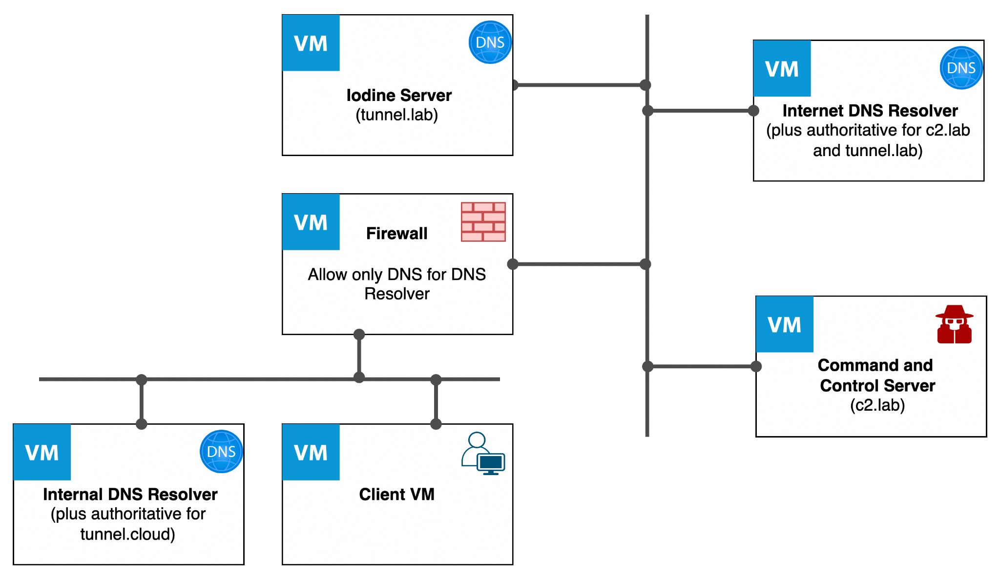{.absolute left=293 top=286 width=722 height=417}

## Lab: Command and Control over DNS {.t19 style="--t:62px"}

{.absolute left=96 top=163 width=181 height=141}

::: {.a .f32 style="left:320px;top:222px;width:783px;font-weight:bold"}
Practical Exercise: DNS C2 with Sliver
:::

{.absolute left=293 top=286 width=722 height=417}

## {.pillars-slide}

DNS & CyberSecurity

1

Preventing communication over DNS

2

Stopping APTs/malware from using DNS

3

Defending DNS Infrastructure

## Detecting DNS Tunnels & Data Exfiltration {.t24 style="--t:30px"}

::: {.a .f32 style="left:46px;top:96px;width:1172px;font-weight:bold"}
Traditional approach
:::

::: {.absolute left=102 top=153 width=815 .f22}
- Use a firewall to **rate limit UDP**, slowing the speed at which data can be transferred but not preventing it from happening
- **Analyze logs by hand** / using a visualization tool to find evidence of tunneling / data exfiltration after it’s happened. Typically achieved by looking for abnormal query types (such as NULL), particular REGEXs and long queries all of the same length.
- **Tunnel endpoints can then be blocked** at the firewall level. Provides protection only if the attacker continues to use the same domain/server in the future.
- **Manually configure security appliances** (such as DDoS mitigation platforms) to block specific REGEXs, query types, long queries etc. Laborious process that risks blocking legitimate software such as anti-virus, that use DNS to check for new signatures, file hashes etc

Ineffective against APTs & software that can be configured to vary query length, query type etc. to avoid detection
:::

{.absolute left=948 top=88 width=112 height=112}
{.absolute left=934 top=201 width=140 height=140}
{.absolute left=946 top=363 width=126 height=126}
{.absolute left=933 top=509 width=158 height=158}

Internet

INTERNET

ENTERPRISE

DNS server

Client-side tunnel program

## DNS Firewall {.t28 style="--t:30px"}

::: {.absolute left=46 top=150 width=788 .f32 .subsm}
- Like a firewall it implements a security policy (called RPZ – Response Policy Zone)
- Has triggers:
  - Queried domain name
  - IP address in response
  - IP address of querying client
- And actions:
  - Reject (NXdomain)
  - Block (no data)
  - Redirect
  - Passthrough and log
:::

{.absolute left=856 top=238 width=305 height=272}

## Detecting DNS Tunnels & Data Exfiltration {.t24 style="--t:30px"}

::: {.a .f32 style="left:47px;top:114px;width:1171px;font-weight:bold"}
DNS Firewall approach (vendor based solutions)
:::

<h3>Signature</h3>
Use <b>algorithms</b> to detect and block all known DNS Tunneling tools (in hardware, at line speed)

<h3>Reputation</h3>
Use <b>DNS Firewall</b> to automatically block known tunnel, C2 and data exfiltration endpoints and newly registered domains with Vendor backed database

<h3>Behavior</h3>
Use <b>DNS heuristics</b> to detect and block zero day data exfiltration, using real-time streaming analytics to mitigate against previously unseen code

## DNS heuristics {.t28 style="--t:30px"}

::: {.absolute left=38 top=125 width=1172 .f34}
- **Entropy**
  - Higher Entropy => more information transferred
  - Legitimate DNS names often have dictionary words or something that looks meaningful. Encoded names have a higher entropy. DNS names that have high entropy can be an indicator of tunneling.
- **Lexical**
  - Analysis of individual characters in domain names
  - non-letters (numbers or allowed special characters) character ratio
  - hex /A-F/ character ratio
  - vowel character ratio
:::

## DNS heuristics {.t28 style="--t:30px"}

::: {.absolute left=49 top=146 width=1172 .f34}
- **N-Gram**
  - Detects non human like domain names based on character distribution. Focus is on 2- and 3-gram (i.e. sequences of 2 or 3 characters, or bigram and trigram analysis).
:::

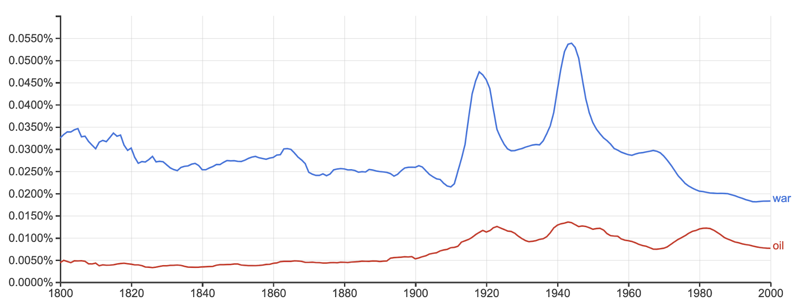{.absolute left=94 top=407 width=508 height=195}
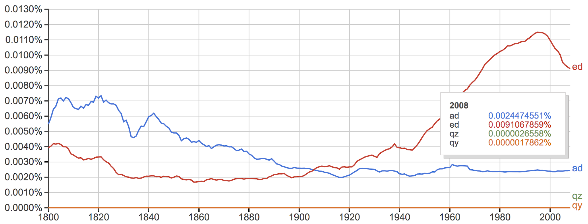{.absolute left=699 top=409 width=502 height=192}

::: {.absolute left=23 top=648 width=620 .f25}
Source: [https://books.google.com/ngrams](https://books.google.com/ngrams)
:::

## DNS heuristics {.t28 style="--t:30px"}

::: {.absolute left=54 top=126 width=1172 .f22 .sp49}
- **Gini index** – how often a randomly chosen character from the domain name would be incorrectly labeled if it was randomly labeled according to the distribution of characters in the domain name
- **Classification error** – measure of the diversity of characters in the string
- **Number of Labels** – number of domain labels in an FQDN payload
- **Frequency**: how often are requests being sent to the same recipient (typically multiple requests to same recipient are not common and indicate malicious activity). Are the queries being repeated at precise intervals?
- **Size** Higher payload size => more information transferred
:::

## {.pillars-slide}

DNS & CyberSecurity

1

Preventing communication over DNS

2

Stopping APTs/malware from using DNS

3

Defending DNS Infrastructure

## Type of DNS attacks {.t28 style="--t:30px"}

<table class="attacks">
<tr class="vol"><td>DNS reflection/DrDoS attacks</td><td>Using third-party DNS servers (mostly open resolvers) to propagate a DoS or DDoS attack</td></tr>
<tr class="vol"><td>DNS amplification</td><td>Using a specially crafted query to create an amplified response to flood the victim with traffic</td></tr>
<tr class="vol"><td>TCP/UDP/ICMP floods</td><td>Denial of service on layer 3 or 4 by bringing a network or service down by flooding it with large amounts of traffic</td></tr>
<tr class="vol"><td>NXDomain attack</td><td>Attacks that flood DNS server with requests for non-existent domains, causing it to send NXDomain (non-existent domain) responses</td></tr>
<tr class="vol"><td>Phantom domain attack</td><td>Attacks where a DNS resolver is forced to resolve multiple non-existent domains, causing it to consume resources while waiting for responses</td></tr>
<tr class="dns"><td>DNS-based exploits</td><td>Attacks that exploit bugs or vulnerabilities in the DNS software</td></tr>
<tr class="dns"><td>DNS cache poisoning</td><td>Corruption of DNS server cache data with a rogue domain or IP</td></tr>
<tr class="dns"><td>Protocol anomalies</td><td>Causing the server to crash by sending malformed DNS packets and queries</td></tr>
<tr class="dns"><td>Reconnaissance</td><td>Attempts by hackers to get information on the network environment before launching a DDoS or other type of attack via DNS queries or Zone Transfers</td></tr>
<tr class="dns"><td>DNS tunneling</td><td>Tunneling of another protocol through DNS port 53 for malware insertion and/or data exfiltration</td></tr>
<tr class="dns"><td>DNS hijacking</td><td>Modifying the DNS record settings to point to a rogue DNS server or domain</td></tr>
</table>

DNS-specific Exploits

Volumetric/DDoS Attacks

## Lab: DNS Reconnaissance {.t19 data-visibility="hidden" style="--t:62px"}

{.absolute left=96 top=163 width=181 height=141}

::: {.a .f32 style="left:310px;top:208px;width:783px;font-weight:bold"}
Practical Exercise: Reconnaissance of a domain
:::

## Improvements of DNS {.t30}

::: {.absolute left=79 top=241 width=1076 .f29 .circ}
- **DNS Transport** mechanisms
  - DNS over TLS (DoT): use DNS over TLS encryption on TCP port 853 (RFC 7858)
  - DNS over HTTPs  (DoH/DoH3) : use HTTP2 or 3 for encrypting requests
  - DNS-over-QUIC (DoQ): use [QUIC](https://http3-explained.haxx.se/en/why-quic) for data transport and encryption (UDP port 853 (also port used for DNS over DTLS)
- **DNS Data** authentication:
  - DNSSEC: use specific DNS records to ensure that the answer given is the authorized one
:::

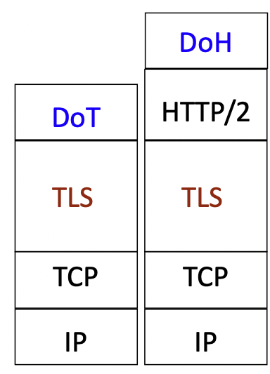{.absolute left=646 top=12 width=203}
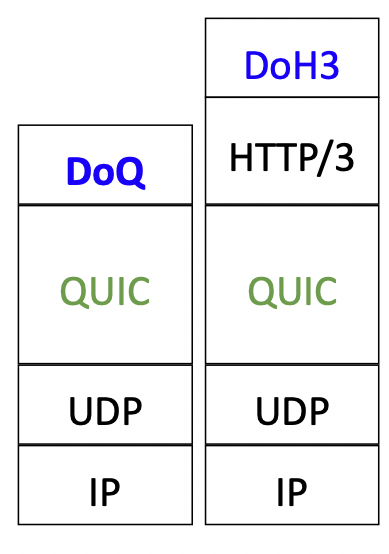{.absolute left=849 top=12 width=194}

TLS1.3

TLS1.3

::: notes
❯ curl 'https://dns.google.com/resolve?name=eu.nomad.airbus.com' -H "Host: dns.google.com"

{"Status":0,"TC":false,"RD":true,"RA":true,"AD":false,"CD":false,"Question":[{"name":"eu.nomad.airbus.com.","type":1}],"Answer":[{"name":"eu.nomad.airbus.com.","type":5,"TTL":60,"data":"eu-nomad.dyn.airbus.com."},{"name":"eu-nomad.dyn.airbus.com.","type":1,"TTL":60,"data":"193.56.36.114"}],"Comment":"Response from 193.56.36.45."}
:::

## Comparing DoT/DoQ and DoH/DoH3 {.t30}

<table class="dot">
<tr><th>DoT</th><th>DoH</th></tr>
<tr><td>RFC 7858</td><td>RFC 8484</td></tr>
<tr><td>New Port 853</td><td>Port 443 (HTTPS)</td></tr>
<tr><td>Traffic can easily be blocked and not open normally by default in enterprise</td><td>Traffic looks like every other encrypted web traffic</td></tr>
<tr><td>No API capabilities</td><td>API capabilities</td></tr>
<tr><td></td><td>Built-in browser support</td></tr>
</table>

{.absolute left=922 top=9 width=160}
{.absolute left=1082 top=9 width=153}

## DNSSEC {.t28 style="--t:30px"}

::: {.absolute left=53 top=134 width=1206 .f26}
The original design of the Domain Name System (DNS) did not include security and allowed false DNS data to be returned.

This required trust that the DNS answers were authentic and not modified.

Domain Name System Security Extensions (DNSSEC) is a set of extensions to DNS that provide DNS clients via a digital signature (resolvers) **origin authentication** of DNS data.

By validating the digital signature, a DNS resolver can check if the information is identical to the data published by the zone owner and served on an authoritative DNS server and thereby mitigate, such as ‘man-in-the-middle attacks’

DNSSEC doesn’t provide confidentiality of data, and the responses are **authenticated** but not **encrypted**.
:::

## DNSSEC {.t28 style="--t:30px"}

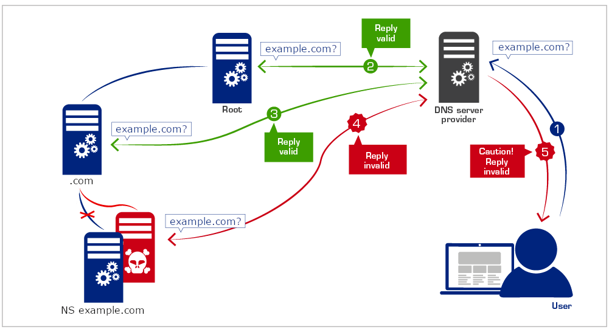{.absolute left=120 top=130 width=1001 height=545}

## Ressources {.t28 style="--t:30px"}

::: {.absolute left=44 top=137 width=1192 .f32 .links}
- [DNS RFCs](https://rfcs.io/dns)
- [An Illustrated Guide to the Kaminsky DNS Vulnerability](http://unixwiz.net/techtips/iguide-kaminsky-dns-vuln.html)
- [DNS for Rocket Scientists](https://www.zytrax.com/books/dns/)
:::

## {.xkcd background-color="#d9d9d9"}

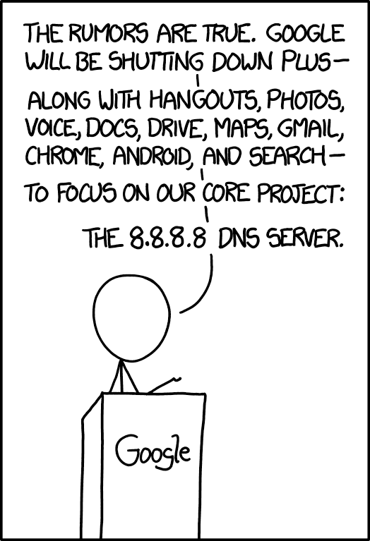{.absolute left=29 top=57 width=332 height=487}

<pre class="a terminal" style="left:463px;top:76px;width:760px;font-size:32px;line-height:1.6;color:#333">❯ dig -x 8.8.8.8 +short
dns.google.

❯ dig txt dns.google. +short
"https://xkcd.com/1361/"
"v=spf1 -all"</pre>
