## Objectives

::: {.absolute left=61 top=130 width=1160 .f32 .gray}
- Describe the principles of DNS and how its data are organized (namespace, zones, records)
- Trace a full DNS resolution with dig and name the servers involved
- Explain how caching and TTL affect the answers you see
- Describe advanced DNS concepts (reverse lookup, split horizon, round robin, zone transfer)
- Explain the role of DNS in the kill chain (the stages of a cyberattack)
- Run a DNS C2 channel in a lab, detect it in the logs and block it with RPZ
- Match DNS attacks to their defenses (DNS firewall, DoT, DoH, DoQ, DNSSEC)
:::

## Teacher Presentation: Julien MANTEAU

::: {.absolute left=83 top=140 width=1100 .f22}
- Network & Telecom Engineer (ENSEEIHT)
:::

Systems & Network Security Engineer

LAN Global Technical Leader

Connectivity Solution Architect

France Network Service Delivery Manager

Cloud Solution Architect

Public & Private Cloud Principal Architect

2019

::: {.absolute left=83 top=512 width=1180 .f22}
- Lecturer at Béziers then Blagnac IUT in “Réseaux Télécoms” from 2010 to 2020
- Leader on Airbus CyberDiploma cursus setup and teacher/lecturer since 2021
- Hobbies:
:::

{.absolute left=240 top=622 width=45}
{.absolute left=316 top=607 width=65}
{.absolute left=434 top=616 width=45}
{.absolute left=520 top=614 width=51}
{.absolute left=612 top=609 width=51}
{.absolute left=704 top=616 width=50}

## Agenda {.agenda-slide}

1

DNS Overview<small>What is the Domain Name System?</small>

2

DNS Security<small>How attackers abuse DNS, and how to defend it</small>

3

Wrap-up<small>What to remember</small>

## DNS Overview {.divider}

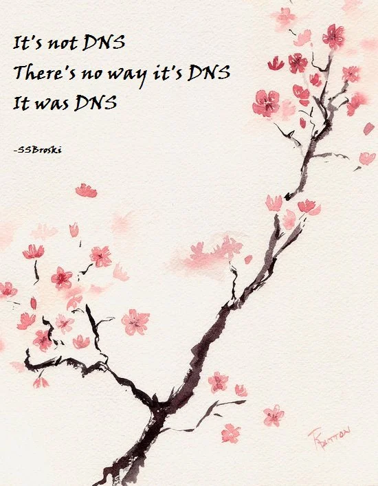

Part 1

What is the Domain Name System?

## DNS is hard ?

::: {.a .f38 .gray style="left:56px;top:140px;width:590px;line-height:1.4"}
The only three hard problems in computer science are **cache invalidation** and **naming things**.

And **DNS is a caching system for names of things.**

(And off-by-one errors)
:::

{.absolute left=785 top=309 width=313 height=313}

## Before we start {.quiz-slide}

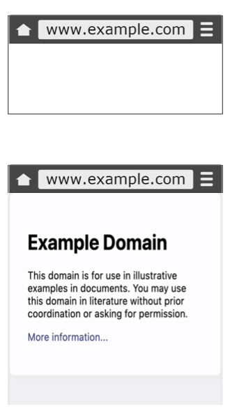{.absolute left=125 top=125 width=311 height=540}

::: {.a .f37 .gray style="left:483px;top:211px;width:760px"}
What is happening behind the scenes ?
:::

::: {.a .f37 .gray style="left:483px;top:407px;width:760px"}
What do you know about the protocol allowing the name to be translated into technical information ?
:::

## Part 1: DNS Overview {.pillars-slide}

1

How DNS is organized

2

How a name is resolved

3

Advanced DNS concepts

::: notes
The three parts ahead: how DNS is organized (namespace, zones, records), how a name is resolved, and advanced DNS concepts.

First part: how DNS is organized.
:::

## What is DNS ?

::: {.a .f32 style="left:44px;top:124px;width:1192px"}
**DNS is a distributed, hierarchical system that translates names into the data needed to reach a service.**
:::

Website

Where is www.example.com? → its IP address

E-mail

Where do I deliver e-mail for example.com? → its mail servers

Address

Which name is behind this IP address? → a name

{.absolute left=190 top=372 width=900}

::: {.a .f28 style="left:44px;top:560px;width:1192px"}
**Critical infrastructure:** when DNS fails, everything that uses names fails with it.
:::

::: notes
"DNS" can mean the system (Domain Name System) or the infrastructure running it (Domain Name Servers). Both meanings are used in this course.

The three cards are the three everyday uses, in plain words. Their record types (A/AAAA, MX, PTR) come later, on "Types of DNS Record": no need to name them yet.

A recent example of "critical": in October 2025, a race condition in AWS's own DNS automation left the DynamoDB endpoint in us-east-1 with an empty DNS record. Services depending on it failed for hours. It was a software fault, not an attack.
:::

## DNS Features

Globally Distributed

Multiple DNS servers managed by different operators

Loosely coherent

One global system, but caches can briefly keep old answers until their TTL expires

Scalable

The system can be scaled up and multiple servers can be added

Reliable

Failure tolerance due to hierarchical distributed architecture and local caches

Dynamic

Anyone can add domains and records without causing outage

## DNS Protocol

::: {.absolute left=60 top=118 width=1180 .f27}
- DNS is a client-server protocol
  - The **stub resolver** on your device asks for a **function** (IP, mail server …) of a **name**
  - The **recursive resolver**, a DNS server, finds the answer and responds with the record
- Requests and responses are normally sent via **UDP/53**
- Also uses **TCP/53** for large responses
  - Ex: copying all of a server's data to another server, answers too large for UDP (see EDNS later)
:::

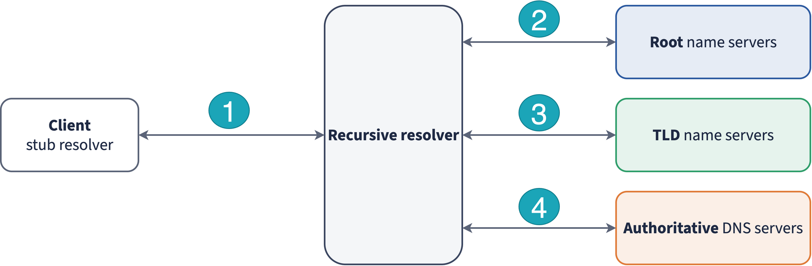{.absolute left=230 top=405 width=820}

## DNS Namespace Hierarchy

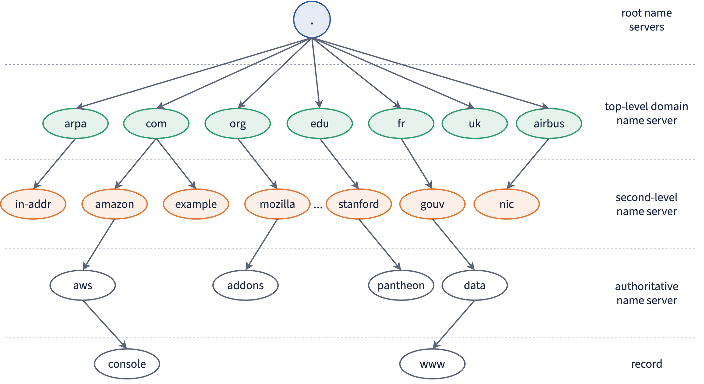{.absolute left=200 top=104 width=1040}

[13 root server names](https://www.internic.net/domain/named.root), [2,048 instances](https://root-servers.org/) (Nov 2026)

[1436 TLDs](https://data.iana.org/TLD/tlds-alpha-by-domain.txt) (Nov 2026)

[~400 million domains](https://investor.verisign.com/news-releases/news-release-details/dnibcom-reports-internet-has-4016-million-domain-name) (Q2 2026)

<b>Anycast:</b> one IP address, served from many sites

::: notes
The servers column shows who usually answers at each level, but delegation is a choice for each operator, as the next slide shows. Anycast is why 13 names are not a bottleneck: each query goes to the nearest of many servers sharing the same address.
:::

## Domain or Zone? Delegation

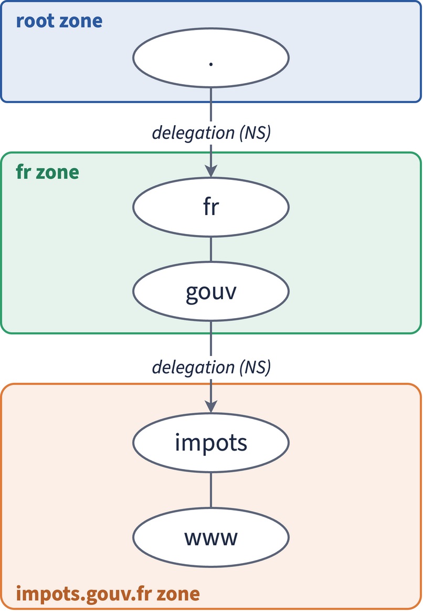{.absolute left=110 top=122 width=370}

::: {.absolute left=590 top=115 width=660 .f25 .incremental}
- A **zone** is the part of the tree managed as one unit. Its data is served by its **authoritative** name servers.
- A **delegation** is how a parent zone hands over a subtree, using NS records. This is the **referral** you will see in a resolution.
- A domain is not always a zone: gouv.fr has no NS records. It lives in the fr zone, which delegates impots.gouv.fr directly.
- **Glue:** dns1.impots.gouv.fr is inside the zone it serves. To break the loop, the parent also gives its address in the referral.
:::

<pre class="a terminal fragment" style="left:590px;top:450px;width:650px;font-size:20px;line-height:1.4">❯ dig NS gouv.fr +short
<b>(no answer)</b>
❯ dig NS impots.gouv.fr +short
dns1.impots.gouv.fr.
dns2.impots.gouv.fr.</pre>

::: notes
This is the slide to come back to whenever students ask why a root server does not simply answer. The root zone only holds the delegation to fr, and the fr zone only holds the delegation to impots.gouv.fr.

The data here was checked in November 2026 with dig +trace. It may change: rerun it before class. Domains can also keep a subdomain in the same zone, as gouv shows: delegating is the operator's choice.

To show the glue: dig +norecurse NS impots.gouv.fr @d.nic.fr returns the two NS records, then their A records in the additional section.
:::

## Who is responsible for DNS ?

::: {.absolute left=46 top=112 width=1192 .f27 .m64 .lh14 .incremental}
- **ICANN (Internet Corporation for Assigned Names and Numbers)**: Oversees the global DNS structure, including the policies governing domain name registration.
- **IANA (Internet Assigned Numbers Authority)**: Part of ICANN, IANA coordinates key technical aspects of DNS, including the root zone. It allocates IP address blocks and records top-level domains (TLDs). The root servers themselves are run by 12 independent operators.
- **Registry Operators**: Responsible for specific TLDs (like Verisign for .com), they maintain the records of domains under each TLD.
- **Registrars**: Accredited companies (e.g., GoDaddy) that allow individuals and organizations to register domain names.
- **ISPs and Network Admins**: Provide recursive resolvers, translating domain names to IP addresses for end-users.
:::

## Types of TLDs

Country code

Generic

Special use

<h3>ccTLD</h3>
.fr .uk .ca .ae

Two letters, one per country or territory.

<h3>IDN ccTLD</h3>
.中国 .рф .مصر

Country codes written in a non-Latin script, such as Chinese, Cyrillic or Arabic.

<h3>gTLD</h3>
.com .org .airbus

Three or more characters. Brand TLDs since 2012; a 2026 round drew 1,615 applications.

kind of gTLD<h3>Unsponsored</h3>
.com .net

Run under ICANN policy for the whole Internet.

kind of gTLD<h3>Sponsored (sTLD)</h3>
.aero .edu

A sponsor decides who may register, for one community.

<h3>[Special-use names](https://www.iana.org/assignments/special-use-domain-names/special-use-domain-names.xhtml)</h3>
.arpa .local .test .onion

.arpa runs Internet infrastructure, such as reverse lookups. The others are reserved and never sold.

::: notes
The 2026 round closed on 12 August 2026. These are applications, not new TLDs: none was delegated as of November 2026.

Sponsored and unsponsored are both kinds of gTLD, from ICANN's earlier rounds. IANA's root database now simply lists them all as "generic".
:::

## DNS Terminology: “name” decomposition

::: {.absolute left=144 top=127 width=1069 .f24 .gray}
A **Fully Qualified Domain Name** is an absolute name containing the host and the domain. **A proper FQDN ends with a dot**, indicating the root of the DNS hierarchy.
:::

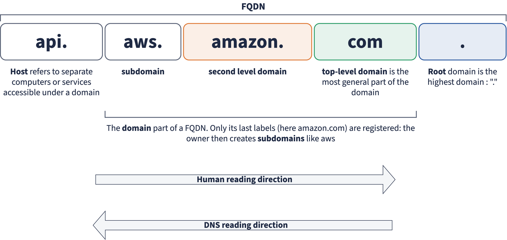{.absolute left=160 top=215 width=960}

::: notes
Root domain is the highest domain : “.”

A top-level domain, or TLD, is the most general part of the domain. The top-level domain is the furthest portion to the right (as separated by a dot)

A “subdomain” refers to any domain that is part of a larger domain. In this case, “amazon.com” can be said to be a subdomain of “com”. This is typically just called the domain or the “amazon” portion is called a SLD, which means second level domain. DNS works in a hierarchy. Each domain can control “subdomains” that are located under it. This is usually what we mean by subdomains. The difference between a host name and a subdomain is that a host defines a computer or resource, while a subdomain extends the parent domain. It is a method of subdividing the domain itself.

Within a domain, the domain owner can define individual hosts, which refer to separate computers or services accessible under a domain

A Fully Qualified Domain Name is an absolute name that specifies its location in relation to the absolute root of the domain name system. This means that it specifies each parent domain including the TLD. A proper FQDN ends with a dot, indicating the root of the DNS hierarchy.
:::

## Types of DNS Record

::: {.absolute left=50 top=124 width=1180 .f25}
There are dozens of DNS record types ([list here](https://en.wikipedia.org/wiki/List_of_DNS_record_types)). The most common are:
:::

A AAAA

Links the hostname to the IP address. (A: IPv4, AAAA: IPv6)

CNAME

Point a Domain Name to another Domain Name

TXT

Text records are used to store descriptive text (site verification, SPF/DMARC mail record, etc)

MX

Mail Exchanger record points to the email server responsible for the domain, with a priority.

SOA

identify the Start of Authority with essential parameters of the zone (primary server, contact info, TTL for negative answers)

NS

NameServer records identify the responsible DNS Server for answering this zone.

PTR

Pointer record links an IP address to a domain name (opposite to A)

SRV

SeRVice record points to a host and its corresponding port for a specific service with a priority. It is used for discovering a service.

::: {.absolute left=148 top=636 width=984 .f21 .center .gray .fragment}
CAA, LOC, HINFO, HTTPS/SVCB, RRSIG, NSEC, DNSKEY are also seen but are more “advanced ones”
:::

## Quiz time {.quiz-slide}

::: {.absolute left=43 top=344 width=612 .f37 .center}
www.pollev.com/jmanteau973
:::
{.absolute left=643 top=91 width=585 height=585}

## Part 1: DNS Overview {.pillars-slide}

1

How DNS is organized

2

How a name is resolved

3

Advanced DNS concepts

::: notes
Second part: how a name is resolved, step by step, and how caches change what you see.
:::

## DNS Client: nslookup/dig

::: {.absolute left=34 top=130 width=1245 .f32}
**dig** gives you the full detail, so it is the better tool for DNS investigation and testing.

**nslookup** was once marked as deprecated, but ISC later reversed that. It is almost universally available (e.g. built into Windows, where PowerShell also offers Resolve-DnsName).

So my recommendation is:

- Master and have dig on your system for DNS investigation and testing.
- Know enough nslookup for basic troubleshooting on other devices
:::

::: {.a .f32 style="left:34px;top:490px;width:1100px;font-weight:bold"}
Live demo: reading a first dig answer
:::

<pre class="a terminal" style="left:34px;top:545px;width:1200px;font-size:26px;line-height:1.45">❯ dig www.example.com +noall +answer
<b>name               TTL   class  type   value</b>
www.example.com.   300   IN     A      167.98.23.23</pre>

::: notes
Run this live with any name, and read one answer line column by column. Keep it short: students do the full dig lab at the end of this part, once they have seen resolution, TTL and reverse DNS. The address on the slide is the one used in the next diagrams; a live answer will differ.
:::

## Full DNS Query and types of DNS Server

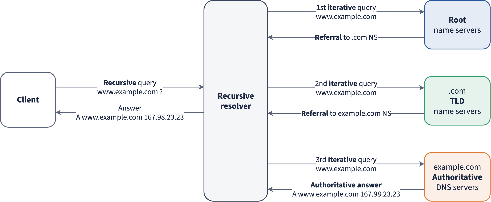{.absolute left=100 top=112 width=1080}

::: {.absolute left=100 top=572 width=1080 .f22 .gray}
Think of a library: the recursive resolver is the librarian, the root an index pointing to a room, the TLD server a rack of books, and the authoritative server the dictionary holding the answer. A **forwarder** is a resolver that passes queries to another resolver instead of walking the tree itself.
:::

::: notes
A Recursive DNS resolver responds to a recursive request from a client and takes the time to track down the DNS record (like a librarian fetching a book for a client querying it with its identifier)

Root nameserver is the first step in translating (resolving) human readable host names into IP addresses. It can be thought of like an index in a library that points to a room with different racks of books.

TLD nameserver can be thought of as finding a specific rack of books in a library. This nameserver is the next step in the search for a specific IP address.

Authoritative nameserver - This final nameserver can be thought of as a dictionary on a rack of books, in which a specific name can be translated into its definition. The authoritative nameserver is the last stop in the nameserver query. If the authoritative name server has access to the requested record, it will return the IP address for the requested hostname back to the DNS Recursor (the librarian) that made the initial request.
:::

## [Full DNS Query](https://sequencediagram.org/index.html#initialData=FAFwliA2CmAECqBnaAnWARAcgZVgJWkQHtIBXcIgO2GADMqQBDAd0KIFtoBWYyMAE1i0AjAAYAnBmgA3MAGNodBizaceJAUIBMAZh35oc0ikRhpcLNiWUmrYmt6bau-XiJEQGHNdurujwWc9WAAVABl0WAA6OQ5YTEZOWGxUcxMfFXt-DUCXWGgAD0SABxgYuIBBcgALIhQIRnBzL1wUlDTEGmB0GXloAFoAPgIjEzMLHAAuZhmowpKy2PZYAH5gRjkmxotehRpGACMiAtgiNINR02bLSewmFE8iWlgUQ2MridwARVJUAE8hHV8kV2KVoOV2DQRu9xi0hm4PC1JsJEJ4AI6-FB-SawGbMOYgsEQ9abMzbfDuTyWElbEBwaFja7eBkfFoAHn6CKpUwItFQKEYkFgICI0SW8SsNH40A2tPplJaULejM+Q3CkQh8UScDaHUmWkoggx-xxeIJC3BSxpZLpoQiYriCSSutQnWALNhlg56odyydOtSrsmvP5guFovmoMWjqs0tlNrgPs1-uSgfSHqZ2CGkaJ4qqIFq9SYTU+qfaQZ0KCNmOxuNmOejkPj0nJDctlRqdQaJZaZY67uVrK9-Tbmvzhe7npwfaDFUoiFYKBxFTr+NH4uEADYAOxRcQADiiuiPOmAcdJLdt647Ba7xanrTTnXPcouMMz6yOJzOqDfKqRACihqnM8ryXA+sA-P83S7NAHIZp8kxzguqDLqu5pRu2yxbruB4nieUoyhe5I9LIChAA)

::: {.absolute left=90 top=110 width=1100}
::: {.r-stack}
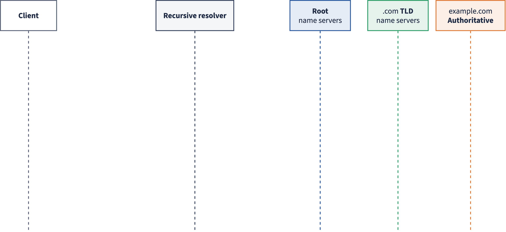

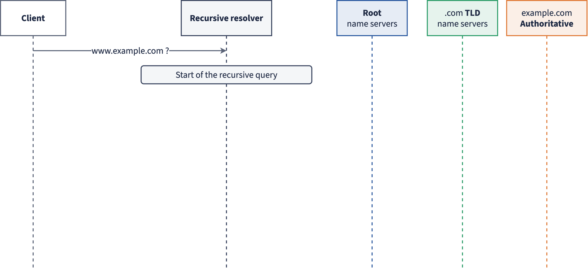{.fragment}

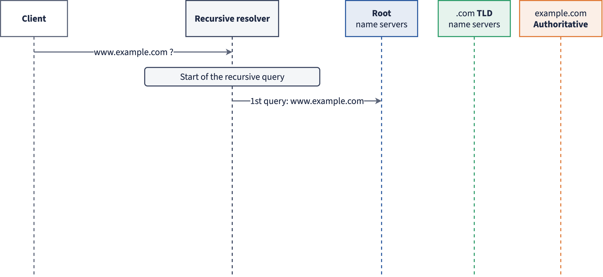{.fragment}

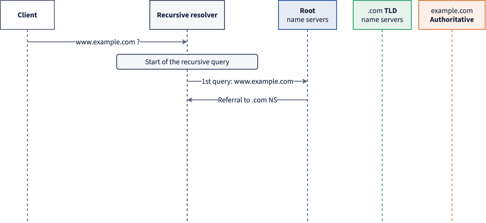{.fragment}

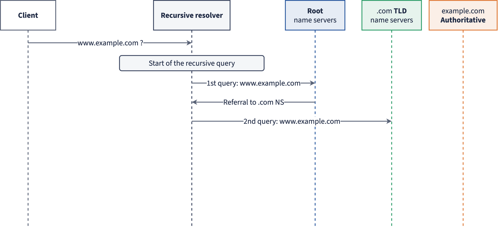{.fragment}

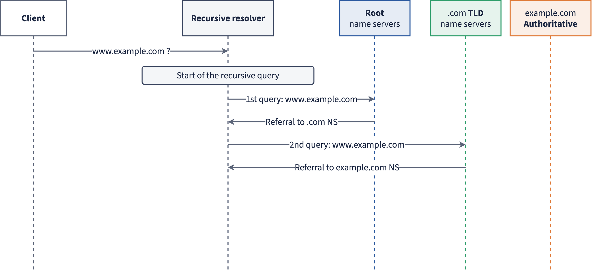{.fragment}

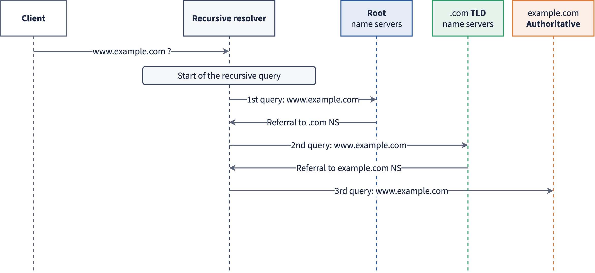{.fragment}

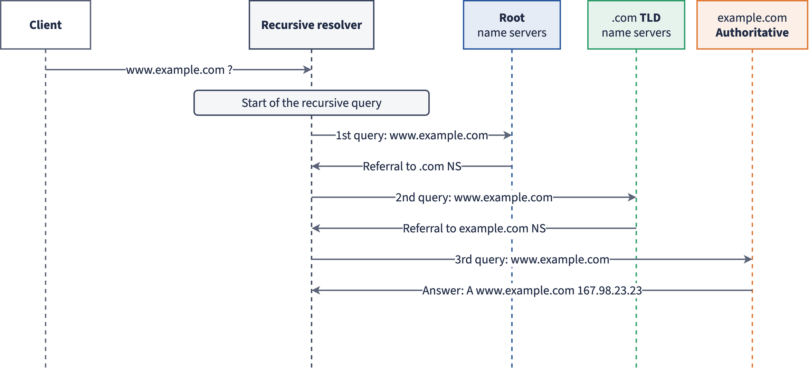{.fragment}

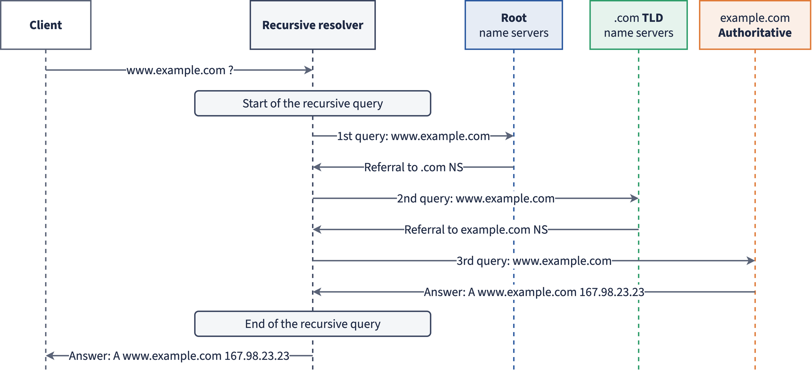{.fragment}
:::
:::

::: {.absolute left=90 top=624 width=1100 .f21 .gray .fragment}
This is the classic view, with the full name sent at each step. With QNAME minimisation (RFC 9156), a resolver may send each server only the part it needs: better for privacy, same result.
:::

## Worked example: a CNAME restarts the resolution

<pre class="a terminal" style="left:44px;top:106px;width:1200px;font-size:20px;line-height:1.4">❯ dig www.example.com +noall +answer
www.example.com.                  300    IN  CNAME  www.example.com-v4.edgesuite.net.
www.example.com-v4.edgesuite.net. 21600  IN  CNAME  a1422.dscr.akamai.net.
a1422.dscr.akamai.net.            20     IN  A      23.72.250.233</pre>

::: {.predict style="left:44px;top:296px;width:1192px"}
Starting from an empty cache: how many zones does the resolver have to visit?
:::

::: {.absolute left=44 top=342 width=1192 .f22 .incremental}
1. The recursive resolver reaches the example.com authoritative server: the answer is not an IP, but a **new name**.
2. New name, new zone: it **starts again** for www.example.com-v4.edgesuite.net (root, then .net, then edgesuite.net). Another CNAME.
3. It starts again for a1422.dscr.akamai.net (.net, then akamai.net). This time, an **A record**.
4. The client receives the whole chain in one answer. Each line keeps its own TTL.
:::

::: {.absolute left=44 top=598 width=1192 .f22 .gray .fragment}
Why so many steps? This site uses a **CDN** (Content Delivery Network): Akamai serves it from many locations and often protects it too. The CNAME hands the name over to the CDN's own zone.
:::

::: notes
Resolvers skip the steps they already have in cache, so .net is usually not asked twice. Point out the very different TTLs: the last one is short so that the CDN can change the address quickly.

This prepares the next exercise, where www.impots.gouv.fr uses the same pattern.
:::

## Full DNS query: sequence diagram {.lab-slide}

{.absolute .lab-icon left=96 top=140 width=150 height=150}

::: {.lab-banner}
Practical Exercise: Full DNS Query for www.impots.gouv.fr
:::

::: {.absolute left=96 top=320 width=1104 .f27}
Based on the sequence diagram (click on the link in its title), please recreate the full chain of the resolution of www.impots.gouv.fr

Tip: `dig +trace www.impots.gouv.fr` shows each step from the root.
:::

<pre class="a terminal" style="left:96px;top:462px;width:1090px;font-size:20px;line-height:1.4">❯ dig www.impots.gouv.fr +noall +answer
www.impots.gouv.fr.	129	IN	CNAME	www.impots.gouv.fr.edgesuite.net.
www.impots.gouv.fr.edgesuite.net. 21429	IN CNAME a1352.dscb.akamai.net.
a1352.dscb.akamai.net.	20	IN	A	95.100.133.81
a1352.dscb.akamai.net.	20	IN	A	95.100.133.74</pre>

## TTL: Definition

::: {.absolute left=44 top=128 width=1192 .f27}
TTL (Time To Live) is a value configured on the DNS Server which informs the client / resolver **how long it should store the DNS record details before sending the query to get the updated information**. The DNS Server returns the TTL Value along the record.

Per the DNS RFC, DNS TTL values can be configured from 0 seconds to 24855 days (about 68 years).

However [DNS client implementations](https://www.ctrl.blog/entry/dns-client-ttl.html) can have different values.

This is why I personally advise TTL values between 1min and 1 day.
:::

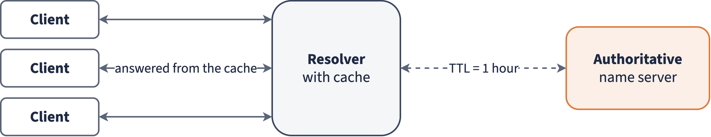{.absolute left=210 top=500 width=860}

::: notes
A or AAAA Record: Your A records should be set to a faster pace TTL as IP address lookups can change frequently if usage of CDN. A standard baseline would be around the 1-hour mark but may need to be adjusted depending on how often changes need to be made on an emergency basis (30 seconds in case of rapid change).

CNAME Record: Your main website URL, for example (www.example.com), should usually never change. It is recommended that you set your TTL for something longer than the average session time (for example 10 min).

TXT Record: Widely used for DKIM records, email security and verifying domain ownership. TXT records are rarely changed so anywhere within the 1 – 12-hour timeframe should suffice.

MX Record: Your mail exchange TTL can be set between the 12-24 hour range, but you may want to consider placing it lower in case of emergencies; somewhere in the 1-4 hour range would be useful as well.
:::

## DNS Cache

::: {.absolute left=44 top=124 width=1192 .f25}
DNS Cache (sometimes called a DNS resolver cache) is a temporary database, maintained by an OS, that contains records of all recent DNS lookups.

Before attempting to resolve a name, the OS will check if the entry is present in the cache. The entries are cleared according to their TTL (a resolver may still serve expired data if the authoritative servers are unreachable, RFC 8767). Before requesting, it will also check the “static cache”: the hosts file.

A browser will also have a DNS cache that it will use before using the OS cache (then the default recursive resolver if not in OS cache, OR its own configured resolver)
:::

<table class="cache" style="top:420px">
<tr><th></th><th>Windows</th><th>Linux (if present)</th><th>macOS</th><th>Chrome</th><th>Firefox</th></tr>
<tr><td>Check Cache</td><td>ipconfig /displaydns</td><td>resolvectl show-cache (systemd 254+)</td><td>No simple listing command</td><td>chrome://net-internals/#dns (looks up one name)</td><td>about:networking#dns</td></tr>
<tr><td>Clear Cache</td><td>ipconfig /flushdns</td><td>resolvectl flush-caches</td><td>sudo dscacheutil -flushcache; sudo killall -HUP mDNSResponder</td><td>chrome://net-internals/#dns (Clear host cache)</td><td>about:networking#dns (Clear DNS Cache)</td></tr>
</table>

::: notes
Walk through the order: browser cache, OS cache (including the hosts file), then the recursive resolver, which has its own cache. This explains the classic "I changed the record but still see the old answer": each layer keeps it until the TTL expires. To check a change, flush the layers you control, or query the authoritative server directly with dig.

Attackers like the hosts file for the same reason: an entry there beats any DNS answer.
:::

## TTL: Lookup

<pre class="a terminal" style="left:44px;top:140px;width:900px;font-size:22px;line-height:1.45">❯ dig wikipedia.org +noall +answer
wikipedia.org.   	 <b>403</b>    IN    A    185.15.58.224
❯ dig ns wikipedia.org +noall +answer
wikipedia.org.   	 2907    IN    NS    ns0.wikimedia.org.
wikipedia.org.   	 2907    IN    NS    ns2.wikimedia.org.
wikipedia.org.   	 2907    IN    NS    ns1.wikimedia.org.
❯ dig wikipedia.org +norecurse @ns0.wikimedia.org +noall +answer
wikipedia.org.   	 <b>600</b>    IN    A    185.15.58.224</pre>

::: {.a .r .f25 .fragment fragment-index=1 style="left:968px;top:210px;width:270px;font-weight:bold"}
Resolver's remaining TTL
:::
::: {.a .r .f25 .fragment fragment-index=2 style="left:968px;top:290px;width:270px;font-weight:bold"}
Locate and direct Query to authoritative NS
:::
::: {.a .r .f25 .fragment fragment-index=4 style="left:968px;top:386px;width:270px;font-weight:bold"}
Authoritative TTL answer
:::

::: {.predict .fragment fragment-index=3 style="left:44px;top:456px;width:1192px"}
Same record, asked directly to the authoritative server: will the TTL be 403, lower, or higher?
:::

::: {.absolute left=44 top=520 width=1192 .f27 .fragment fragment-index=5}
If your default DNS server is not the authoritative server for the zone you are digging (so 99,99% of the time) dig will show the time remaining (until the next refresh) instead of the raw TTL value in this position.
:::

## Reading a dig answer: the sections

<pre class="a terminal" style="left:43px;top:108px;width:850px;font-size:16px;line-height:22px">❯ dig www.example.com
; &lt;&lt;&gt;&gt; DiG 9.20.10 &lt;&lt;&gt;&gt; www.example.com
;; global options: +cmd
;; Got answer:
;; -&gt;&gt;HEADER&lt;&lt;- opcode: QUERY, status: <b>NOERROR</b>, id: 17148
;; flags: <b>qr rd ra</b>; QUERY: 1, ANSWER: 4, AUTHORITY: 0, ADDITIONAL: 1
;; OPT PSEUDOSECTION:
; EDNS: version: 0, flags:; udp: 1232
; COOKIE: e2abe7f2209ce7a5… (good)
;; QUESTION SECTION:
;www.example.com.                  IN  A
;; ANSWER SECTION:
www.example.com.                  300    IN  CNAME  www.example.com-v4.edgesuite.net.
www.example.com-v4.edgesuite.net. 21600  IN  CNAME  a1422.dscr.akamai.net.
a1422.dscr.akamai.net.            20     IN  A      23.72.250.233
a1422.dscr.akamai.net.            20     IN  A      23.72.250.203
;; Query time: 185 msec
;; SERVER: 192.168.227.200#53(192.168.227.200) (UDP)
;; WHEN: Tue Nov 25 09:56:07 CET 2025
;; MSG SIZE  rcvd: 185</pre>

::: {.tag .fragment fragment-index=1 style="left:912px;top:232px;width:330px"}
Header: status, flags, and how many records in each section
:::
::: {.tag .fragment fragment-index=2 style="left:912px;top:302px;width:330px"}
EDNS: room for answers over 512 bytes
:::
::: {.tag .fragment fragment-index=3 style="left:912px;top:360px;width:330px"}
Question: the name, class and type you asked
:::
::: {.tag .fragment fragment-index=4 style="left:912px;top:436px;width:330px"}
Answer: the records, each line with its own TTL
:::
::: {.tag .fragment fragment-index=5 style="left:912px;top:536px;width:330px"}
Footer: which server answered, how fast, over UDP or TCP
:::

::: notes
The same CNAME chain as the worked example, as dig prints it by default. Read it top to bottom once, then remind students that `+noall +answer` keeps only the answer section. The next slide decodes the status and flags from the header.
:::

## Reading a dig answer: status and flags

<table class="status">
<tr><th>Status</th><th>Meaning</th></tr>
<tr><td>NOERROR</td><td>The query worked</td></tr>
<tr><td>NXDOMAIN</td><td>This name does not exist</td></tr>
<tr><td>NODATA</td><td>The name exists, but has no record of this type. Not a real status: NOERROR with 0 answers</td></tr>
<tr><td>SERVFAIL</td><td>The server could not give a valid answer (e.g. DNSSEC failure)</td></tr>
<tr><td>REFUSED</td><td>The server declines to answer (policy)</td></tr>
</table>

::: {.absolute left=850 top=112 width=400 .f25}
**Flags**

- `aa` authoritative answer
- `rd` recursion desired
- `ra` recursion available
- `tc` truncated
- `ad` validated by DNSSEC
:::

::: {.predict style="left:43px;top:394px;width:1194px"}
impots.gouv.fr has no IPv6 address. Asking for AAAA gives NOERROR, NXDOMAIN or SERVFAIL?
:::

<pre class="a terminal" style="left:43px;top:438px;width:1194px;font-size:20px;line-height:1.4">❯ dig @1.1.1.1 AAAA impots.gouv.fr
;; status: NOERROR      ;; flags: qr rd ra      ANSWER: 0     <b>(this is NODATA)</b>
impots.gouv.fr.   <b>2908</b>   IN   SOA   dns0.dgfip.finances.gouv.fr. ... <b>3600</b></pre>

::: {.absolute left=43 top=598 width=1194 .f25 .fragment fragment-index=2}
**Negative caching:** "this does not exist" is cached too, so the same lookup is not repeated. The last SOA field sets the limit (here 3600 s), and 2908 s remain for this resolver. So a record you just created can stay invisible for a while.
:::

::: notes
Output captured in November 2026; rerun it before class. Flags tell you who answered: the previous slide's query to the authoritative server returns qr aa, and the same query to a resolver returns qr rd ra.

The negative TTL is the lower of the SOA's own TTL and its last field, the MINIMUM (RFC 2308). Students meet NXDOMAIN again with DGA, and NODATA with RPZ.
:::

## Part 1: DNS Overview {.pillars-slide}

1

How DNS is organized

2

How a name is resolved

3

Advanced DNS concepts

::: notes
Third part: advanced DNS concepts: reverse lookup, answers that depend on the client, load balancing and zone transfers.
:::

## Reverse lookup and PTR records

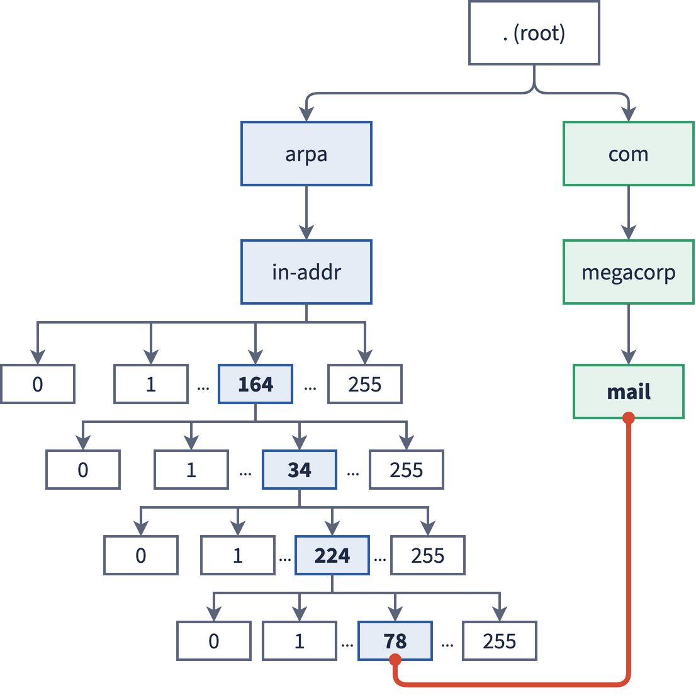{.absolute left=25 top=118 width=440}

::: {.absolute left=490 top=114 width=750 .f22 .rev}
::: step
**Goal:** find the name behind an IP address. Logs, mail servers and traceroute use it to show names instead of numbers.
:::

::: {.step .fragment}
**How:** DNS can only look up names, so the address becomes one. Its numbers are written backwards under `in-addr.arpa`, and a **PTR** record there holds the answer.

<pre class="terminal">❯ dig -x 164.34.224.78 +short
<b>mail.megacorp.com.</b>
stored as: 78.224.34.164.in-addr.arpa.
           PTR mail.megacorp.com.</pre>
:::

::: {.step .fragment}
**Why backwards?** A name is read from right to left: `com`, then `megacorp`, then `mail`. An IP address is read the other way: `164` (the network) first, `78` (the machine) last. Flipped, it reads like a name, and the tree starts with `164`.

The network then sits at the **end** of the name. DNS delegates by name ending, so the owner of `164.34.x.x` gets its own reverse zone, `34.164.in-addr.arpa`, just like a domain.
:::
:::

::: notes
The technical reason is delegation. RFC 1035 (section 3.5): "The reversal, though awkward to read, allows zones to be delegated which are exactly one network of address space." DNS only hands over zones by suffix (the end of a name), while IP blocks are handed out by prefix (IANA, then a registry, then an ISP, then a company). Reversing turns the prefix into a suffix.

Caching is a side effect, not the reason: the resolver caches the NS referral for 34.164.in-addr.arpa, so the next reverse lookup in that network goes straight to the company's server.

Delegation can only happen at label boundaries, so at /8, /16 or /24. A customer with a /26 needs the CNAME trick of RFC 2317 (classless delegation). IPv6 works the same way under ip6.arpa, with one label per hexadecimal digit, so it can delegate on any 4-bit boundary.
:::

## DNS Concepts: Split Horizon

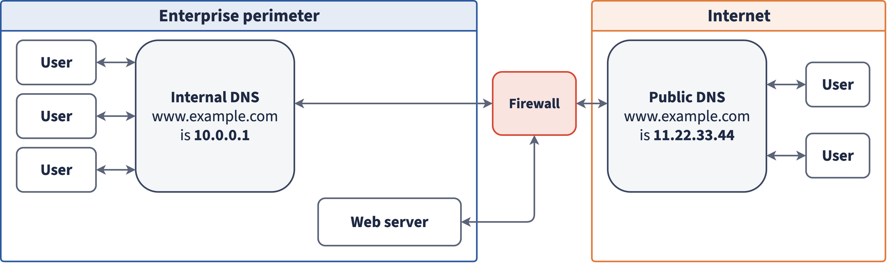{.absolute left=115 top=108 width=1050}

::: {.absolute left=115 top=432 width=1050 .f22}
Split Horizon is the DNS concept that the same name gets a different answer depending on where the resolution is done. It can be implemented in different ways:

- DNS Views
- Different DNS servers (hence different zones)
- DNS Global Load Balancing
- RPZ (seen in the next part)
:::

## DNS Concepts: Views

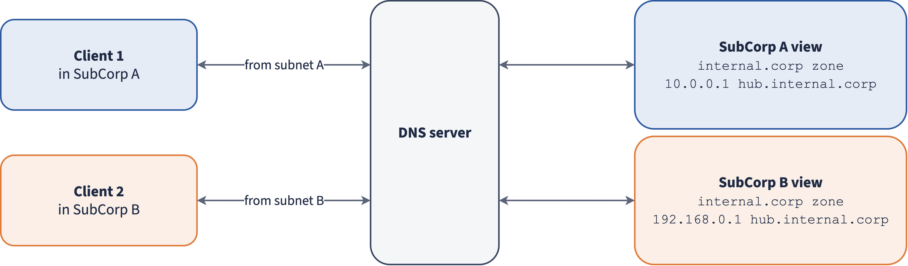{.absolute left=40 top=115 width=1200}

::: {.absolute left=105 top=500 width=1098 .f29 .center}
The DNS server matches the client subnet and chooses the right view to answer from. This is simple here because the server holds both versions of the zone itself.
:::

## EDNS: bigger answers, and the client's location

::: {.absolute left=43 top=115 width=1194 .f25}
- **EDNS(0)** extends the DNS message. A client can announce that it accepts more than the original 512 bytes over UDP. DNS Flag Day 2020 recommended 1232 bytes, to avoid IP fragmentation.
- An answer that does not fit comes back truncated (`tc` flag), and the client retries over TCP.
- **Client Subnet (ECS)** is an EDNS option: the resolver tells the authoritative server which network the client is on, so it can answer with a nearby server. It also shares part of the client's address with that server.
:::

<pre class="a terminal" style="left:43px;top:395px;width:1194px;font-size:22px;line-height:1.4">❯ dig @8.8.8.8 www.wikipedia.org +subnet=129.20.0.0/24 +short     <b># a network in France</b>
dyna.wikimedia.org.
<b>185.15.58.224</b>
❯ dig @8.8.8.8 www.wikipedia.org +subnet=138.186.8.0/24 +short    <b># a network in Chile</b>
dyna.wikimedia.org.
<b>195.200.68.224</b></pre>

::: notes
This is one way to build the "DNS Global Load Balancing" of the Split Horizon slide. Students use the same +subnet option in the dig lab. Output captured in November 2026; rerun it before class. Not every resolver or authoritative server supports ECS.
:::

## DNS Concepts: Round Robin

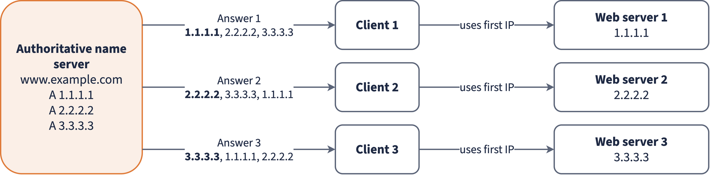{.absolute left=165 top=112 width=950}

::: {.absolute left=81 top=360 width=1120 .f25}
- **What it is**: A DNS load balancing method managed by the authoritative nameserver, without needing dedicated load-balancing hardware.
- **Use Cases**: Ideal for websites or services hosted on multiple redundant servers or when a single DNS name directs to multiple proxy servers.
- **How it works**: The nameserver returns all the server IPs and rotates their order in each response. Clients mostly use the first one (shown in the diagram), which spreads the traffic.
- **Limits**: Caching makes the balancing rough, and a server that is down keeps being handed out.
:::

## DNS Concepts: Primary, Secondary & Zone Update

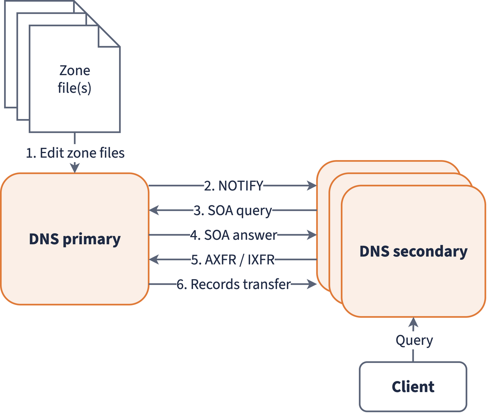{.absolute left=97 top=150 width=560}

::: {.absolute left=371 top=150 width=866 .f27}
DNS Zone Primary / Secondary (used to be called Master / Slave) is a concept which allows DNS servers to scale while keeping one unique management point for zone edition.

The primary contains the DNS data source of truth.
:::

::: {.absolute left=735 top=457 width=491 .f22}
The secondary reads the primary's SOA record, checks the serial number and requests a zone transfer if it is higher
:::

::: {.absolute left=736 top=610 width=542 .f22}
It is impossible to determine from a query result that it came from a zone primary or secondary.
:::

## Request DNS with dig {.lab-slide}

{.absolute .lab-icon left=96 top=140 width=150 height=150}

::: {.lab-banner}
Practical Exercise: Request DNS with Dig
:::

::: {.absolute left=96 top=350 width=760 .f29}
You now have what the questions need: records, resolution, TTL, reverse DNS and split horizon.

The lab is in `dns-dig-lab`, with a one-page **dig cheat sheet**. Then check your answers and compete on **Dig Quest**: scan the code on the leaderboard.
:::

dig lab

Cheat sheet

::: notes
Create the Dig Quest session before class (see dns-dig-lab/game/README.md) and project the leaderboard: it shows the join QR code for the session. Closing the session unlocks the explanations, which replace a slide-by-slide correction.
:::

## Quiz time {.quiz-slide}

::: {.absolute left=43 top=344 width=612 .f37 .center}
www.pollev.com/jmanteau973
:::
{.absolute left=643 top=91 width=585 height=585}

## Agenda {.agenda-slide}

1

DNS Overview<small>What is the Domain Name System?</small>

2

DNS Security<small>How attackers abuse DNS, and how to defend it</small>

3

Wrap-up<small>What to remember</small>

::: notes
End of part 1. Next: how attackers abuse DNS, and how to defend it.
:::

## DNS Security {.divider}

Part 2

How attackers abuse DNS, and how to defend it

## From Part 1 to Part 2: why attackers like DNS

::: {.absolute left=70 top=130 width=1140 .f32 .incremental}
- **DNS is allowed out** of almost every network, because everything depends on it.
- **The recursive resolver delivers any query** to the authoritative server of the domain, even if an attacker runs that server.
- **A name can carry data**: `<data>.s.attacker.com` reaches the attacker, and the answer can carry data back.
:::

<pre class="a terminal fragment" style="left:70px;top:500px;width:1150px;font-size:25px;line-height:1.6">Infected client → Enterprise resolver → Root, TLD → Attacker's server

<b>The resolution you just traced, with a different destination.</b></pre>

::: notes
This is the key idea of the second half. Nothing new is needed: it is the same resolution as in part 1, except that the attacker owns the last server. Ask the class what a firewall sees: only the client talking to its own resolver.
:::

## DNS in the kill chain

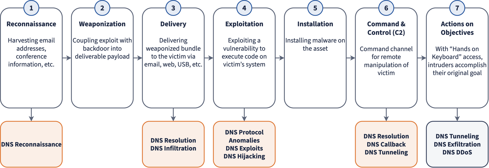{.absolute left=56 top=140 width=1168}

::: {.absolute left=51 top=600 width=1173 .f21 .gray .center}
The kill chain (Lockheed Martin) lists the stages of a cyberattack. DNS plays a role in most of them.
:::

::: notes
Use this as a map, not a list to memorise: the DNS terms in the orange and grey boxes are explained in the next slides. Ask for each stage how an attacker could use DNS before showing the boxes.

The kill chain gives the big picture. MITRE ATT&CK is the finer map used in practice: T1071.004 (C2 over DNS), T1568.001 (fast flux), T1568.002 (DGA).
:::

## Part 2: DNS Security {.pillars-slide}

1

How attackers abuse DNS

2

Detecting and blocking abuse

3

Protecting DNS itself

::: notes
The three parts ahead: how attackers abuse DNS, how to detect and block that abuse, and how to protect DNS itself.

First part: how DNS is abused to move data and control malware.
:::

## DNS as a transport: exfiltration

::: {.absolute left=50 top=124 width=790 .f22 .sp2 .sub25}
- Attacker registers a domain & sets up an authoritative DNS server on the Internet to act as the tunnel endpoint
- Data to be sent from inside network is:
  - Encrypted using public key
  - Encoded into a-z, 0-9 and – using algorithm such as Base32, which allows up to 110 bytes to be encoded into an FQDN
  - Divided into chunks of up to 63 characters (label limit)
  - Sent as individual queries in format of \<chunk\>.domain
- Queries can be sent direct (if allowed by firewall), via a network’s existing DNS servers or via proxies (e.g. request http://\<chunk\>.domain)
- If sent directly, the source address can be spoofed to make tracing harder
- Attacker’s authoritative server receives encoded chunks, reassembles data, decodes & decrypts using private key
:::

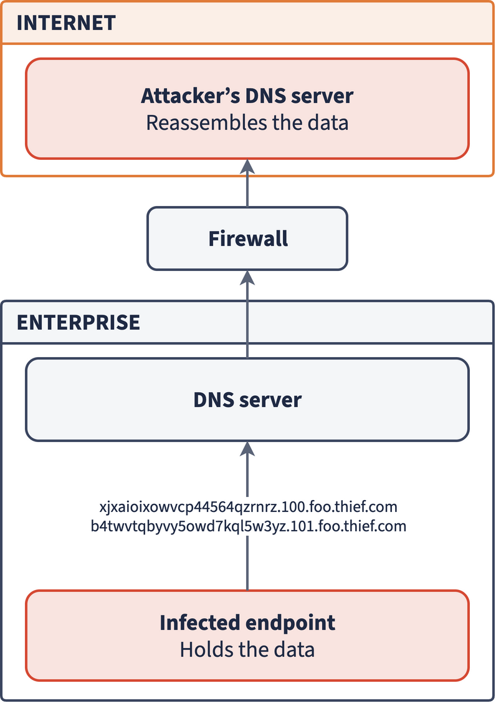{.absolute left=870 top=120 width=370}

::: notes
Follow the diagram from bottom to top, and link it to the bridge slide: the enterprise DNS server is simply doing its job. DNS names are case-insensitive, which is why the data is encoded in Base32 rather than Base64. Each query carries only a little data, so an exfiltration produces many queries: that is what detection will look for. Each name is also unique, because a repeated name would be answered from the resolver's cache and never reach the attacker.

Real case: SUNBURST (the SolarWinds compromise, 2020) encoded victim data in subdomains of avsvmcloud.com, then used a CNAME in the DNS answer to move chosen victims to the next C2 stage.
:::

## DNS as a transport: infiltration

::: {.absolute left=60 top=124 width=1170 .f25 .sp2 .sp3}
- Can be used to download a payload in a covert way for example.
- TCP features can be imitated by encoding the chunks with additional data, such as Checksum & Packet Number
- Data can be sent back in a variety of records, e.g.
  - A - allowing 4 bytes  (enough for codes, e.g. 1.1.1.200 = resend packet 200)
  - AAAA - allowing 16 bytes
  - MX record : 2 bytes + domain name (255 bytes)
  - CNAME - allowing up to 110 bytes in Base32
  - TXT - allowing N x 220 bytes in Base64 (up to RDATA limit of 64kB)
  - NULL - allowing up to 65,535 bytes in the record, in practice limited by the DNS message size
- Using TXT and NULL make transmission faster, at expense of easier detection
:::

::: notes
Same channel, opposite direction. The record type is a trade-off between speed and stealth: TXT and NULL carry the most data, but they stand out. NULL is a rarely used record type, which is exactly why it is suspicious.
:::

## DGA – Domain Generation Algorithm

::: {.a .f22 style="left:63px;top:110px;width:689px;line-height:1.5"}
An algorithm producing Command & Control (C2) rendezvous points dynamically

For example: every day malware connects to time-based server FQDN: *\<month\>-\<day\>-\<year\>.com* i.e. on December 24, 2017 malware connects to 2017-12-24.com

**Why?** The attacker registers just one of today's domains, while defenders would have to block them all.
:::

<table class="dga" style="position:absolute;left:63px;top:440px">
<tr><th>Family</th><th>Example domain</th></tr>
<tr><td>DirCrypt</td><td>vlbqryjd.com</td></tr>
<tr><td>Bamital</td><td>b83ed4877eec1997fcc39b7ae590007a.info</td></tr>
<tr><td>CCleaner</td><td>ab6d54340c1a.com</td></tr>
</table>

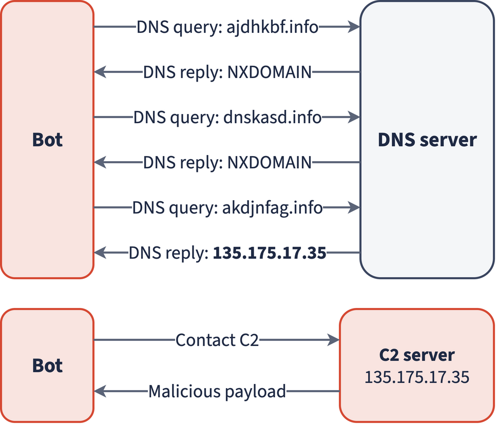{.absolute left=765 top=130 width=480}

::: notes
Point out the diagram: the bot gets NXDOMAIN answers until it hits the one domain the attacker registered. Many NXDOMAIN answers from one client are themselves a signal for detection.
:::

## C2 vocabulary

::: {.absolute left=60 top=135 width=1160 .f32}
**C2** (Command and Control) is how an attacker remotely drives the malware on a victim's machine.

- **Implant**: the software placed on the target to keep access and take orders
- **Beacon**: the implant regularly checks in with the C2 server for instructions
- **Jitter**: a random delay added between check-ins, to make the pattern less predictable
- **Fast flux**: hiding C2 servers behind rapidly changing addresses, using the short TTLs and round robin you already know

The next lab uses **Sliver**, an open-source C2 framework. Its implant talks to its server only through DNS queries.
:::

::: notes
The lab README has the longer list (staged payload, BOF, etc). Three words are enough to follow the lab.
:::

## Command and control over DNS {.lab-slide}

{.absolute .lab-icon left=96 top=140 width=150 height=150}

::: {.lab-banner}
Practical Exercise: DNS C2 with Sliver (Red Team)
:::

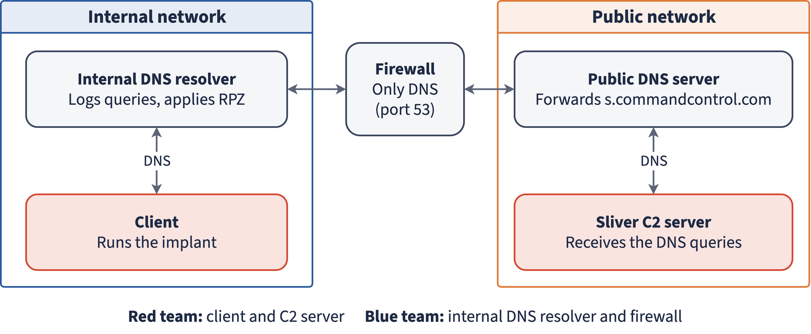{.absolute left=290 top=255 width=960}

Cyber lab

::: notes
Run the Red Team part only, then leave the lab running: the Blue Team part comes after the detection slides and uses the logs created here.
:::

## Part 2: DNS Security {.pillars-slide}

1

How attackers abuse DNS

2

Detecting and blocking abuse

3

Protecting DNS itself

::: notes
Second part: how to detect and block what we just did.
:::

## Lookalike Domain Detection

::: {.absolute left=87 top=128 width=1172 .f26}
- Detects from Newly Observed Domains (NOD), domain names that try to mimic popular domains (top-100 lists) or strategic domains for phishing (e.g. banks) and spamming.
- Detects domains that overlaps and/or have homograph n-grams, e.g. letter ‘O’ and number ‘0’ are considered homographs. Use distance analysis to detect the likelihood of lookalike attacks
- Detects
  - Letter replacement, example g00gle.com, gooogle.com, bankofthevvest.com, rn1cr0soft.com
  - apple.com  >>>  app**I**e.com (Arial) &nbsp;&nbsp;&nbsp;&nbsp; apple.com  >>>  app**I**e.com (Cutive)
  - TLD change, example, walmart.cc
  - other generic highly resembled domains, example: bankofAmericas.com
- SOA record is analyzed and used for catching false positives.
:::

::: notes
This is a defensive technique: it works on newly observed domains, before any attack has been seen. Ask the class to spot the fake in each example before showing it in the other font.
:::

## Which of these are malicious? {.exercise-slide}

::: {.absolute left=70 top=130 width=1172 .f22 .sp40}
- g63uar2ejiq5tlrkg3zezf2fkemc6pi88tz.er.spotify.com
- a-0.19-b3000081.a010083.15e0.1d99.36d4.210.0.ic7arfsqqzf694fs8zf8nz2t9b.avts.mcafee.com
- 4rzjp8zy7i7vawluximoxrko1p2tn58gj0fjjj2g.p.03.s.sophosxl.net
- p2.a22a43lt5rwfg.ihg5ki5i6q3cfn3n.191742.i1.ds.ipv6-exp.l.google.com
- a1294.w20.akamai.net
- dnn506yrbagrg.cloudfront.net
- A98dc034c7781a941ebabac02262202668bbe918ea9fb5289cd2.r58.cf2.rackcdn.com
:::

::: {.absolute left=70 top=596 width=1140 .f25 .fragment}
**None of them.** CDNs, anti-virus and other services legitimately encode data in DNS names, so detection has to cope with these false positives.
:::

::: notes
Give the class a minute and take a vote before revealing the answer. These names come from Spotify, McAfee, Sophos, Google, Akamai, CloudFront and Rackspace. Come back to this list when you show the entropy numbers.
:::

## Detecting tunnels: the traditional approach

::: {.absolute left=60 top=124 width=840 .f22}
- Use a firewall to **rate limit UDP**, slowing the speed at which data can be transferred but not preventing it from happening
- **Analyze logs by hand** / using a visualization tool to find evidence of tunneling / data exfiltration after it’s happened. Typically achieved by looking for abnormal query types (such as NULL), particular REGEXs and long queries all of the same length.
- **Tunnel endpoints can then be blocked** at the firewall level. Provides protection only if the attacker continues to use the same domain/server in the future.
- **Manually configure security appliances** (such as DDoS mitigation platforms) to block specific REGEXs, query types, long queries etc. Laborious process that risks blocking legitimate software such as anti-virus, that use DNS to check for new signatures, file hashes etc

Ineffective against APTs & software that can be configured to vary query length, query type etc. to avoid detection
:::

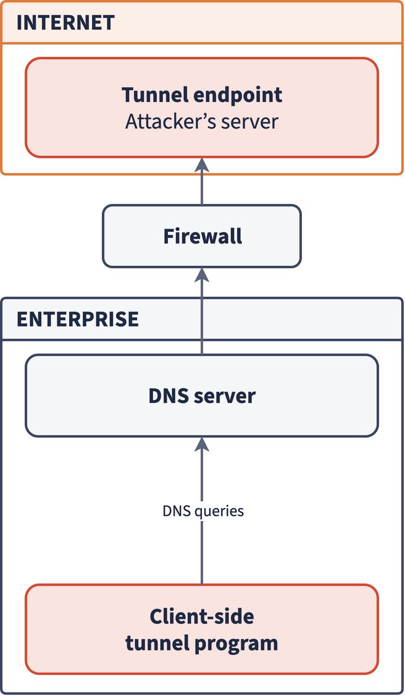{.absolute left=930 top=115 width=325}

::: notes
The traditional approach works after the fact, by hand, and is easy to evade. Students will do a scripted version of the log analysis in the lab: the point is that a one-off regex does not hold, not that logs are useless.
:::

## DNS Concepts: RPZ definition

::: {.absolute left=67 top=115 width=1140 .f34 .tight}
- DNS Response Policy Zone (RPZ) is a DNS zone which allow to customize policy in DNS servers, so that the server returns modified answers to clients’ queries.
- **RPZ** provides a way to **alter a DNS response** in real time. RPZ is a “lying” mechanism.
- It can be used to modify potentially unsafe DNS Data to block communication or provide local data to redirect to a “walled garden”.
- RPZ is the mechanism. A **DNS firewall** (also DNS sinkhole, or **Protective DNS**) is the usual way to use it: altering or blocking answers for chosen domains.
:::

::: notes
RPZ comes up now because we have a reason to use it. Students block their own C2 domain with it in the Blue Team part of the lab.
:::

## DNS Concepts: RPZ schema

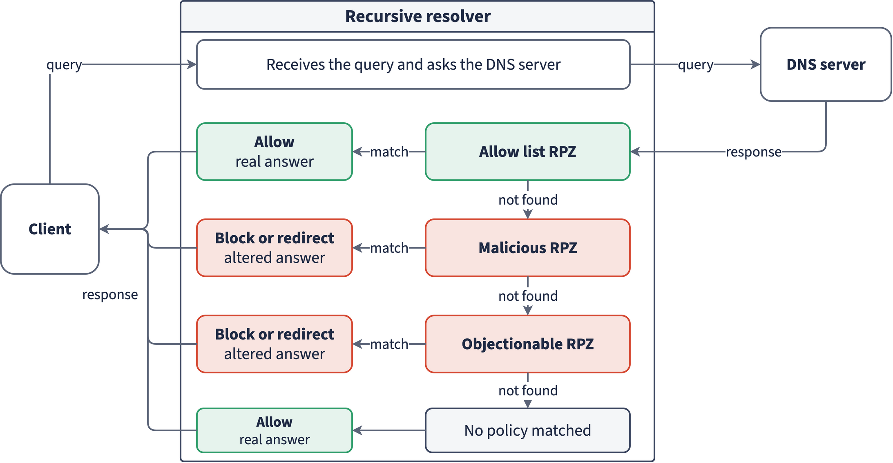{.absolute left=115 top=115 width=1050}

::: notes
Follow one query through the chain: the first matching policy wins. An allow list at the top protects legitimate domains from a mistake further down.
:::

## DNS Firewall

::: {.absolute left=46 top=150 width=788 .f32 .subsm}
- A DNS firewall is RPZ in use: like a firewall, it implements a security policy
- Has triggers:
  - Queried domain name
  - IP address in response
  - IP address of querying client
- And actions:
  - Reject (NXdomain)
  - Block (no data)
  - Redirect
  - Passthrough and log
:::

{.absolute left=856 top=238 width=305 height=272}

::: notes
Link each action to RPZ syntax for the lab: CNAME . gives NXDOMAIN, CNAME *. gives an empty answer (NODATA), and a CNAME to another name redirects. The lab uses CNAME *.
:::

## Detecting tunnels: DNS firewall products

<h3>Signature</h3>
Use <b>algorithms</b> to detect and block known DNS tunneling tools, at full network speed

<h3>Reputation</h3>
Use <b>DNS Firewall</b> to automatically block known tunnel, C2 and data exfiltration endpoints and newly registered domains using a threat intelligence database

<h3>Behavior</h3>
Use <b>DNS heuristics</b> to detect and block zero day data exfiltration, using real-time streaming analytics to mitigate against previously unseen code

::: notes
Three families to remember, whichever product implements them: signature (known tools), reputation (known bad domains), behavior (unknown threats). Only behavior can catch something new, and the next slides explain how.
:::

## DNS heuristics

::: {.absolute left=38 top=125 width=1172 .f34}
- **Entropy**
  - Higher Entropy => more information transferred
  - Legitimate DNS names often have dictionary words or something that looks meaningful. Encoded names have a higher entropy. DNS names that have high entropy can be an indicator of tunneling.
- **Lexical**
  - Analysis of individual characters in domain names
  - non-letters (numbers or allowed special characters) character ratio
  - hex /A-F/ character ratio
  - vowel character ratio
:::

::: notes
Entropy measures how unpredictable the characters are. The worked numbers come two slides later. The lexical ratios are cheap to compute, so they are often the first filter.
:::

## DNS heuristics

::: {.absolute left=49 top=146 width=1172 .f34}
- **N-Gram**
  - Detects non human like domain names based on character distribution. Focus is on 2- and 3-gram (i.e. sequences of 2 or 3 characters, or bigram and trigram analysis).
:::

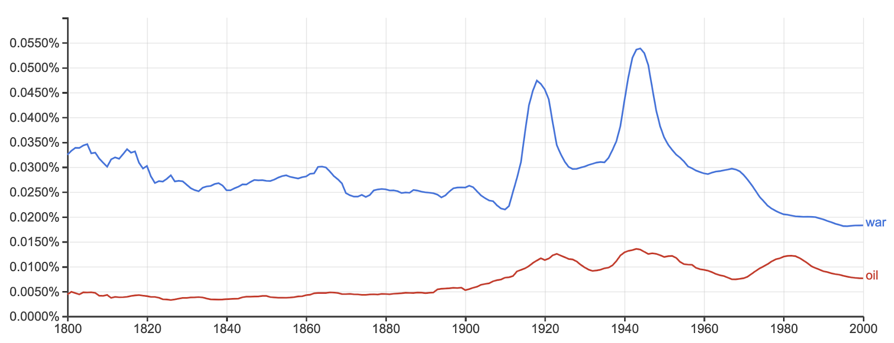{.absolute left=94 top=407 width=508 height=195}
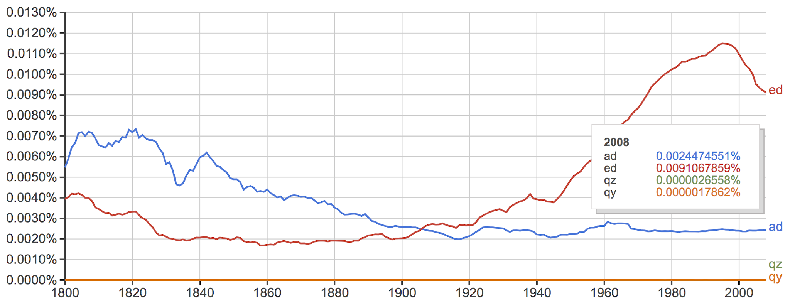{.absolute left=699 top=409 width=502 height=192}

::: {.absolute left=23 top=648 width=620 .f25}
Source: [https://books.google.com/ngrams](https://books.google.com/ngrams)
:::

::: notes
The charts use book text, not domain names: in real language, some letter pairs are common (ed) and others almost never occur (qz, qy). A domain name full of rare pairs is unlikely to have been chosen by a human.
:::

## DNS heuristics

::: {.absolute left=54 top=126 width=1172 .f27 .sp49}
- **Gini index** and **classification error** – two other measures of how evenly the characters are spread
- **Number of Labels** – number of domain labels in an FQDN payload
- **Frequency**: a resolver asking the same server again and again is normal. The signals are many unique subdomains under one domain, a high NXDOMAIN rate, and queries repeated at precise intervals
- **Size** Higher payload size => more information transferred
:::

::: notes
Gini and classification error are other ways to measure how evenly characters are spread. The next slide gives real values. Frequency and size are about the traffic rather than the name, and they catch what the name analysis misses.
:::

## DNS heuristics: real numbers

<table class="metrics">
<tr><th>Name</th><th>What it is</th><th>Length</th><th>Entropy</th><th>Gini</th><th>Class. error</th></tr>
<tr><td>wikipedia</td><td>Chosen by a human</td><td>9</td><td class="fragment" data-fragment-index="1">2.64</td><td class="fragment" data-fragment-index="1">0.81</td><td class="fragment" data-fragment-index="1">0.67</td></tr>
<tr><td>facebook</td><td>Chosen by a human</td><td>8</td><td class="fragment" data-fragment-index="1">2.75</td><td class="fragment" data-fragment-index="1">0.84</td><td class="fragment" data-fragment-index="1">0.75</td></tr>
<tr><td>vlbqryjd</td><td>DGA (DirCrypt)</td><td>8</td><td class="fragment" data-fragment-index="1">3.00</td><td class="fragment" data-fragment-index="1">0.88</td><td class="fragment" data-fragment-index="1">0.88</td></tr>
<tr><td>ab6d54340c1a</td><td>DGA (CCleaner)</td><td>12</td><td class="fragment" data-fragment-index="1">3.25</td><td class="fragment" data-fragment-index="1">0.89</td><td class="fragment" data-fragment-index="1">0.83</td></tr>
<tr><td>b83ed4877eec1997fcc39b7ae590007a</td><td>DGA (Bamital)</td><td>32</td><td class="fragment" data-fragment-index="1">3.59</td><td class="fragment" data-fragment-index="1">0.91</td><td class="fragment" data-fragment-index="1">0.84</td></tr>
<tr><td>xjxaioixowvcp44564qzrnrz</td><td>Tunnel chunk</td><td>24</td><td class="fragment" data-fragment-index="1">3.86</td><td class="fragment" data-fragment-index="1">0.92</td><td class="fragment" data-fragment-index="1">0.88</td></tr>
<tr class="hl"><td>g63uar2ejiq5tlrkg3zezf2fkemc6pi88tz</td><td>Legitimate (Spotify)</td><td>35</td><td class="fragment" data-fragment-index="1">4.29</td><td class="fragment" data-fragment-index="1">0.95</td><td class="fragment" data-fragment-index="1">0.91</td></tr>
</table>

::: {.predict style="left:50px;top:494px;width:1180px"}
Which name has the highest entropy, the most "random-looking" letters?
:::

::: {.absolute left=50 top=540 width=1180 .f22 .fragment fragment-index=2}
Worked example, facebook: 6 letters appear once and "o" twice, so entropy = 6 × (1/8 × 3) + 1/4 × 2 = **2.75** bits per character.

**The legitimate name scores highest.** No single indicator is enough: this is why the lab's script combines many into one score.
:::

::: notes
Formulas, the same as in the lab's analysis.py. With p the share of each character: entropy = minus the sum of p × log2(p), Gini = 1 minus the sum of p², classification error = 1 minus the largest p.

Entropy also grows with length, so a short random name can score close to a real word (vlbqryjd against facebook). The tunnel chunk is real Base32, generated for this example.
:::

## Detect and block DNS C2 {.lab-slide}

{.absolute .lab-icon left=96 top=140 width=150 height=150}

::: {.lab-banner}
Practical Exercise: DNS C2 with Sliver (Blue Team)
:::

Cyber lab

::: {.absolute left=96 top=350 width=940 .f29}
Back to the lab you left running. Now you are the defender:

- Find the C2 traffic in the DNS logs, using the indicators you just saw
- Tune the detection, to remove false positives
- Block the C2 domain with RPZ, and check that the implant loses contact
:::

::: notes
Students reuse the logs from the Red Team part, so the lab must still be running. The expected result is NOERROR with an empty answer, because the lab uses CNAME *.
:::

## Quiz time {.quiz-slide}

::: {.absolute left=43 top=344 width=612 .f37 .center}
www.pollev.com/jmanteau973
:::
{.absolute left=643 top=91 width=585 height=585}

::: notes
Draft questions for PollEverywhere, to be added to the poll:

1. An attacker's server receives a tunneled query. Which server sent it? (The enterprise's recursive resolver.)
2. Why do attackers use a DGA? (They need one registered domain, while defenders must block them all.)
3. A name has very high entropy. Is it malicious? (Not necessarily: CDNs and other services use such names.)
4. Which RPZ rule returns NXDOMAIN? (CNAME . while CNAME *. returns an empty answer.)
:::

## Part 2: DNS Security {.pillars-slide}

1

How attackers abuse DNS

2

Detecting and blocking abuse

3

Protecting DNS itself

::: notes
Third part: protecting DNS itself. So far DNS was the attacker's channel. Now DNS is the target.
:::

## Types of DNS attacks: volumetric/DDoS

<table class="attacks attacks3" style="top:118px">
<tr class="head"><th>Attack</th><th>What it does</th><th>Main defense</th></tr>
<tr class="vol"><td>DNS reflection/DrDoS attacks</td><td>Using third-party DNS servers (mostly open resolvers) to propagate a DoS or DDoS attack</td><td>Close open resolvers, block spoofed sources</td></tr>
<tr class="vol"><td>DNS amplification</td><td>Using a specially crafted query to create an amplified response to flood the victim with traffic</td><td>Response rate limiting</td></tr>
<tr class="vol"><td>TCP/UDP/ICMP floods</td><td>Denial of service on layer 3 or 4 by bringing a network or service down by flooding it with large amounts of traffic</td><td>DDoS mitigation, anycast</td></tr>
<tr class="vol"><td>NXDomain attack</td><td>Attacks that flood DNS server with requests for non-existent domains, causing it to send NXDomain (non-existent domain) responses</td><td>Rate limiting, caching negative answers</td></tr>
<tr class="vol"><td>Phantom domain attack</td><td>Attacks where a DNS resolver is forced to resolve multiple non-existent domains, causing it to consume resources while waiting for responses</td><td>Limits on recursive queries per client and per domain</td></tr>
</table>

::: notes
These attacks aim to overwhelm: the DNS content does not matter, the volume does. Reflection and amplification are often used together: a small spoofed query gets a large answer, sent to the victim.
:::

## Types of DNS attacks: DNS-specific

<table class="attacks attacks3" style="top:118px">
<tr class="head"><th>Attack</th><th>What it does</th><th>Main defense</th></tr>
<tr class="dns"><td>DNS-based exploits</td><td>Attacks that exploit bugs or vulnerabilities in the DNS software (e.g. KeyTrap, a DNSSEC validation flaw disclosed in 2024)</td><td>Patching</td></tr>
<tr class="dns"><td>DNS cache poisoning</td><td>Corruption of DNS server cache data with a rogue domain or IP (e.g. the Kaminsky attack, next slide)</td><td>Source port and ID randomisation, DNSSEC</td></tr>
<tr class="dns"><td>Protocol anomalies</td><td>Causing the server to crash by sending malformed DNS packets and queries</td><td>Patching, DNS-aware filtering</td></tr>
<tr class="dns"><td>Reconnaissance</td><td>Attempts by hackers to get information on the network environment before launching a DDoS or other type of attack via DNS queries or Zone Transfers</td><td>Restrict zone transfers</td></tr>
<tr class="dns"><td>DNS tunneling</td><td>Tunneling of another protocol through DNS port 53 for malware insertion and/or data exfiltration</td><td>DNS firewall, heuristics</td></tr>
<tr class="dns"><td>DNS hijacking</td><td>Modifying the DNS record settings to point to a rogue DNS server or domain</td><td>Registrar lock, strong accounts, MFA</td></tr>
</table>

::: notes
These attacks abuse how DNS works. Cache poisoning is the one to remember for the next slides: it is what DNSSEC was built to stop. You have already practiced the defense against tunneling.

DNSSEC does not stop a hijack through the registrar account: an attacker who controls the account can replace the DS record as well. Randomising the source port and query ID makes forged answers much harder to get accepted, and it is what resolvers deployed first after Kaminsky.

For reconnaissance, registration data now comes from RDAP: since 28 January 2025 ICANN no longer requires gTLD registries and registrars to run WHOIS, except for .com, .name and .post.
:::

## Cache poisoning: winning the race

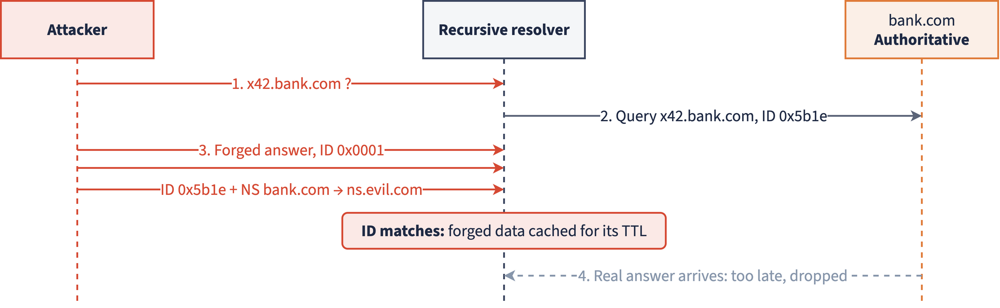{.absolute left=140 top=104 width=1000}

::: {.absolute left=60 top=422 width=1160 .f22}
::: {.fragment}
**The race:** the resolver accepts the first answer that matches its query. The query ID is 16 bits, so a forged answer has 1 chance in 65,536.
:::
::: {.fragment}
**Kaminsky (2008):** ask for random names (x1.bank.com, x2.bank.com…). None is cached, so each one is a new race with no TTL to wait for. The forged answer also carries an NS record, so the whole domain is hijacked, not one name.
:::
::: {.fragment}
**Defenses:** a random source port as well as a random ID (about 1 in 4 billion), then **DNSSEC**: a forged answer has no valid signature.
:::
:::

::: notes
Before Kaminsky, poisoning one name meant waiting for its TTL to expire before a new try. The random-subdomain trick removed that wait, which is why all resolvers were patched together in July 2008 with source port randomisation.

Mention 0x20 encoding (random upper and lower case in the query name) as one more source of randomness some resolvers add. DNSSEC is the only defense that does not rely on the attacker failing to guess: this is the bridge to the DNSSEC slides.
:::

## Dangling records: subdomain takeover

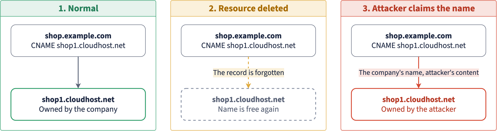{.absolute left=43 top=108 width=1194}

::: {.absolute left=43 top=450 width=1194 .f25}
- **Why it works:** the record still points to a name the company no longer controls, and cloud services often let anyone claim a released name.
- **Defense:** delete the DNS record before the resource, and regularly check that every record still points to something you own.
- **Sitting Ducks**, a close relative: a domain is delegated to a DNS provider where anyone can claim it, with no access to the owner's account.
:::

::: notes
This uses the CNAME chain from the worked example in part 1: the CDN pattern is safe only while the far end still belongs to you. No DNS server is hacked, and DNSSEC would not help, because the company's own record is the problem.

Vendor reports give very different counts for how common this is, so teach the mechanism rather than a number.
:::

## Improvements of DNS

::: {.absolute left=60 top=140 width=740 .f27 .circ}
- **DNS Transport** mechanisms
  - DNS over TLS (DoT): use DNS over TLS encryption on TCP port 853 (RFC 7858)
  - DNS over HTTPS (DoH/DoH3): use HTTP2 or 3 for encrypting requests (RFC 8484)
  - DNS-over-QUIC (DoQ): use [QUIC](https://http3-explained.haxx.se/en/why-quic) for data transport and encryption on UDP port 853 (RFC 9250)
- **DNS Data** authentication:
  - DNSSEC: use specific DNS records to ensure that the answer given is the authorized one
:::

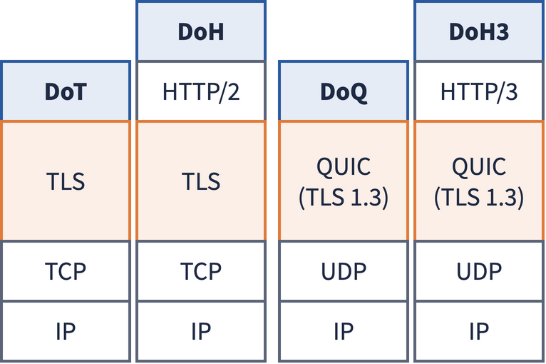{.absolute left=830 top=160 width=400}

::: notes
The split is the frame for what follows: transport protects the path against someone watching, while DNSSEC proves the data is genuine. One does not replace the other.

❯ curl 'https://dns.google.com/resolve?name=eu.nomad.airbus.com' -H "Host: dns.google.com"

{"Status":0,"TC":false,"RD":true,"RA":true,"AD":false,"CD":false,"Question":[{"name":"eu.nomad.airbus.com.","type":1}],"Answer":[{"name":"eu.nomad.airbus.com.","type":5,"TTL":60,"data":"eu-nomad.dyn.airbus.com."},{"name":"eu-nomad.dyn.airbus.com.","type":1,"TTL":60,"data":"193.56.36.114"}],"Comment":"Response from 193.56.36.45."}
:::

## Comparing DoT/DoQ and DoH/DoH3

<table class="dot" style="left:43px;top:130px;width:850px;font-size:24px">
<tr><th>DoT/DoQ</th><th>DoH/DoH3</th></tr>
<tr><td>RFC 7858 (DoT), RFC 9250 (DoQ)</td><td>RFC 8484</td></tr>
<tr><td>New port 853 (TCP for DoT, UDP for DoQ)</td><td>Port 443 (HTTPS)</td></tr>
<tr><td>Traffic can easily be blocked and not open normally by default in enterprise</td><td>Traffic looks like every other encrypted web traffic</td></tr>
<tr><td>No API capabilities</td><td>API capabilities</td></tr>
<tr><td>Usually set up at OS or network level</td><td>Built-in browser support</td></tr>
<tr><td>Blocking the port keeps clients on the enterprise resolver</td><td><b>Can bypass the enterprise resolver, and with it the RPZ you just built</b></td></tr>
</table>

{.absolute left=925 top=150 width=310}

::: notes
Good for privacy, a problem for defenders: all the detection and blocking of this course happens on the resolver, and DoH can route around it. Enterprises usually turn it off in browsers, or provide their own DoH service. Two standards help a network point its clients to an approved encrypted resolver: DDR (RFC 9462) and DNR (RFC 9463). Client support varies, so check it before relying on them. The next slide shows the attacker's side of this.
:::

## C2 over DNS over HTTPS (DoH)

::: {.absolute left=44 top=112 width=1192 .f25}
**The same privacy works for attackers:** C2 traffic sent to a public DoH service looks like normal HTTPS, and the enterprise resolver never sees the lookup.

**Domain fronting (mostly history):** hide the real destination by showing one name in the visible TLS SNI, and another in the encrypted HTTP Host header. Major providers have blocked it, Google and Amazon in 2018.
:::

<pre class="a terminal" style="left:44px;top:268px;width:1192px;font-size:24px">curl 'https://8888.google/resolve?name=example.com' -H "Host: dns.google"</pre>

::: {.absolute left=44 top=392 width=1192 .f25}
- Unencrypted DNS lookup & TLS SNI: <b class="g">8888.google</b>
- Encrypted HTTP host: <b class="y">dns.google</b>
- Requested domain: <b class="r">example.com</b> (an attacker would ask for their C2 domain)
:::

::: {.absolute left=44 top=540 width=1192 .f21 .gray}
This command works because both names belong to the same service. Tested in Nov 2026, the same trick across different services fails: Google returns 404 and Cloudflare 403.

**ECH** (Encrypted Client Hello, RFC 9849) goes further: it hides the SNI using keys published in the site's DNS HTTPS record, so defenders lose that view too.
:::

::: notes
This command is harmless and safe to run live, since it only looks up example.com. Retest it before class, as providers change this behavior. Domain fronting still appears in older reports and tools, which is why it stays in the course.

The tests in November 2026 were: SNI google.com or www.google.com with Host dns.google (404), and SNI cloudflare.com with Host cloudflare-dns.com (403).
:::

## DNSSEC

::: {.absolute left=53 top=124 width=1180 .f28}
DNS was designed without security: a resolver cannot tell a forged answer from a real one. That is what **cache poisoning** exploits.
:::

SIGNED

Each record set carries a signature (RRSIG). A validating resolver checks it: the data is what the zone owner published, unchanged.

NOT ENCRYPTED

Answers are authenticated, not hidden: anyone on the path still reads them. DoT, DoH and DoQ do the encryption.

CHAIN OF TRUST

It follows the tree you know: the root vouches for the key of .fr (DS), .fr for the domain's key (DNSKEY), and the domain signs its records.

::: notes
Domain Name System Security Extensions (DNSSEC) give resolvers origin authentication of DNS data through digital signatures. By validating them, a resolver checks that the data is identical to what the zone owner published on its authoritative server. This defeats cache poisoning and man-in-the-middle changes, as seen on the poisoning slide.

DNSSEC does not provide confidentiality: responses are authenticated, not encrypted.
:::

## DNSSEC

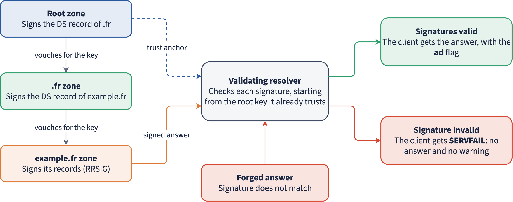{.absolute left=65 top=112 width=1150}

::: {.absolute left=65 top=590 width=1150 .f25 .gray}
**October 2026:** the root key changed. A validating resolver that had not added the new key can no longer validate anything, so its lookups fail.
:::

::: notes
Compare with slide "Full DNS Query": the same tree, now carrying signatures. The ad flag comes from the resolver, so the client is trusting its resolver and the path to it. This is one reason DNSSEC and encrypted transport go together.

The root key rollover completed on 11 October 2026 (ICANN), and the old key is due to be revoked on 11 January 2027. APNIC measured validation falling by half or more on 58 networks afterwards.
:::

## Agenda {.agenda-slide}

1

DNS Overview<small>What is the Domain Name System?</small>

2

DNS Security<small>How attackers abuse DNS, and how to defend it</small>

3

Wrap-up<small>What to remember</small>

::: notes
End of part 2. Last part: what to remember.
:::

## Wrap-up {.divider}

Part 3

What to remember

## True or false? {.exercise-slide}

DNS only uses UDP.

FALSE

Large answers (<code>tc</code> flag) and zone transfers use TCP. DoT and DoH run over TCP too.

A DNS change “propagates” across the Internet.

FALSE

Nothing is pushed. Each cache keeps the old answer until its TTL expires.

Lowering a TTL takes effect at once.

FALSE

Caches still hold the old, long TTL. Lower it at least one old TTL before the change.

dig and the browser always see the same answer.

FALSE

The browser has its own cache, may use its own DoH resolver, and the hosts file wins over both.

“This name does not exist” is never cached.

FALSE

Negative answers are cached too, for the time set by the zone's SOA.

DNSSEC encrypts DNS.

FALSE

It signs: anyone can still read the answers. DoT, DoH and DoQ encrypt.

::: notes
Read each statement and ask for a show of hands (true or false) before revealing it. They are all false, and each one is a classic source of support tickets. Students who voted "true" on one know which slide to revisit.
:::

## What to remember

::: {.absolute left=75 top=115 width=1150 .f27 .gray}
1. DNS is a distributed tree: zones split it up, and delegation connects them.
2. Your recursive resolver walks that tree for you: root, TLD, then authoritative server.
3. Caches keep answers until the TTL expires (or longer if the source is unreachable), so clients can see different answers for a while.
4. The same name can give different answers by design: split horizon, views, round robin.
5. DNS helps attackers at most stages of an attack, because it is allowed almost everywhere.
6. DNS can carry C2. No single indicator finds it: combine them, then block with RPZ.
7. DoT, DoH and DoQ protect the client-to-resolver path, DNSSEC proves authenticity. Neither does both, and DoH can also hide attackers.
:::

::: notes
These seven points match the seven objectives on the second slide. Ask students which one they could not yet do on their own. Run the exit ticket next, then point them to the Resources slide.
:::

## Exit ticket {.quiz-slide}

::: {.absolute left=43 top=300 width=612 .f37 .center}
www.pollev.com/jmanteau973
:::

::: {.absolute left=43 top=400 width=612 .f25 .center .gray}
Three quick questions before you leave.
:::

{.absolute left=643 top=91 width=585 height=585}

::: notes
Questions to add to PollEverywhere (one per part, plus a self-assessment):

1. You change a record's IP, then lower its TTL from 86400 to 60. An hour later some users still reach the old IP. Why? (Their resolvers cached the record with the old 86400 TTL: lower it before the change, not after.)
2. A DNS C2 implant is active on a laptop. Which control cuts it off: DNSSEC, DoH or RPZ? (RPZ. DNSSEC only proves authenticity, and DoH can even hide the C2 traffic.)
3. Open question: which of the seven objectives are you least sure about?

Look at the answers before the next session and open with the weakest point.
:::

## Resources

dig cheat sheet

::: {.absolute left=44 top=137 width=1000 .f32 .links}
- [dig cheat sheet](https://github.com/jmanteau/dns-course-labs/blob/main/dns-dig-lab/cheatsheet.pdf)
- [DNS RFCs](https://www.statdns.com/rfc/)
- [An Illustrated Guide to the Kaminsky DNS Vulnerability](http://unixwiz.net/techtips/iguide-kaminsky-dns-vuln.html)
- [DNS for Rocket Scientists](https://www.zytrax.com/books/dns/)
- [NIST SP 800-81r3: Secure DNS Deployment Guide (2026)](https://csrc.nist.gov/pubs/sp/800/81/r3/final)
- [MITRE ATT&CK: C2 over DNS (T1071.004)](https://attack.mitre.org/techniques/T1071/004/)
:::

## {.xkcd background-color="#eef1f5"}

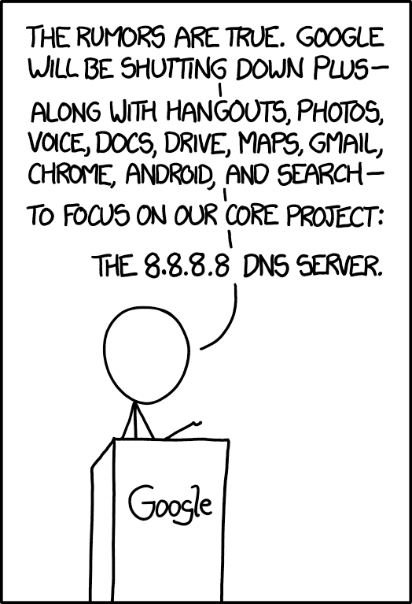{.absolute left=29 top=57 width=332 height=487}

<pre class="a terminal" style="left:463px;top:76px;width:760px;font-size:32px;line-height:1.6">❯ dig -x 8.8.8.8 +short
dns.google.

❯ dig txt dns.google. +short
"https://xkcd.com/1361/"
"v=spf1 -all"</pre>
