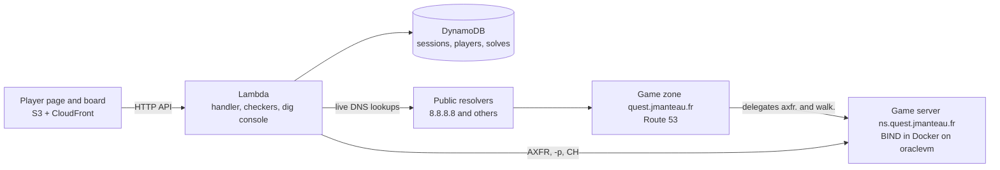

# Dig Quest: guide for teachers and maintainers

Dig Quest turns the dig lab into a game: students answer the lab questions in a browser, earn points and follow a live leaderboard. This guide explains how to run it for a class, test it, deploy it and add questions. For teachers and maintainers. Updated November 2026.

Students: you don't need this page. Play at [dns.jmanteau.fr](https://dns.jmanteau.fr) with the class code your teacher gives you, or read the [dig lab handout](../).

The game runs at **https://dns.jmanteau.fr**. Below, `<GameUrl>` stands for that address (or the `GameUrl` output of another deployment).

## Contents

- [How the game works](#how-the-game-works)
- [How the parts fit together](#how-the-parts-fit-together)
- [Run a class](#run-a-class)
- [Run the class from the admin page](#run-the-class-from-the-admin-page)
- [Run the live quiz](#run-the-live-quiz)
- [How screens stay in sync](#how-screens-stay-in-sync)
- [Keep the answers private](#keep-the-answers-private)
- [Try it on your computer](#try-it-on-your-computer)
- [Test everything in the local simulation](#test-everything-in-the-local-simulation)
- [Deploy to AWS](#deploy-to-aws)
- [The game zone](#the-game-zone)
- [The game server](#the-game-server)
- [Edit the questions](#edit-the-questions)

`make help` lists a shortcut for every command in this guide.

## How the game works

**Joining.** Players join with a class code and a nickname, without an account.

**Three stages:**

| Stage | What students do | Unlocks when |
|-------|------------------|--------------|
| Warm-up | Five short questions answered with `dig` on their own computer: `dig -v`, their resolver's IP, a first lookup, NXDOMAIN and flags, writing a command | At once |
| Main | The missions of the dig lab, with the dig console | Every warm-up part is solved |
| Advanced | 25 missions on concepts the course does not teach: anycast and CHAOS, NSID, whoami resolvers, SOA, extended errors, the DNSSEC chain, mail records, IPv6 reverse, IDN, truncation, SRV and NAPTR, AXFR and NSEC walking, and puzzles on the game zone and the game server | 80% of the warm-up and main parts are solved (`ADV_SHARE` in `backend/handler.py`) |

**Scoring:**

- Data questions are graded with a live DNS lookup, so the answers never go stale.
- A hint costs 25% of the part, then 50%. A wrong multiple-choice guess costs 25%.
- The first player to clear a mission gets +50, the second +25, the third +10. The warm-up gives no such bonus.
- Advanced points go to a **separate leaderboard**, shown beside the main one, so the main ranking stays fair.

**Explanations.** The explanations (the old correction) unlock for a player who has cleared every part of a stage, or for everyone when you close the session. Main and advanced explanations unlock separately.

**Advanced slides.** The theory for the advanced stage is the *DNS Beyond the Basics* deck, `course/dns-advanced.qmd`. The game links to it as `deck/dns-advanced.html`. `make dev` and `make deploy` build it first.

**Dig console.** A console sits beside the missions (a drawer on phones). It runs real lookups and shows the matching `dig` command:

- Options: `+short`, `+trace`, `+norecurse`, `+dnssec`, `+tcp`, `+nsid`, `+cd`, `+subnet`, `-x`, class `CH`, and "authoritative server". Extended DNS Errors (EDE) and NSID (Name Server Identifier) are printed as dig prints them.
- Limits: public servers only (a server name must resolve to a public address), and 20 lookups a minute per player.
- AXFR (zone transfer) and `-p` (another port) work only toward the game server (`GAME_SERVER`, set by the stack). So the console cannot be used to transfer or scan anyone else's servers.

## How the parts fit together



In words: the player page and the projector board are static files served by CloudFront. They call an HTTP API backed by one Lambda function. The Lambda stores sessions, players and solves in DynamoDB. It grades answers and runs the dig console with live DNS lookups through public resolvers. The advanced missions use two extra pieces. The first is a game zone in Route 53, `quest.jmanteau.fr`. The second is a BIND game server, `ns.quest.jmanteau.fr`, to which the zone delegates two sub-zones. The console may query that server directly for zone transfers, other ports and CHAOS-class questions.

| Path | What it holds |
|------|---------------|
| `backend/` | Lambda code: handler, checkers (dnspython), dig console (`dig.py`), scoring, DynamoDB store |
| `frontend/` | Static player page (`index.html`) and projector board (`board.html`, with a join QR code from the vendored `qrcode.min.js`) |
| `infra/` | CDK (Cloud Development Kit) app in Python: DynamoDB, Lambda, HTTP API, S3 + CloudFront, admin secret, game zone, game server files, local simulation |
| `secret/` | **Private** submodule: `questions.json` (answers, checks), `explanations/*.md`, `zone.json`, `server.json` |
| `tests/` | `pytest`: unit tests with mocked DNS and DynamoDB; `-m live` checks real DNS; `-m sim` runs in the local simulation |
| `dev_server.py` | Runs everything on your computer with an in-memory DynamoDB |
| `admin.py` | Creates and closes class sessions |
| `Makefile` | Shortcuts for every command: `make help` |

## Run a class

Before the class:

1. Check that every live question can still be answered: `make live`.
2. Create the session:

   ```
   export QUEST_API=<ApiUrl> QUEST_ADMIN_SECRET_ARN=<AdminSecretArn>
   python admin.py create CLASS-A "IUT Blagnac A"
   ```

   Or `make session CODE=CLASS-A NAME="IUT Blagnac A"`.

During the class:

3. Project `<GameUrl>/board.html?session=CLASS-A`. It shows a QR code that opens `<GameUrl>/index.html?session=CLASS-A` with the class code filled in. You can also give students the link directly. The QR code is hidden once the session is closed.

When the class ends:

4. Close the session: `python admin.py close CLASS-A` (or `make close CODE=CLASS-A`). This unlocks the explanations for everyone. `make reopen CODE=CLASS-A` reopens it.

## Run the class from the admin page

You drive everything from the admin page, on your own laptop: `<GameUrl>/admin.html?session=CLASS-A`. The board on the projector only shows what students may see.

**The admin token:** the page asks for it once per page load, and keeps it in that browser tab only. If you cancel or the token is wrong, the controls stay locked and show an **Enter the admin token** button: the page never asks in a loop. You can also put it in the address, after a `#`: `admin.html?session=CLASS-A#token=…`. The part after `#` is never sent to the server, and the page removes it from the address bar.

**Activities:** two switches decide what students can work on.

| Switch | Covers | When it is off |
|---|---|---|
| **Dig lab** | the warm-up, the missions and the dig console | students see "Waiting for your teacher"; the board shows "Dig lab paused" |
| **Advanced missions** | the advanced stage, for students who solved 80% of the missions | the advanced section reads "your teacher opens them" |

Progress and scores are kept while an activity is off, and a switch reaches students within 3 seconds. A new session runs both. From the terminal: `make lab-on`, `make lab-off`, `make advanced-on`, `make advanced-off` (with `CODE=CLASS-A`).

**Session:** the same page closes the session (which unlocks every explanation) or reopens it.

## Run the live quiz

The quiz replaces PollEverywhere. You put one question at a time on every student's screen: it covers the whole screen until you close it, whatever activity they were on, and whether the dig lab runs or not. A student only needs to have joined.

**In class**, on the admin page:

1. Pick the round. The deck's quiz slides say which one: round 1 after "Types of DNS Record", round 2 after the dig lab, round 3 after the blue team lab, round 4 for the exit ticket.
2. For each question:
   1. Press → (or **Open next**, or click its number). The question fills every phone, with a timer. The admin page shows "N of M answered" and the countdown; the board shows the question.
   2. Press **R** (or **Reveal**). The board and the phones show the bars, the right answer and the explanation; each student sees whether they were right and their points.
   3. For open questions, the answers appear without names, sorted by upvotes. Students upvote from their phones. **✕** on the admin page hides an answer.
   4. Points are added at the reveal. If you open another question or close this one before revealing it, the admin page asks you to confirm, because its answers would score nothing.
   5. Press **Esc** (or **Close**): students go back to where they were, and the board to the leaderboards, which include a **Quiz** panel.

**Scoring:** a right answer gives 100 points, plus up to 50 for answering in the first 20 seconds. Open questions and polls give none. Points are added at the reveal, and only on the quiz board: mission scores never change. A student gets one answer per question; a question opened again keeps the answers already given.

**Questions:** they are in the private `secret/quiz.json`, 34 questions in 4 rounds. The format is in the docstring of `backend/quiz.py`. Types: `mcq` (one right option), `multi` (tick all that apply), `static` (short text), `open` (free text, upvotes, not graded) and `poll` (no right answer). A `static` answer is right if it matches one of its regex `patterns`, or is close to one of its `accept` phrases: case, accents and punctuation don't matter, and small typos pass ("fully qualified domaine name" counts for "fully qualified domain name"), but a fragment like "domain name" does not. Run `make quiz-check` after editing. To change the type of a question a session has already answered (say, open text to multiple choice), give it a new id: each student keeps one answer per id, and the old answers would not match the new type.

**From the terminal** (a fallback for the admin page): `make quiz-list CODE=CLASS-A`, `make quiz-open CODE=CLASS-A Q=r1q01`, `make quiz-reveal CODE=CLASS-A`, `make quiz-close CODE=CLASS-A`. They need the same `QUEST_API` and admin secret as `make session`.

**Rehearse alone, on your computer:** run `make quiz-serve` (add `N=30` for more players). It starts the local game, opens the board and the admin page (with the local admin token already filled in), and starts 20 simulated players. They answer right 70% of the time, using the answers in `secret/quiz.json`, and upvote open answers. Open a player tab on `http://localhost:8787/?session=DEV` to answer as a student too. Ctrl-C stops everything.

To drive it from the terminal instead, use the targets with `LOCAL=1`, for example `make quiz-open LOCAL=1 CODE=DEV Q=r1q01` or `make lab-off LOCAL=1 CODE=DEV`.

The same works with `make sim-dev` (the game against the local simulation), then `make quiz-bots` in a second terminal.

## How screens stay in sync

When you open, reveal or close a question, switch an activity or close the session, the server rings every open page of that session through a WebSocket. The message only says what changed; each page then fetches the new state with its usual calls, so it shows up at once.

- **On AWS:** an API Gateway WebSocket API (the `WsUrl` output), handled by the same Lambda (`backend/push.py`). Each open page is one `S#CODE / WS#…` item, which expires after 4 hours.
- **Locally:** `dev_server.py` runs the same doorbell on port 8788 (`ws://localhost:8788`), with the `websockets` package (`make setup` installs it).
- **Fallback:** pages keep polling, more slowly while the socket is up: every 20 s for students, 10 s for the board and admin page. While a question is live, the board and admin page poll every 1.5 s for the answer count. If the socket drops, pages reconnect and go back to the faster polling meanwhile.

## Keep the answers private

This repository is public, so the answers live in a private repository, mounted as the `secret/` submodule (`jmanteau/dns-dig-lab-game`). It is copied into the Lambda package at deploy time. To set it up in a fresh clone:

```
git submodule add -f <private-repo-url> dns-dig-lab/game/secret
```

## Try it on your computer

`make setup` creates the Python environments. Then:

```
python3 -m venv .venv && .venv/bin/pip install dnspython "moto[server]" pytest boto3
.venv/bin/python dev_server.py     # http://localhost:8787/?session=DEV
                                   # board: /board.html?session=DEV
                                   # live DynamoDB viewer: /_debug
.venv/bin/python -m pytest         # unit tests
.venv/bin/python -m pytest -m live # before a class: are all live questions still answerable?
```

The same with make: `make dev`, `make test`, `make live`.

`dev_server.py` starts a moto "AWS" server (DynamoDB on port 5000) and runs the real Lambda handler against it. You can play as a student and watch the items change in the viewer. It needs no Docker and no AWS account.

## Test everything in the local simulation

Run `make sim-test` to test the game zone and the game server before deploying anything, or after you edit a spec. It needs Docker or Podman.

`infra/sim.py` renders `build/sim/` from the same specs that get deployed. Then compose starts these containers on a private network, 10.53.0.0/24:

| Container | Address | Plays the part of |
|-----------|---------|-------------------|
| `resolver` | 10.53.0.2 | The resolver students use: the Internet through 8.8.8.8, and the local game zone with its delegations |
| `zone` | 10.53.0.10 | Route 53: the game zone, served by BIND (TXT escapes converted from octal to decimal) |
| `main` + `alt` | 10.53.0.53 | The game server, on ports 53 and 8053, exactly as on `oraclevm` |
| `runner` | 10.53.0.100 | The game code: the tests, or `dev_server.py` |

The tests run inside `runner`, because on macOS the host cannot reach those addresses. `make sim-test` runs:

1. the unit tests;
2. every `live` test;
3. the end-to-end tests in `tests/test_sim.py`: grading of a15, a23, a24 and a25, and the console's CH, AXFR and `-p 8053`.

Other commands:

- `make sim-dev` serves the game on http://localhost:8787/?session=DEV against the simulation.
- `make sim-down` stops and removes the containers.

Three environment variables point the code at the simulation. None of them is set in AWS.

- `QUEST_RESOLVER` replaces 8.8.8.8 in the checkers and the console.
- `DIG_ALLOW_NET` lets the console reach the private network.
- `GAME_SERVER` names the game server.

Limit: `+trace` starts from the real root servers, so it cannot find the local game zone.

## Deploy to AWS

Do not deploy during a class.

```
cd infra
python3 -m venv .venv && .venv/bin/pip install -r requirements.txt
npx aws-cdk bootstrap          # once per account/region
npx aws-cdk deploy --all
```

Or `make deploy`, which also builds the advanced slides first.

The outputs give `GameUrl`, `BoardUrl`, `ApiUrl` and `AdminSecretArn`. A class costs a few cents.

`--all` also deploys `DigQuestZone`, the game zone, when `secret/zone.json` exists.

**The game's address:** the pages also answer on `https://dns.jmanteau.fr`, set by `siteDomain` and `siteZone` in `infra/cdk.json` (the zone must be in the same AWS account). CloudFront only takes certificates from us-east-1, so the certificate lives in its own stack there, `DigQuestSiteCert`, and the account needs a CDK bootstrap in us-east-1 as well as in the game's region. Remove the two context keys to serve only the cloudfront.net address. The game's address is kept out of the puzzle zone (`quest.jmanteau.fr`), which only holds puzzles and the game server's records.

## The game zone

Missions a15 to a20 are played on a real zone, `quest.jmanteau.fr`. It holds a trail of clues (TXT → MX → SRV), a CNAME maze, wildcards, encoded TXT records, a long TXT, and a picture split into TXT chunks.

- `secret/zone.json` (private) holds the content, so the answers stay out of this repository. `infra/game_zone.py` turns it into Route 53 records. Its docstring describes the spec.
- `DigQuestZone` creates the hosted zone. Because `jmanteau.fr` is in the same AWS account (`"parent"` in the spec), it also creates the NS delegation. It costs $0.50 a month, plus queries.
- After a deploy or an edit of the spec, run `make zone-check`. It checks that every record is published as the spec describes. Allow 300 seconds (the TTL) for changes to show.

## The game server

Missions a21 to a25 need what Route 53 cannot do. So BIND 9.20 runs in Docker on an always-on host, `oraclevm` (an Oracle Cloud free-tier Ampere VM), as `ns.quest.jmanteau.fr`. It serves:

- an open zone transfer (`axfr.`);
- a zone signed with NSEC, to walk (`walk.`);
- custom CH TXT answers;
- a second instance on port 8053;
- `secret.lab`, a zone no resolver can find.

How it is built:

- `secret/server.json` (private) holds the content and the server's public IPv4 address (`address`).
- `infra/game_server.py` renders a Docker folder from it: a Debian 13 image, two containers on the host network, `named.conf` and the zone files. The host network lets BIND see the real client addresses, which its rate limiting needs.
- `DigQuestZone` publishes the server's address and delegates `axfr.` and `walk.` to it.
- The server is authoritative only (`recursion no`), with response rate limiting: it can never serve as an open resolver.

The first time:

1. Create the VM with the `oci-pkms` project (`~/SynologyDrive/Dev/oci-pkms`): `terraform apply`, then `make deploy-all` to install Docker. Its `network.tf` already allows UDP and TCP on ports 53 and 8053 in the VCN security list.
2. Add `oraclevm` to `~/.ssh/config`, with the address from `terraform output -raw ampere_public_ip`:
   ```
   Host oraclevm
     HostName <ampere_public_ip>
     User ubuntu
     IdentityFile ~/.ssh/id_ed25519
   ```
3. Put the same address in `secret/server.json` (`address`). It is an ephemeral IP: it changes only if the instance is recreated. Then update both places and run `make deploy-zone`.
4. Open the same ports in the host firewall: `make server-firewall`.

The VM also runs the `oci-pkms` Traefik stack on ports 80 and 443. They don't clash: BIND uses 53 and 8053, and Ubuntu's `systemd-resolved` listens only on 127.0.0.53 and 127.0.0.54.

After each change of the spec:

1. `make server-deploy` copies the folder over SSH, then runs `docker compose up -d --build`.
2. `make deploy-zone`, if the address or the zones changed.
3. `make server-check` checks the CH answers, the transfer, the NSEC chain, the private zone and the second port against the spec.

`make server-logs` shows the containers' logs.

## Edit the questions

Edit `secret/questions.json`.

- **Stage.** `"stage"` is `warmup`, `main` (the default) or `advanced`. Main questions stay locked until every warm-up part is solved, and advanced ones until 80% of the warm-up and main parts are solved (`ADV_SHARE`). The debrief of the missions still needs all of them.
- **Part types.** `live` (checked against real DNS), `static` (regex `patterns`) and `mcq` (`options`, and the `answer` index).

Live check kinds:

| Kind | Expects |
|---|---|
| `rrset` | records of `name`/`type` (options: `server`, `ecs`, `cd`, `all`, `match: prefix24`, `field`: keep one word of each record, e.g. 2 = SRV port) |
| `mx_primary`, `chain_len`, `auth_ttl` | best MX, number of names in the answer chain, TTL from an authoritative server |
| `rcode` | status (options: `server`, `cd`) |
| `txt_has`, `txt_count`, `txt_contains`, `txt_tag` | domains whose TXT holds a needle, how many of `list100.txt` do, `yes`/`no`, the value of a tag (`p` of DMARC) |
| `chaos_txt` | CH TXT answer of a `server` (`match: version` also accepts x.y.z alone) |
| `soa_field` | `mname`, `rname` (as an e-mail), `serial_date`, `serial`, `refresh`, `retry`, `expire`, `expire_days`, `minimum` |
| `ede_code` | Extended DNS Error code (retried: some anycast instances leave it out) |
| `null_mx` | which of `domains` publish `MX 0 .` |

Two rules:

- `txt_count` reads `backend/data/list100.txt`. Keep it in sync with `../list100.txt`.
- Anycast answers (`hostname.bind`, NSID) depend on where you ask from. Grade them with a `static` pattern, not a live check.
